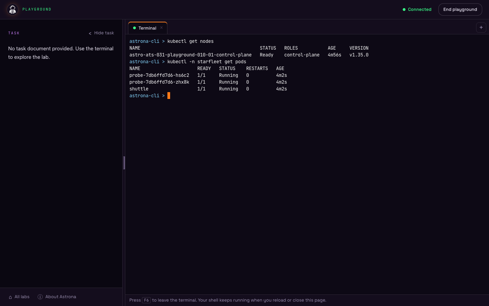

# Get Your Machine Ready

This course is hands-on. You run every example yourself on a practice environment on your own computer, so your machine needs a few tools first. This page shows you what to install, how to check that it works, and which commands you will use every day. Plan about 20 minutes for the first setup.

## Install the tools

All practice environments start with `astrona`, the command-line tool of the Astrona platform. It creates a playground or a lab on your machine, connects you to it, grades your work and removes it again. Install `astrona` first. Then let it install the rest:

```sh
astrona setup
```

The `astrona setup` command shows each step before it runs it and asks you to say yes. On macOS it installs three tools with Homebrew and starts the container engine:

- **kubectl:** the Kubernetes command-line tool. It sends your requests to the API server of the cluster.
- **kind:** a tool that runs a Kubernetes cluster as containers, one container per node.
- **Podman:** the container engine that runs those containers. On macOS, Podman runs inside a small Linux virtual machine called the Podman machine.

On Linux, `astrona setup` installs kind and kubectl, but it does not install a container engine for you. It prints the command for your Linux distribution, and you run it yourself. On Windows, `astrona setup` prepares WSL 2 (Windows Subsystem for Linux) and installs `astrona` inside it.

Some modules use a QEMU virtual machine instead of a kind cluster. These are the modules where you change files on a real control plane node, such as the API server and etcd settings that a CIS benchmark checks. For them, you also need QEMU and the `oras` tool, which downloads the virtual machine image. On macOS, install both with Homebrew:

```sh
brew install qemu oras
```

On Linux, install the `qemu` and `oras` packages with your package manager, together with `xorriso` or `genisoimage`. A few exercises also use Helm, Python 3 and OpenSSL, so install those too if you do not have them yet.

## Check your machine

Before you start your first playground, ask `astrona` to check your machine:

```sh
astrona check
```

The output lists each tool with a ✓ when it is found, or a ✗ when it is missing. The required part must be all green. The QEMU tools appear under "Optional", because only some modules need them. The check also shows how much memory and how many CPUs the container engine has.

Give the container engine enough room. Each node of a kind playground is a container that needs memory. A QEMU playground asks for 2 CPUs and 4 GiB of memory just for its virtual machine. When you run `astrona check` with a lab, it also tells you whether that lab's estimated memory fits. On macOS, you can give the Podman machine more memory with `podman machine set --memory` while the machine is stopped.

## Start and use a playground

The easiest way to start a playground is from the course website. Sign in once, and then keep your computer connected:

```sh
astrona login
astrona connect
```

The `astrona connect` command keeps a link open between your computer and the website. When you click to start a playground on a course page, the website asks `astrona` to build it on your machine. Only a short list of lab actions can travel over this link: start, status, submit, reset, stop and remove. No shell commands or files are sent. Stop the link with Ctrl+C when you are done.

### The browser workspace

When a playground or a lab starts, `astrona` opens the browser workspace. This is a web page that `astrona` serves from your own computer, and it is where you do all the hands-on work in this course. The page first shows the playground while it is being built. When it is ready, it looks like this:



The screenshot shows the workspace of the first network policy playground. The two commands in the terminal, `kubectl get nodes` and `kubectl -n starfleet get pods`, were typed straight into the browser.

The workspace has a few parts:

- **Task panel (left):** the task text of a lab. In a playground it stays empty, because the steps are on the course page. Use "Hide task" to give the terminal more room.
- **Terminal tab (right):** a shell that is already connected to the right environment. For a kind playground, `kubectl` talks to the playground cluster and not to any other cluster you have. For a QEMU playground, there is one terminal tab for each virtual machine, already logged in on that machine.
- **The + button:** opens a second terminal, for example to watch pods in one tab while you change a policy in the other.
- **Status (top right):** "Connected" in green means the terminal is linked to the environment.
- **End playground:** removes the playground and everything in it.
- **All labs (bottom left):** lists every playground and lab that runs on your computer, where you can open or end each one.

Your shell keeps running when you reload or close the page. Press F6 to move the keyboard focus out of the terminal. If you close the tab by mistake, open the workspace again with `astrona ui`. The link that `astrona` gives you works only once and only for two minutes, so `astrona ui` always makes a fresh one.

### Working from your own terminal

If you prefer your own terminal, that works too. For a kind playground, `astrona kubeconfig` and the playground name give you the path of the kubeconfig, the file that tells `kubectl` which cluster to use and which credentials to send. For a QEMU playground, `astrona ssh` and the playground name open the same login as the terminal tab in the workspace.

## Commands you will use every day

You only need a handful of `astrona` commands. Each one takes the name of the playground or lab, or works on the only one that is running.

| Command | What it does |
| --- | --- |
| `astrona ui` | Opens the browser workspace of a running playground or lab again. |
| `astrona list` | Lists every playground and lab on this machine. |
| `astrona status` | Shows the health of a lab, how to connect to it and your last score. |
| `astrona kubeconfig <name>` | Prints the path of the kubeconfig for a kind playground or lab. |
| `astrona ssh <name>` | Opens a shell on the virtual machine of a QEMU playground or lab. |
| `astrona submit --watch` | Grades your lab again and again while you work. It records nothing. |
| `astrona submit` | Grades your lab for real. This ends the attempt and removes the lab. |
| `astrona stop` / `astrona start` | Pauses a kind playground to free memory, and starts it again later. |
| `astrona reset` | Removes a lab and builds it again from the start. |
| `astrona destroy <name>` | Removes a playground or lab and everything in it. |

A playground stays until you remove it. The last page of each module removes the playground of that module for you. A lab is removed when you submit it.

## When a start goes wrong

Most start problems have a simple cause: the container engine is not running, a port is already in use, or the machine does not have enough memory. Ask `astrona` to find it:

```sh
astrona doctor
```

The `astrona doctor` command checks your machine, the lab configuration and the running lab, and says what is wrong and how to fix it. It only reads; it does not change anything. On macOS, a common cause is a stopped Podman machine. Start it with `podman machine start` and try again.

If the problem stays, write down the playground or lab name and copy the exact error message. You need both when you report the problem.

Your machine is now ready. The last page of the introduction explains how the course is written and checked, and how to report a mistake.
