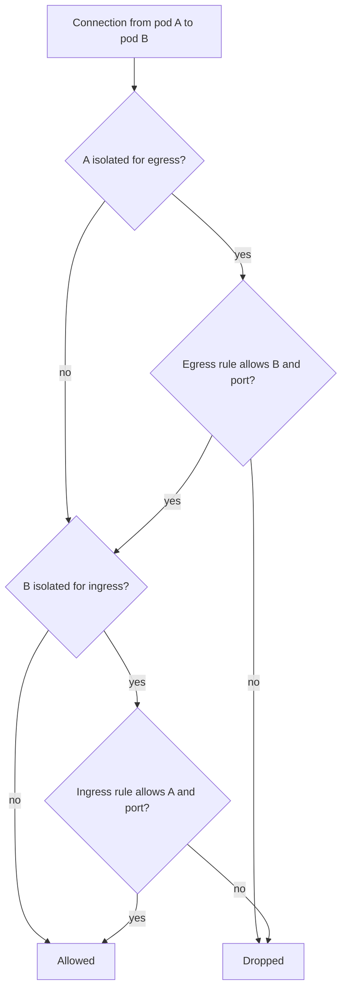

# How NetworkPolicy Isolation Works

Without a policy, a Kubernetes cluster has a flat network: any pod reaches any other pod by its pod IP address, and a Service only adds a stable name and load balancing on top. That is convenient for development and dangerous in production. This part explains what a NetworkPolicy changes, which component enforces it, and the rules that decide whether one connection is allowed.

## The cluster before any policy

You start by looking at the pods in the playground and at what the network allows today. Both namespaces and their pod labels matter, because policies select pods by label.

<!-- astrona:playground:renew -->

```sh
kubectl -n starfleet get pods --show-labels
kubectl -n outpost get pods --show-labels
kubectl get namespaces --show-labels
```

You should see the two `probe` pods and the `shuttle` pod in `starfleet`, and the `drifter` pod in `outpost`. Every namespace has the label `kubernetes.io/metadata.name` with its own name as the value. Kubernetes sets this label automatically, so a policy can select a namespace by name without you labelling it.

Now send a request from each client to the `probe` Service. `wget -q -T 3 -O-` prints the response body and gives up after three seconds.

```sh
kubectl -n starfleet exec shuttle -- wget -q -T 3 -O- http://probe/
kubectl -n outpost exec drifter -- wget -q -T 3 -O- http://probe.starfleet/
```

Both commands succeed. The `probe` server answers with one line that contains `version=v1`, the name of the pod that answered, and `greeting=hello`. The `drifter` pod reaches a Service in another namespace because nothing restricts it.

## What the API server and the network plugin each do

The API server validates a NetworkPolicy and stores it in etcd. It does not filter any traffic. The network plugin runs an agent on every node (for Calico, the `calico-node` pod) that watches NetworkPolicy objects and programs packet filtering rules for the pods on that node. The plugin, not the API server, drops the packets.

Not every plugin enforces NetworkPolicy. The simple `flannel` plugin does not, for example. In that case `kubectl apply` succeeds and traffic keeps flowing. Check which agent runs in the cluster:

```sh
kubectl get pods --all-namespaces
kubectl get networkpolicy --all-namespaces
```

The first command lists every pod. Look for the `calico-node` pods (the namespace depends on how the plugin was installed); they are the agents that enforce policies. The second lists no policies in `starfleet` or `outpost`, which is why every request above succeeded.

## Isolation: the rule that changes the default

A pod is **isolated for ingress** when at least one NetworkPolicy selects it with `Ingress` in its `policyTypes`. A pod is **isolated for egress** in the same way with `Egress`. The two directions are independent. A pod that is not isolated in a direction accepts all traffic in that direction.

When a pod is isolated in a direction, only connections that some selecting policy allows can pass. Policies never contain deny rules. They only add allowances, and the allowed traffic is the union of the rules of all policies that select the pod. Two policies on the same pod therefore never conflict, and a later policy can only widen access. To remove an allowance, edit or delete the policy that grants it.

The field `spec.policyTypes` states which directions a policy isolates. If you leave it out, Kubernetes always sets `Ingress`, and also sets `Egress` only when the policy has an `egress` section. A policy that should isolate egress and has no egress rules must list `Egress` explicitly.

## Evaluating one connection

A connection from pod A to pod B has two decisions. The egress side of A and the ingress side of B must both allow it. If A is not isolated for egress, that side allows everything. If B is not isolated for ingress, that side allows everything.



The diagram shows that a connection needs an allowance on every isolated side, and that a side with no isolation allows everything. Reply packets of an allowed connection pass without a second rule, because the plugin tracks the connection.

One more detail matters for Services. A client sends its request to the Service IP address on port 80. The node rewrites the destination to a pod IP address and port 8080 before the policy filter sees the packet. A policy therefore matches the pod IP address and the pod port (`containerPort` or `targetPort`), never the Service name or Service port.

## What a NetworkPolicy cannot do

A standard NetworkPolicy works on pod and namespace labels, IP address ranges (`ipBlock`), protocols (TCP, UDP and SCTP) and port numbers. It does not read HTTP paths or methods, it does not know the user behind a request, and it does not encrypt traffic. It applies to pods, not to Services or nodes. Rules for cluster-wide default policies, deny rules or logging need extra features of a specific plugin and are not part of the Kubernetes API.

You now know what a policy changes and who enforces it. The next question is how to write one that allows a single caller and nothing else.

## Common pitfalls

> [!WARNING]
> - **Assuming the API server enforces policies.** A policy applied to a cluster whose network plugin ignores NetworkPolicy is accepted and does nothing. Check the plugin first.
> - **Expecting deny rules.** NetworkPolicy has only allow rules. To deny, select the pods and leave out the allowance.
> - **Matching the Service port.** Policies see the pod port after the Service rewrote the destination. Use the container port in the rule.
> - **Forgetting that two sides decide.** An ingress allowance on the destination does not help when the source is isolated for egress and has no matching egress rule.
