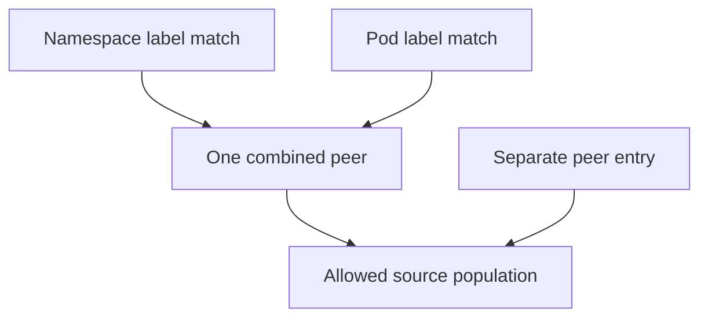

# Traffic Isolation And Allowed Peers

A rule should allow only Pods labelled `app: shuttle` inside a selected namespace. Placing both selectors in one peer requires both matches. Splitting them into separate peers changes the condition into alternatives and can widen access.

## Learning objectives

- Explain Pod selection and direction-specific network isolation.
- Evaluate additive allowed rules and selector structure.
- Relate DNS and dependencies to egress requirements.

## Before you start

This chapter is standalone reading material; no running cluster or installed tools are required. A Pod is the Kubernetes unit for running one or more containers, and a namespace groups namespaced objects. Treat the worked configurations as teaching examples rather than recorded observations from a provisioned environment.

## Responsible components and behavior

The `probe` application should accept traffic from `shuttle` and reject unrelated callers. A NetworkPolicy selects destination or source Pods and describes allowed network traffic. The cluster's network implementation must support and enforce it. The application programming interface (API) server can accept a policy even when the installed network implementation does not enforce its rules.

Ingress policy governs incoming traffic to selected Pods. Egress policy governs outgoing traffic from selected Pods. In a direction where no policy isolates a Pod, traffic is allowed by default under the NetworkPolicy model. Once policies isolate that direction, the union of their allowed rules determines permitted traffic.

When both endpoints are isolated, the source's egress and destination's ingress must permit the connection. An ingress allowance at the destination cannot override an egress restriction at the source. Return traffic for an allowed connection is handled as part of that connection rather than requiring an independent reversed rule.

Selectors and rule structure matter. A Pod selector applies within the relevant namespace scope; a namespace selector can identify other namespaces by labels. Combining selectors in one peer can require both conditions, while separate peers represent alternatives. An empty selected-Pod set and an empty allowed-peer set have different meanings.

Standard NetworkPolicy focuses on network connections through addresses, ports and protocols. It does not express arbitrary HTTP path authorization or user identity rules. It also does not automatically encrypt traffic. Features beyond the standard API depend on the implementation.

For a blocked request, identify which Pods each policy selects, which directions are isolated and what peers and ports are allowed. This is more reliable than assuming a policy named “allow” permits every connection involving the application.

## Calculating Allowed Traffic

Suppose a policy selects `probe` Pods for ingress isolation and allows callers with `app: shuttle` in `starfleet` on the intended application port. Another policy selects those same destination Pods and allows a monitoring caller. The permitted ingress is the union of these allowances; the second policy does not replace the first.

Now consider a `shuttle` source whose egress is isolated. Even if the destination allows it, the source must permit the outbound connection. A connection is not allowed merely because one direction contains a permissive rule. Determine isolation and applicable allowances independently at both endpoints.

An empty Pod selector selects every Pod in the policy's namespace. An isolated direction with no allowed traffic can express default deny for those selected Pods. An empty or omitted rule structure can mean something else depending on its position, so the location of a selector or list matters as much as its words. Evaluate the API structure rather than the policy's filename.

## Namespace And Pod Selection Together

A peer that combines a namespace selector and Pod selector requires a matching Pod in a matching namespace. Separate peer entries can instead express alternatives. Confusing those structures can widen access beyond the intended caller group. Namespace labels also need controlled ownership if security depends on their values.

Egress isolation often needs explicit allowance for dependencies such as Domain Name System (DNS) and data services. A blocked DNS lookup can prevent an application from reaching an otherwise allowed backend by name. The application symptom can therefore occur before the intended backend connection is attempted.

Standard policies govern supported connection properties, not every application operation. They cannot independently decide whether an authenticated user may delete a report at a particular HTTP path. A complete design connects network isolation with identity, authorization and encryption requirements while confirming that the network implementation actually enforces the rules.

## Work through the decision

A peer combines namespaceSelector and podSelector as one condition when both appear in the same peer entry. The namespace must match and the Pod inside it must match. Separate peer entries form alternatives. Indentation changes this structure even when the same field names appear, which makes full object inspection more useful than reading a policy's name.

An empty policy-level podSelector selects every Pod in that policy's namespace. An isolated direction with no allowed rules permits no connections in that direction through that policy. An empty peer selector can instead widen the matching population. Read the field's position and applicable scope before calling an empty value restrictive. Namespace labels used for trust boundaries also require controlled ownership.

Conditions within one peer combine, while separate peer entries contribute alternative allowed populations.

You can now explain the actual matching structure rather than relying on a policy title. Complete connection verification still needs the selected ports, isolated directions and real enforcement behavior.

## Common pitfalls

> [!WARNING]
> NetworkPolicy rules are additive allowances within isolated directions. Source egress and destination ingress can both matter, and enforcement requires a supporting network implementation.
