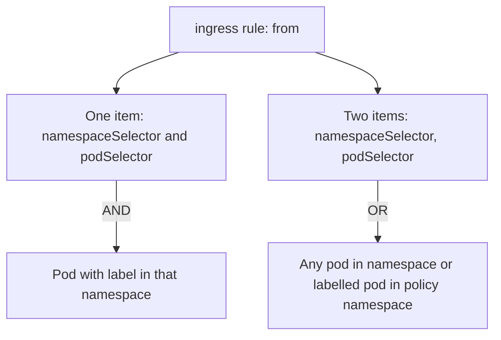

# Allow One Peer With An Ingress Policy

The `probe` pods answer every caller today. The goal in this part is that only the `shuttle` pod in the same namespace can reach them, and the `drifter` pod in another namespace cannot. To get there you select the destination pods, name the allowed source and the port, and then test both the allowed and the denied path.

## The policy

An ingress policy has two selectors with different jobs. `spec.podSelector` chooses the pods the policy protects (the destination). Each entry in `spec.ingress[].from` chooses who may connect (the sources). The `ports` list limits which destination ports the sources may use.

The policy below protects the pods labelled `app: probe` and allows TCP port 8080 from pods labelled `app: shuttle`. The `from` entry has a `podSelector` and no `namespaceSelector`. Without a `namespaceSelector`, a `podSelector` in a peer matches only pods in the namespace of the policy itself.

<!-- astrona:playground:renew -->

Save this as `networkpolicy-probe-shuttle.yaml`:

```yaml
apiVersion: networking.k8s.io/v1
kind: NetworkPolicy
metadata:
  name: probe-shuttle
  namespace: starfleet
spec:
  podSelector:
    matchLabels:
      app: probe
  policyTypes:
  - Ingress
  ingress:
  - from:
    - podSelector:
        matchLabels:
          app: shuttle
    ports:
    - protocol: TCP
      port: 8080
```

Apply it:

```sh
kubectl apply -f networkpolicy-probe-shuttle.yaml
```

Then check the result. The first command must still print the `probe` response. The second must not: the request from the `outpost` namespace gets no answer, and `wget` stops after three seconds with a timeout error.

```sh
kubectl -n starfleet exec shuttle -- wget -q -T 3 -O- http://probe/
kubectl -n outpost exec drifter -- wget -q -T 3 -O- http://probe.starfleet/
```

The `drifter` request times out instead of being refused. A refused connection means a listener answered with a reset. A timeout means the network plugin dropped the packets without a reply. When you test a denial, a timeout is the evidence that a policy did the work. A refusal points to a closed port instead.

Read the policy back with `describe`, which prints the selected pods and the allowed sources in a short form:

```sh
kubectl -n starfleet describe networkpolicy probe-shuttle
```

## Peers: one entry or two

Each item in the `from` list is a peer. A peer is one of `podSelector`, `namespaceSelector`, a combination of both in the same item, or `ipBlock`. Items in the list are alternatives: a connection is allowed when it matches any item. The ports list in the same rule applies to every peer in that rule.

Suppose the allowed caller must be the `shuttle` pod in the `starfleet` namespace and nothing else. Both conditions belong to one item:

```yaml
  ingress:
  - from:
    - namespaceSelector:
        matchLabels:
          kubernetes.io/metadata.name: starfleet
      podSelector:
        matchLabels:
          app: shuttle
```

This reads "a pod labelled `app: shuttle` in a namespace named `starfleet`". Now see what happens when the dash moves, so that the same two selectors become two items:

```yaml
  ingress:
  - from:
    - namespaceSelector:
        matchLabels:
          kubernetes.io/metadata.name: starfleet
    - podSelector:
        matchLabels:
          app: shuttle
```

This reads "any pod in the `starfleet` namespace, or any pod labelled `app: shuttle` in the policy namespace". The first item admits every pod in `starfleet`, so the policy is far wider than intended. One missing indentation level changes the meaning, which makes this the most common mistake in written policies and in exam tasks.



The diagram shows that fields inside one item combine with AND, while separate items combine with OR.

## Other selector forms

An empty `podSelector: {}` selects all pods, in the policy namespace when it is the top-level selector. An empty `namespaceSelector: {}` in a peer selects all namespaces. A rule with `from` omitted or an empty rule `- {}` allows every source. A policy with `policyTypes: [Ingress]` and no `ingress` section allows no source at all. These forms look similar and mean opposite things, so read the exact fields.

A source can also be an address range. `ipBlock` takes a `cidr` and an optional `except` list. Use it for addresses outside the cluster, not for pods, because pod IP addresses change.

## Trust in labels

A `namespaceSelector` trusts namespace labels, and a `podSelector` trusts pod labels. Anyone who can label a namespace or create a pod with the right label in an allowed namespace gets the access. The automatic `kubernetes.io/metadata.name` label is safer for namespaces because the cluster sets it and users cannot change it to another name.

You now have a working ingress policy that you tested from an allowed and a denied peer. The `shuttle` pod still has unrestricted egress, so a compromised `shuttle` could contact anything. The next question is how to limit what a client may send.

## Common pitfalls

> [!WARNING]
> - **Testing only the allowed path.** A policy that accidentally allows everyone also passes the allowed test. Always run the denied request too.
> - **Mistaking a refusal for a block.** Only a timeout shows that the plugin dropped the packets. A reset means a pod answered.
> - **Wrong dash in `from`.** Selectors in one item combine with AND. The same selectors in two items combine with OR and widen the access.
> - **Using the Service port.** The rule needs 8080 (the pod port), not 80 (the Service port).
