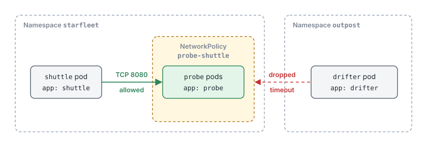
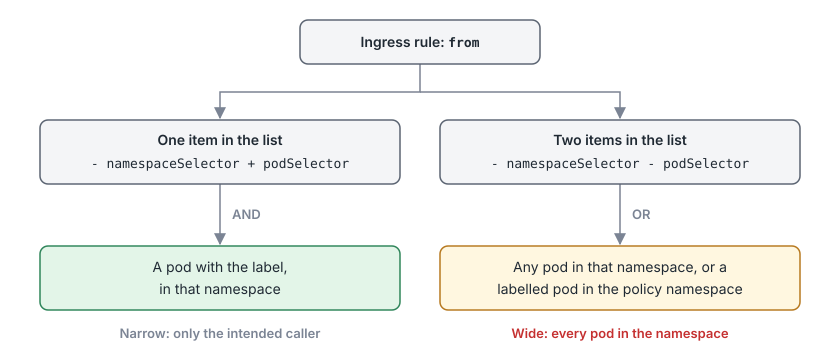

# Allow One Peer With An Ingress Policy

Right now, the `probe` pods answer every caller. On this page, you change that. Only the `shuttle` pod in the same namespace may reach them, and the `drifter` pod in the `outpost` namespace may not.

You get there in three steps. You select the pods to protect, you name the one source and port that may connect, and then you test both the allowed and the blocked path.

## The policy

An ingress policy controls incoming traffic, and it uses two selectors with different jobs:

- `spec.podSelector` picks the pods the policy protects. These are the destination of the traffic.
- Each entry in `spec.ingress[].from` picks who may connect. These are the sources.

A third field, `ports`, limits which destination ports the sources may use.

The policy below protects the pods labelled `app: probe`. It allows TCP port 8080, and only from pods labelled `app: shuttle`. The `from` entry has a `podSelector` but no `namespaceSelector`. In that case, the `podSelector` only matches pods in the same namespace as the policy.

<!-- astrona:playground:renew -->

Save this as `networkpolicy-probe-shuttle.yaml`:

```yaml
apiVersion: networking.k8s.io/v1
kind: NetworkPolicy
metadata:
  name: probe-shuttle
  namespace: starfleet
spec:
  podSelector:
    matchLabels:
      app: probe
  policyTypes:
  - Ingress
  ingress:
  - from:
    - podSelector:
        matchLabels:
          app: shuttle
    ports:
    - protocol: TCP
      port: 8080
```

Apply it:

```sh
kubectl apply -f networkpolicy-probe-shuttle.yaml
```

Then check the result. The first command must still print the `probe` response. The second must not: the request from the `outpost` namespace gets no answer, and `wget` stops after three seconds with a timeout error.

```sh
kubectl -n starfleet exec shuttle -- wget -q -T 3 -O- http://probe/
kubectl -n outpost exec drifter -- wget -q -T 3 -O- http://probe.starfleet/
```

Look closely at how the `drifter` request fails. It times out; it is not refused. The difference matters:

- A **refused** connection means a pod answered with a reset, because nothing listens on that port.
- A **timeout** means the network plugin dropped the packets, so no reply ever came back.

So when you test a block, a timeout is your proof that the policy did the work. A refusal points to a closed port instead.



The drawing shows the result. The `probe-shuttle` policy lets the `shuttle` pod in on TCP port 8080, and it drops the request from the `drifter` pod in the `outpost` namespace.

To read the policy back in a short form, use `describe`. It prints the pods the policy selects and the sources it allows:

```sh
kubectl -n starfleet describe networkpolicy probe-shuttle
```

## Peers: one entry or two

The policy works, but its `from` list hides a trap that catches many people. To see it, you first need to know what the list holds.

Each item in the `from` list is called a peer. A peer is a `podSelector`, a `namespaceSelector`, both of them together in one item, or an `ipBlock`. The items are alternatives: a connection is allowed when it matches any one of them. The `ports` list of the rule applies to every peer in that rule.

Now suppose the allowed caller must be the `shuttle` pod in the `starfleet` namespace, and nothing else. Both conditions belong in one item:

```yaml
  ingress:
  - from:
    - namespaceSelector:
        matchLabels:
          kubernetes.io/metadata.name: starfleet
      podSelector:
        matchLabels:
          app: shuttle
```

This reads as "a pod labelled `app: shuttle`, in the namespace named `starfleet`".

Now move one dash, so that the same two selectors become two items:

```yaml
  ingress:
  - from:
    - namespaceSelector:
        matchLabels:
          kubernetes.io/metadata.name: starfleet
    - podSelector:
        matchLabels:
          app: shuttle
```

This reads as "any pod in the `starfleet` namespace, or any pod labelled `app: shuttle` in the policy's namespace". The first item alone lets in every pod in `starfleet`, so the policy is much wider than you meant. A single dash changes the meaning. That is why this is the most common mistake, both in real policies and in exam tasks.



The diagram shows the rule: fields inside one item combine with AND, and separate items combine with OR.

## Other selector forms

Some selectors look almost the same but mean the opposite. Read the exact fields every time:

- An empty `podSelector: {}` at the top of a policy selects all pods in the policy's namespace.
- An empty `namespaceSelector: {}` in a peer selects all namespaces.
- A rule without `from`, or an empty rule `- {}`, allows every source.
- A policy with `policyTypes: [Ingress]` and no `ingress` section allows no source at all.

A source can also be a range of IP addresses. The `ipBlock` peer takes a `cidr` and an optional `except` list. Use it for addresses outside the cluster, not for pods, because pod IP addresses change.

## Trust in labels

Every selector trusts labels, so it is worth asking who can set them. A `namespaceSelector` trusts namespace labels, and a `podSelector` trusts pod labels. Anyone who can add a label to a namespace, or create a pod with the right label in an allowed namespace, gets the access.

For namespaces, the automatic `kubernetes.io/metadata.name` label is the safer choice. The cluster sets it to the namespace name, and users cannot change it to another name.

You now have a working ingress policy, tested from an allowed and a blocked caller. But the `shuttle` pod can still send traffic anywhere. If an attacker took over `shuttle`, they could contact any pod. The open question is how to limit what a client may send.

## Common pitfalls

> [!WARNING]
> - **Testing only the allowed path.** A policy that accidentally allows everyone also passes the allowed test. Always run the denied request too.
> - **Mistaking a refusal for a block.** Only a timeout shows that the plugin dropped the packets. A reset means a pod answered.
> - **Wrong dash in `from`.** Selectors in one item combine with AND. The same selectors in two items combine with OR and widen the access.
> - **Using the Service port.** The rule needs 8080 (the pod port), not 80 (the Service port).
