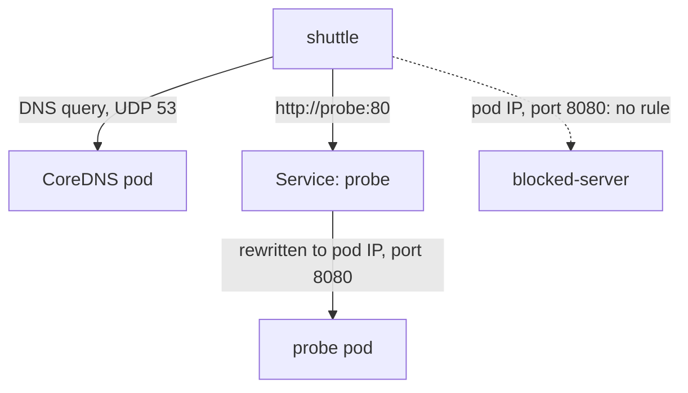

# Restrict Egress And Allow DNS

An ingress policy protects a destination. It does not stop a compromised client from sending requests to anything it can reach. An egress policy limits what a selected pod may send. It is stricter work to write, because an isolated client also loses things it silently relied on, above all name resolution. This part builds an egress policy for the `shuttle` pod that keeps DNS and one application dependency and blocks every other destination.

## A second listener to prove the block

A good test needs a destination that is healthy but must stay blocked. If the test target is broken, a failed request proves nothing. Create a second web server in `starfleet`, labelled `app: blocked-server`, that listens on port 8080 like `probe`.

<!-- astrona:playground:renew -->

Save this as `pod-blocked-server.yaml`:

```yaml
apiVersion: v1
kind: Pod
metadata:
  name: blocked-server
  namespace: starfleet
  labels:
    app: blocked-server
spec:
  restartPolicy: Never
  containers:
  - name: web
    image: docker.io/library/python:3.13-alpine
    command:
    - python
    - -m
    - http.server
    - '8080'
```

Apply it:

```sh
kubectl apply -f pod-blocked-server.yaml
```

Then check the result. Wait until the pod is ready, store its IP address, and request it from `shuttle`. No policy selects `shuttle` for egress yet, and none selects `blocked-server` for ingress, so the request succeeds and returns a directory listing.

```sh
kubectl -n starfleet wait --for=condition=Ready pod/blocked-server --timeout=120s
BLOCKED_IP=$(kubectl -n starfleet get pod blocked-server -o jsonpath='{.status.podIP}')
kubectl -n starfleet exec shuttle -- wget -q -T 3 -O- "http://$BLOCKED_IP:8080/"
```

## What the egress policy must contain

For `shuttle` the policy needs two allowances. Name resolution is the first one. A pod resolves `probe` by sending a DNS query to the cluster DNS service, which `CoreDNS` serves from pods labelled `k8s-app: kube-dns` in the `kube-system` namespace. DNS uses UDP port 53, and TCP port 53 for large answers, so both protocols belong in the rule. The second allowance is the application connection to the `probe` pods on TCP port 8080.

If the DNS rule is missing, the application connection is never attempted. Every name lookup fails first, and the client reports a resolution problem, not a connection problem. This is why DNS is the first rule to check when an isolated client suddenly cannot reach anything by name.

Save this as `networkpolicy-shuttle-egress.yaml`:

```yaml
apiVersion: networking.k8s.io/v1
kind: NetworkPolicy
metadata:
  name: shuttle-egress
  namespace: starfleet
spec:
  podSelector:
    matchLabels:
      app: shuttle
  policyTypes:
  - Egress
  egress:
  - to:
    - namespaceSelector:
        matchLabels:
          kubernetes.io/metadata.name: kube-system
      podSelector:
        matchLabels:
          k8s-app: kube-dns
    ports:
    - protocol: UDP
      port: 53
    - protocol: TCP
      port: 53
  - to:
    - podSelector:
        matchLabels:
          app: probe
    ports:
    - protocol: TCP
      port: 8080
```

The DNS rule has the `namespaceSelector` and the `podSelector` in the same item, so they combine with AND: only the DNS pods in `kube-system`, not every pod in that namespace. The second rule has only a `podSelector`, so it matches `probe` pods in the policy's own namespace.

Apply it:

```sh
kubectl apply -f networkpolicy-shuttle-egress.yaml
```

Then check the result. The lookup and the request to `probe` must work. The request to `blocked-server` must time out, although the server is healthy and nothing selects it for ingress.

```sh
kubectl -n starfleet exec shuttle -- nslookup probe.starfleet.svc.cluster.local
kubectl -n starfleet exec shuttle -- wget -q -T 3 -O- http://probe/
kubectl -n starfleet exec shuttle -- wget -q -T 3 -O- "http://$BLOCKED_IP:8080/"
```

The `BLOCKED_IP` variable must still be set in your shell from the earlier step; run the `BLOCKED_IP=` line again if you opened a new shell.

## Why the port is 8080 and not 80

The `shuttle` pod sends its request to the Service on port 80. Before the egress filter on the node sees the packet, the Service address has already been replaced by a `probe` pod address and port 8080. The egress rule is checked against that pod address and port. A rule that allows port 80 would not match, and the request would time out even though the application is healthy.



The solid arrows are the two allowed paths. The dotted arrow is dropped because no egress rule names `blocked-server`.

## Egress to other namespaces and to the outside

To reach a pod in another namespace, the egress peer needs a `namespaceSelector`, and often a `podSelector` in the same item. To reach addresses outside the cluster, use `ipBlock` with a `cidr`. Keep in mind that pod destinations are compared after Service translation, but `ipBlock` rules for external addresses are compared with the real destination address.

Egress policies do not apply to the pod's own loopback traffic. They also do not stop the node from reaching the pod for health checks in most plugins, and the details of that depend on the plugin.

You now have an egress policy that gives a client name resolution and one dependency and blocks a healthy listener. The remaining problem is what to do when a connection fails and you must find out which policy, selector or label is responsible.

## Common pitfalls

> [!WARNING]
> - **No DNS rule.** After egress isolation every name lookup fails, and the application looks broken. Allow UDP and TCP port 53 to the DNS pods.
> - **Opening all of `kube-system`.** A `namespaceSelector` without the `podSelector` in the same item allows every pod in that namespace. Put both in one item.
> - **Testing against a broken target.** Check that the blocked listener is `Ready` first, or a timeout proves nothing.
> - **Allowing port 80 instead of 8080.** The filter sees the pod port after the Service rewrote the destination.
