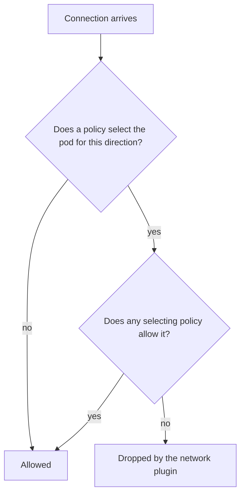

# Why A Baseline Comes First

Kubernetes starts open: any pod can send a request to any other pod, in any namespace. That is convenient for development and dangerous in production, because one compromised pod can scan every workload in the cluster. This part shows the open state with real requests, explains what a baseline changes, and describes the task pattern the exam uses.

## The cluster starts open

Before any policy exists, check that the namespaces hold no NetworkPolicy and that a pod in one namespace can reach a service in another. The `shuttle` pod in `dock` has nothing to do with the `probe` pods in `starfleet`, yet the request below should succeed.

<!-- astrona:playground:renew -->

```sh
kubectl get networkpolicy --all-namespaces
kubectl -n dock exec shuttle -- wget -q -T 3 -O- http://probe.starfleet/
kubectl -n dock exec shuttle -- wget -q -T 3 -O- http://probe.outpost/
```

The first command lists no policy. The two requests return the `probe` response, because a pod that no policy selects is not isolated. The name `probe.starfleet` is a Service in the `starfleet` namespace. The cluster DNS service, CoreDNS, resolves it, and the Service forwards the request to one of the two `probe` pods on port 8080.

## What isolation means

A pod becomes isolated for a direction when at least one NetworkPolicy selects it and lists that direction in `policyTypes`. After that, the pod accepts only the connections that the union of all selecting policies allows. Isolation is separate for ingress and egress: a policy that lists only `Ingress` leaves egress of the same pod open.

The core NetworkPolicy API contains allow rules only. There is no field that denies one source while allowing the others. A policy never conflicts with another policy, and a second policy can only widen what the first one allows. For that reason the baseline must be the policy that isolates, and every later policy must open one path.



The diagram shows that a connection is dropped only when a policy selects the pod and no selecting policy allows the connection.

## Blast radius of one pod

The blast radius is everything an attacker can reach from one compromised pod. In an open namespace it is the whole cluster. If the `shuttle` pod in `dock` runs a vulnerable library, an attacker who takes it over can contact the `probe` pods in all three namespaces, the Kubernetes API server and any database in the cluster. A baseline cuts this down to the paths you allow on purpose.

Look at the pods and their labels. The labels are what policies select on, so you need them before you write any policy.

```sh
kubectl -n dock get pods --show-labels
kubectl get namespaces --show-labels
```

The namespace listing shows that each namespace already carries the label `kubernetes.io/metadata.name` with its own name as value. The cluster sets this label automatically, and later policies use it to select a namespace.

## The pattern of the exam task

Exam tasks about NetworkPolicy follow a fixed pattern. The task names a namespace and asks for a default-deny policy, then asks you to allow one named path, for example "allow the `shuttle` pods to reach the `probe` pods on port 8080". The checks are request tests: the allowed path must work and every other path must fail.

The safe order is: read the labels and ports, apply the baseline, apply the allow rules, and test both the allowed and the denied path. Testing the denied path matters as much as testing the allowed one, because a policy that accidentally allows everything also passes the allowed test.

You now know why the cluster is open, what isolation changes and how the exam frames the task. The next question is how to write the first baseline, the one that denies ingress.

## Common pitfalls

> [!WARNING]
> - **Testing only the allowed path.** A policy that allows everyone also passes the allowed test.
> - **Looking for a deny rule.** The core API has no deny rule. Isolation plus allow rules is the only model.
> - **Assuming a namespace is protected because it has labels.** Labels do nothing until a policy selects on them.
> - **Forgetting that the network plugin enforces.** The API server accepts a policy on any cluster; only a plugin that implements NetworkPolicy drops traffic.
