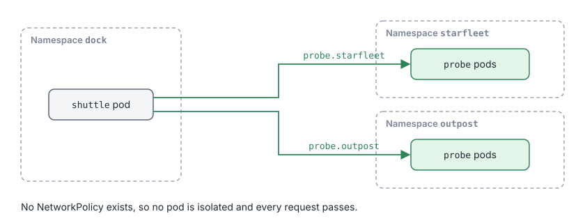
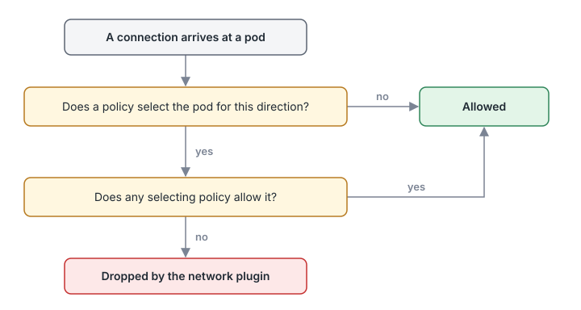

# Why A Baseline Comes First

Kubernetes starts open. Any pod can send a request to any other pod, in any namespace. That is handy while you build, but it is a risk in production, because one compromised pod can scan every workload in the cluster.

On this page, you first see the open state with real requests. Then you learn what a baseline changes, and you meet the task pattern that the exam uses.

## The cluster starts open

Before you write a policy, check two things. No namespace holds a NetworkPolicy yet, and a pod in one namespace can reach a Service in another. The `shuttle` pod in `dock` has nothing to do with the `probe` pods in `starfleet`, yet the request below should succeed.

<!-- astrona:playground:renew -->

```sh
kubectl get networkpolicy --all-namespaces
kubectl -n dock exec shuttle -- wget -q -T 3 -O- http://probe.starfleet/
kubectl -n dock exec shuttle -- wget -q -T 3 -O- http://probe.outpost/
```

The first command lists no policy. The two requests return the `probe` response, because a pod that no policy selects is not isolated.

The name `probe.starfleet` is the `probe` Service in the `starfleet` namespace. The cluster DNS service, CoreDNS, turns that name into an IP address. The Service then forwards the request to one of the two `probe` pods on port 8080.



The drawing shows the open cluster. The `shuttle` pod in `dock` reaches the `probe` pods in both other namespaces, and nothing stops it.

## What isolation means

The open state changes as soon as a policy selects a pod. A pod becomes isolated for a direction when at least one NetworkPolicy selects it and lists that direction in `policyTypes`. From then on, the pod accepts only the connections that the policies together allow. In other words, the allowances of all selecting policies add up to one set, the union.

Isolation is separate for ingress and egress. A policy that lists only `Ingress` leaves the egress of the same pod open.

The core NetworkPolicy API contains allow rules only. It has no field that denies one source while it allows the others. As a result, two policies never conflict, and a second policy can only widen what the first one allows. That is why the baseline must be the policy that isolates the pods, and every later policy opens one path.



The drawing shows the decision for one connection. The network plugin drops the connection only when a policy selects the pod and no selecting policy allows the connection.

## Blast radius of one pod

Isolation matters because of what an attacker can reach. The blast radius is everything an attacker can reach from one compromised pod. In an open namespace, it is the whole cluster.

Suppose the `shuttle` pod in `dock` runs a library with a security hole. An attacker who takes over the pod can contact the `probe` pods in all three namespaces, the Kubernetes API server and any database in the cluster. A baseline cuts this down to the paths you allow on purpose.

Policies select pods by their labels, so you need the labels before you write any policy. List the pods and the namespaces with their labels:

```sh
kubectl -n dock get pods --show-labels
kubectl get namespaces --show-labels
```

The namespace listing shows that each namespace already carries the label `kubernetes.io/metadata.name`, with its own name as the value. The cluster sets this label automatically. Later policies use it to select a namespace.

## The pattern of the exam task

With the labels known, you are ready for the kind of task the exam sets. Exam tasks about NetworkPolicy follow a fixed pattern. The task names a namespace and asks for a default-deny policy. Then it asks you to allow one named path, for example "allow the `shuttle` pods to reach the `probe` pods on port 8080". The checks are request tests: the allowed path must work, and every other path must fail.

The safe order has four steps:

1. Read the labels and ports.
2. Apply the baseline.
3. Apply the allow rules.
4. Test both the allowed and the denied path.

Testing the denied path matters as much as testing the allowed one. A policy that allows everything by mistake also passes the allowed test.

You now know why the cluster is open, what isolation changes and how the exam frames the task. The open question is how to write the first baseline, the one that denies all incoming connections.

## Common pitfalls

> [!WARNING]
> - **Testing only the allowed path.** A policy that allows everyone also passes the allowed test.
> - **Looking for a deny rule.** The core API has no deny rule. Isolation plus allow rules is the only model.
> - **Assuming a namespace is protected because it has labels.** Labels do nothing until a policy selects on them.
> - **Forgetting that the network plugin enforces the policy.** The API server accepts a policy on any cluster. Only a plugin that implements NetworkPolicy drops traffic.
