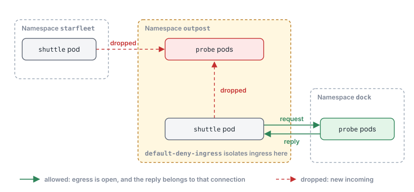

# Deny All Ingress

The most common baseline stops all incoming connections to every pod in a namespace. It protects servers, because nothing can reach them until an allow rule opens a path.

On this page, you write that policy and apply it to the `outpost` namespace. Then you prove its effect with requests from two directions, and you check what it leaves open.

## The policy

A default-deny ingress policy needs only two fields. Its `podSelector` is empty, and its `policyTypes` lists `Ingress`. An empty `podSelector: {}` selects every pod in the namespace of the policy. The policy has no `ingress` section, so the list of allowed sources is empty, and nothing is allowed.

Write `policyTypes` out, even though Kubernetes can work it out. When the field is missing, Kubernetes sets the type from the sections that exist. A policy with no `egress` section then never isolates egress.

<!-- astrona:playground:renew -->

Save this as `networkpolicy-default-deny-ingress.yaml`:

```yaml
apiVersion: networking.k8s.io/v1
kind: NetworkPolicy
metadata:
  name: default-deny-ingress
  namespace: outpost
spec:
  podSelector: {}
  policyTypes:
  - Ingress
```

Apply it:

```sh
kubectl apply -f networkpolicy-default-deny-ingress.yaml
```

Then check the result. The first request comes from a pod in another namespace, and the second comes from a pod in the same namespace. Both target the `probe` Service in `outpost`. Both must stop after three seconds with a timeout. The ingress side of the `probe` pods is now isolated, and no rule allows any source.

```sh
kubectl -n starfleet exec shuttle -- wget -q -T 3 -O- http://probe.outpost/
kubectl -n outpost exec shuttle -- wget -q -T 3 -O- http://probe/
```

Both failures are timeouts, not refusals. The difference tells you who acted:

- A **refused** connection means a host answered with a reset.
- A **timeout** means the network plugin dropped the packets, so no reply came back.

The second request also shows that a baseline blocks traffic inside the namespace. The `shuttle` pod and the `probe` pods share a namespace, and the policy still stops the connection.

## What the baseline does not change

The policy lists only `Ingress`, so egress stays open for every pod in `outpost`. You can prove it. The `shuttle` pod in `outpost` can still send a request to a pod in a namespace without a policy:

```sh
kubectl -n outpost exec shuttle -- wget -q -T 3 -O- http://probe.dock/
```

The request returns the `probe` response from `dock`. The reply comes back into `outpost`, even though `outpost` denies ingress. The network plugin tracks each connection, and it allows the reply to an allowed connection automatically. Ingress policy applies to new incoming connections, not to replies.



The drawing shows both sides of the baseline. New connections into the `probe` pods in `outpost` are dropped, while the outgoing request to `dock` and its reply still pass.

## Reading the policy back

After you apply a policy, check how the cluster understands it. Use `describe`: the output states which pods the policy selects, the allowed incoming traffic and the policy types.

```sh
kubectl -n outpost describe networkpolicy default-deny-ingress
```

The output reports three facts. The policy selects all pods in the namespace, it allows no incoming traffic, and it affects ingress. If the output names a different policy type than you expect, check the `policyTypes` field first.

## A variant that looks the same

Some tutorials write the baseline with an empty ingress rule, `ingress: [{}]`. That policy allows all traffic, which is the opposite of a baseline. The difference is one pair of brackets, so always read the section:

- A missing `ingress` section with `policyTypes: [Ingress]` means "allow nothing".
- An `ingress` entry with no fields means "allow everything".

![Diagram: a policy with no ingress section allows no source, while a policy with the empty rule ingress: [{}] allows every source](images/no-rule-vs-empty-rule.svg)

The drawing puts the two forms side by side. They differ by one line, yet one blocks every source and the other lets every source in.

You can now deny all incoming traffic in a namespace and prove it from two directions. Egress is still open, so a compromised pod can still send requests anywhere. The open question is what happens when you close that direction too.

## Common pitfalls

> [!WARNING]
> - **Writing `ingress: [{}]`.** An empty rule allows all sources. The baseline has no `ingress` section.
> - **Putting the policy in the wrong namespace.** A policy selects pods only in its own namespace.
> - **Expecting the baseline to block egress.** Ingress and egress are separate directions.
> - **Testing with a pod that does not exist or is not ready.** A failed request from a missing pod proves nothing. Check the client first.
