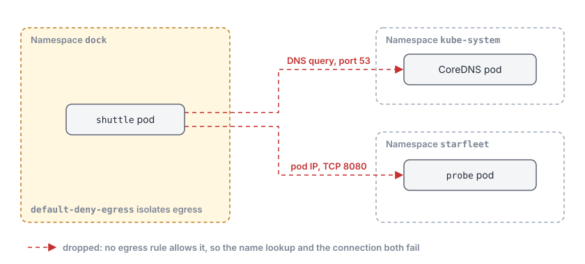

# Deny All Egress And Its Side Effects

An egress baseline stops every pod in a namespace from opening outgoing connections. It limits what an attacker can do from a compromised pod, for example reach a database, an internal service or the internet.

It is also the baseline that breaks things first. Every pod relies on outgoing connections that the application code never mentions. On this page, you apply the baseline to the `dock` namespace, see the failure, and learn which component caused it.

## The policy

The egress baseline is the mirror image of the ingress baseline. It selects all pods with `podSelector: {}` and lists `Egress` in `policyTypes`. It has no `egress` section, so the list of allowed destinations is empty.

<!-- astrona:playground:renew -->

Save this as `networkpolicy-default-deny-egress.yaml`:

```yaml
apiVersion: networking.k8s.io/v1
kind: NetworkPolicy
metadata:
  name: default-deny-egress
  namespace: dock
spec:
  podSelector: {}
  policyTypes:
  - Egress
```

Apply it:

```sh
kubectl apply -f networkpolicy-default-deny-egress.yaml
```

Then check the result. The `shuttle` pod in `dock` sends a request to the `probe` Service in `starfleet`, which has no policy. Only the egress of the sending pod has changed.

```sh
kubectl -n dock exec shuttle -- wget -q -T 3 -O- http://probe.starfleet/
```

The request fails, but not because the connection to the `probe` pods timed out. Depending on how the DNS lookup fails, `wget` says that it could not resolve the address, or that the download timed out. Either way, the request never reached `starfleet`.

## Why DNS breaks first

To see why, follow what happens before the request. Before `wget` can open a connection to `probe.starfleet`, the pod must turn the name into an IP address. So the pod sends a DNS query to the cluster DNS service on port 53, and CoreDNS answers it.

CoreDNS runs as pods in the `kube-system` namespace, outside `dock`. So the query is an outgoing connection from the `shuttle` pod, and the egress baseline drops it.

You can test the connection without DNS. A request to the pod IP address of a `probe` pod in `starfleet` needs no name lookup. It shows whether the connection itself is blocked:

```sh
PROBE_IP=$(kubectl -n starfleet get pod -l app=probe -o jsonpath='{.items[0].status.podIP}')
kubectl -n dock exec shuttle -- wget -q -T 3 -O- "http://$PROBE_IP:8080/"
```

This request also fails, with a timeout. The egress baseline blocks every outgoing connection, not only DNS. So two separate things are now blocked: the name lookup and the application connection. When you open one path later, test both.



The drawing shows the two blocked connections. The DNS query to CoreDNS and the direct request to the `probe` pod IP address both leave the `shuttle` pod, so the egress baseline in `dock` drops both.

## Other traffic that stops

DNS is only the first thing you notice. Egress policy applies to everything a pod sends, so four kinds of traffic fail in a namespace with this baseline:

- DNS queries to CoreDNS (UDP and TCP port 53).
- Connections to other pods and Services.
- Connections to the Kubernetes API server, for pods that call the API with their ServiceAccount.
- Connections to anything outside the cluster, such as a package mirror or a database.

The probes of the kubelet, the agent that runs pods on each node, are different. The kubelet sends readiness and liveness probes from the node, and the pods still show as ready. The network plugin treats traffic from a node to its own pods apart from pod egress, and Calico allows it by default. Check the pods:

```sh
kubectl -n dock get pods
```

Both `probe` pods and the `shuttle` pod stay in the `Running` state. A pod does not fail when its egress is blocked, unless the application exits on an error. You see the failure in the requests, not in the pod status. That is why this baseline is easy to apply and hard to debug.

## Seeing which side drops the packet

To the client, a blocked egress request and a blocked ingress request look the same: a timeout. The policy list tells you which side to look at. For a request from `dock` to `starfleet`, check `dock` for egress policies and `starfleet` for ingress policies:

```sh
kubectl get networkpolicy --all-namespaces
```

The only policy that applies to this path is `default-deny-egress` in `dock`, so the egress side is the cause. Wherever both sides are isolated, a connection needs an allowance on both sides:

- The source namespace must allow the egress.
- The destination namespace must allow the ingress.

You can now apply an egress baseline and recognise its first side effect, the broken DNS lookup. The open question is how to add allow rules on top of a baseline, in an order that does not lock you out.

## Common pitfalls

> [!WARNING]
> - **Blaming the destination.** With an egress baseline, the source namespace causes the drop. Check the policies of the source first.
> - **Testing a Service name after denying egress.** The name lookup fails before any connection starts. Test with a pod IP address to separate DNS from the connection.
> - **Expecting a pod status change.** Blocked egress does not stop a pod. Only requests fail.
> - **Forgetting the API server.** Pods that call the Kubernetes API need an egress rule for it.
