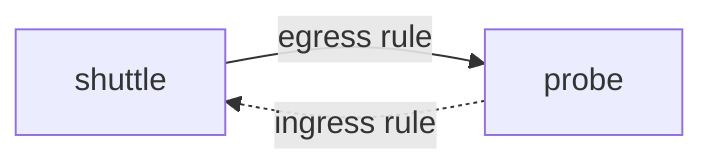

# Combine Baselines With Allow Rules

A baseline alone makes a namespace unusable. The useful result is a namespace that denies everything except the paths the application needs. This part applies one combined baseline to `outpost`, then adds three allow policies on top and explains why the order of the steps matters.

## One policy for both directions

A single policy can isolate ingress and egress together. Its `policyTypes` lists both values, and it still has no `ingress` or `egress` section. Start from a clean namespace so that earlier experiments do not change the result:

<!-- astrona:playground:renew -->

```sh
kubectl -n outpost delete networkpolicy --all
```

Save this as `networkpolicy-default-deny-all.yaml`:

```yaml
apiVersion: networking.k8s.io/v1
kind: NetworkPolicy
metadata:
  name: default-deny-all
  namespace: outpost
spec:
  podSelector: {}
  policyTypes:
  - Ingress
  - Egress
```

Apply it:

```sh
kubectl apply -f networkpolicy-default-deny-all.yaml
```

Then check the result. The `shuttle` pod can no longer send a request to the `probe` Service in its own namespace. The request stops after the three second limit, because the DNS query and the connection are both dropped.

```sh
kubectl -n outpost exec shuttle -- wget -q -T 3 -O- http://probe/
```

## Union of policies

The network plugin does not read policies in order. For each pod and direction it takes every policy that selects the pod and combines their allow rules into one set. A connection passes when any rule in that set allows it. Adding a policy therefore never removes access that another policy gives, and the name or the age of a policy has no meaning.

A connection between two isolated pods needs two allowances. The source needs an egress rule, and the destination needs an ingress rule. The component that enforces each side is the network plugin on the node of that pod. If you write only one side, the connection still fails.



The diagram shows that the egress rule of `shuttle` and the ingress rule of `probe` are two separate requirements for the same connection.

## Add the allow rules

Three allowances are needed for the request from `shuttle` to `probe`: ingress to `probe` on port 8080, egress from `shuttle` to `probe` on port 8080, and egress from `shuttle` to CoreDNS on port 53. Save the ingress rule first as `networkpolicy-probe-ingress.yaml`:

```yaml
apiVersion: networking.k8s.io/v1
kind: NetworkPolicy
metadata:
  name: probe-ingress
  namespace: outpost
spec:
  podSelector:
    matchLabels:
      app: probe
  policyTypes:
  - Ingress
  ingress:
  - from:
    - podSelector:
        matchLabels:
          app: shuttle
    ports:
    - protocol: TCP
      port: 8080
```

Apply it:

```sh
kubectl apply -f networkpolicy-probe-ingress.yaml
```

The request from `shuttle` still fails, because its egress is not open yet. Add the egress policy. It has two rules: one to the `probe` pods and one to CoreDNS. CoreDNS pods carry the label `k8s-app: kube-dns` in the `kube-system` namespace, and DNS uses UDP port 53 and TCP port 53. Save this as `networkpolicy-shuttle-egress.yaml`:

```yaml
apiVersion: networking.k8s.io/v1
kind: NetworkPolicy
metadata:
  name: shuttle-egress
  namespace: outpost
spec:
  podSelector:
    matchLabels:
      app: shuttle
  policyTypes:
  - Egress
  egress:
  - to:
    - podSelector:
        matchLabels:
          app: probe
    ports:
    - protocol: TCP
      port: 8080
  - to:
    - namespaceSelector:
        matchLabels:
          kubernetes.io/metadata.name: kube-system
      podSelector:
        matchLabels:
          k8s-app: kube-dns
    ports:
    - protocol: UDP
      port: 53
    - protocol: TCP
      port: 53
```

Apply it:

```sh
kubectl apply -f networkpolicy-shuttle-egress.yaml
```

Then check the result. The first request, from `shuttle` to its `probe` Service, must work. The second request, from `shuttle` in `starfleet` to the `probe` Service in `outpost`, must time out, because `probe-ingress` allows only the `shuttle` pods of its own namespace.

```sh
kubectl -n outpost exec shuttle -- wget -q -T 3 -O- http://probe/
kubectl -n starfleet exec shuttle -- wget -q -T 3 -O- http://probe.outpost/
```

## A safe order and self-lockout

Apply the allow rules before or together with the baseline in a namespace that already serves traffic. If you apply the baseline first, the running application is cut off until the allow rules arrive. In the exam the namespace is usually empty of users, so the order is not a risk there, but in a real cluster the gap is an outage.

Self-lockout has a second meaning: a policy can block the traffic you use to repair it. Policies do not block `kubectl` itself, because `kubectl` talks to the API server and not to a pod. They do block `kubectl exec` tests that need DNS from inside an isolated pod, which is why you test with a pod IP address when DNS is in doubt.

You can now build a namespace that denies everything but one path, and you know that the source and the destination need a rule each. The remaining question is how to do this for many namespaces without writing every file by hand.

## Common pitfalls

> [!WARNING]
> - **Writing only the ingress half.** The connection needs egress at the source and ingress at the destination when both are isolated.
> - **Leaving out UDP or TCP for DNS.** DNS uses UDP port 53 and falls back to TCP port 53 for large answers. Allow both.
> - **Applying the baseline first on a live namespace.** The running workload loses traffic until the allow rules exist.
> - **Expecting policy order to matter.** The plugin merges all selecting policies, so only the content counts.
