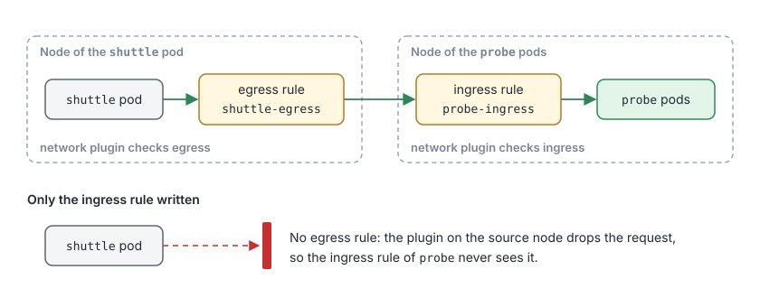
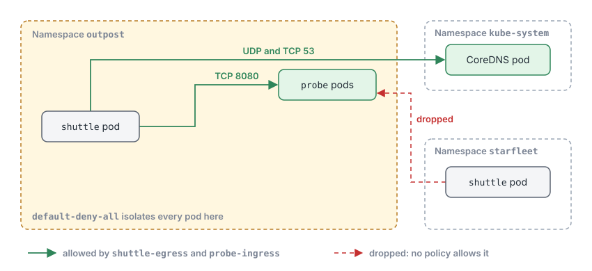

# Combine Baselines With Allow Rules

A baseline alone makes a namespace unusable. What you really want is a namespace that denies everything except the paths the application needs.

On this page, you apply one baseline for both directions to the `outpost` namespace. Then you add allow policies on top, until one request works again, and you learn why the order of the steps matters.

## One policy for both directions

A single policy can isolate ingress and egress together. Its `policyTypes` lists both values, and it still has no `ingress` or `egress` section.

Start from a clean namespace, so that earlier experiments do not change the result. The command below deletes every NetworkPolicy in `outpost`:

<!-- astrona:playground:renew -->

```sh
kubectl -n outpost delete networkpolicy --all
```

Save this as `networkpolicy-default-deny-all.yaml`:

```yaml
apiVersion: networking.k8s.io/v1
kind: NetworkPolicy
metadata:
  name: default-deny-all
  namespace: outpost
spec:
  podSelector: {}
  policyTypes:
  - Ingress
  - Egress
```

Apply it:

```sh
kubectl apply -f networkpolicy-default-deny-all.yaml
```

Then check the result. The `shuttle` pod can no longer send a request to the `probe` Service in its own namespace. The request stops after the three-second limit, because the network plugin drops both the DNS query and the connection.

```sh
kubectl -n outpost exec shuttle -- wget -q -T 3 -O- http://probe/
```

## Union of policies

Before you open a path, you need to know how the network plugin reads several policies. It does not read them in order. For each pod and each direction, it takes every policy that selects the pod and combines their allow rules into one set, the union. A connection passes when any rule in that set allows it.

So adding a policy never removes access that another policy gives. The name or the age of a policy has no meaning.

A connection between two isolated pods needs two allowances. The source needs an egress rule, and the destination needs an ingress rule. The network plugin on the node of each pod enforces that pod's side. If you write only one side, the connection still fails.



The drawing shows one connection with two checks. The egress rule of `shuttle` and the ingress rule of `probe` are two separate requirements, and the request passes only when both allow it.

## Add the allow rules

With that rule in mind, count what the request from `shuttle` to `probe` needs. It needs three allowances:

- ingress to `probe` on port 8080;
- egress from `shuttle` to `probe` on port 8080;
- egress from `shuttle` to CoreDNS on port 53.

Start with the ingress rule. Save this as `networkpolicy-probe-ingress.yaml`:

```yaml
apiVersion: networking.k8s.io/v1
kind: NetworkPolicy
metadata:
  name: probe-ingress
  namespace: outpost
spec:
  podSelector:
    matchLabels:
      app: probe
  policyTypes:
  - Ingress
  ingress:
  - from:
    - podSelector:
        matchLabels:
          app: shuttle
    ports:
    - protocol: TCP
      port: 8080
```

Apply it:

```sh
kubectl apply -f networkpolicy-probe-ingress.yaml
```

The request from `shuttle` still fails, because its egress is not open yet. So add the egress policy next. It has two rules: one to the `probe` pods and one to CoreDNS.

The CoreDNS pods run in the `kube-system` namespace and carry the label `k8s-app: kube-dns`. DNS uses UDP port 53 and TCP port 53, so the rule lists both. Save this as `networkpolicy-shuttle-egress.yaml`:

```yaml
apiVersion: networking.k8s.io/v1
kind: NetworkPolicy
metadata:
  name: shuttle-egress
  namespace: outpost
spec:
  podSelector:
    matchLabels:
      app: shuttle
  policyTypes:
  - Egress
  egress:
  - to:
    - podSelector:
        matchLabels:
          app: probe
    ports:
    - protocol: TCP
      port: 8080
  - to:
    - namespaceSelector:
        matchLabels:
          kubernetes.io/metadata.name: kube-system
      podSelector:
        matchLabels:
          k8s-app: kube-dns
    ports:
    - protocol: UDP
      port: 53
    - protocol: TCP
      port: 53
```

Apply it:

```sh
kubectl apply -f networkpolicy-shuttle-egress.yaml
```

Then check the result. The first request, from `shuttle` to the `probe` Service in its own namespace, must work. The second request, from `shuttle` in `starfleet` to the `probe` Service in `outpost`, must time out. The `probe-ingress` policy allows only the `shuttle` pods of its own namespace.

```sh
kubectl -n outpost exec shuttle -- wget -q -T 3 -O- http://probe/
kubectl -n starfleet exec shuttle -- wget -q -T 3 -O- http://probe.outpost/
```



The drawing shows the namespace after the three policies. The `shuttle` pod in `outpost` can resolve the name and reach the `probe` pods, while the request from the `starfleet` namespace is dropped.

## A safe order and self-lockout

The policies now work, but the order in which you applied them matters on a live system. In a namespace that already serves traffic, apply the allow rules before the baseline or together with it. If you apply the baseline first, the running application is cut off until the allow rules arrive.

In the exam, no real users usually depend on the namespace, so the order is not a risk there. In a real cluster, that gap is an outage.

Self-lockout has a second meaning: a policy can block the traffic you use to repair it. Policies do not block `kubectl` itself, because `kubectl` talks to the API server and not to a pod. They do block `kubectl exec` tests that need DNS from inside an isolated pod. That is why you test with a pod IP address when you are not sure that DNS works.

You can now build a namespace that denies everything but one path, and you know that the source and the destination each need a rule. The open question is how to do this for many namespaces without writing every file by hand.

## Common pitfalls

> [!WARNING]
> - **Writing only the ingress half.** When both sides are isolated, the connection needs egress at the source and ingress at the destination.
> - **Leaving out UDP or TCP for DNS.** DNS uses UDP port 53 and falls back to TCP port 53 for large answers. Allow both.
> - **Applying the baseline first on a live namespace.** The running workload loses traffic until the allow rules exist.
> - **Expecting policy order to matter.** The plugin merges all selecting policies, so only the content counts.
