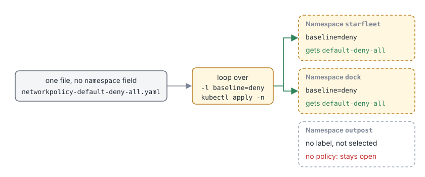

# Baselines Across Many Namespaces

A cluster has many namespaces, and a baseline in only one of them leaves the others open. A NetworkPolicy is a namespaced object: it lives in one namespace and selects pods only there. So no single NetworkPolicy covers all namespaces.

On this page, you apply the same baseline to several namespaces with a label and a short shell loop. Before you apply it, you preview each change with `kubectl diff`.

## Label the namespaces you want to cover

A namespace label is a key and value pair on the Namespace object. You can select namespaces by label with `kubectl get namespaces -l` and use the result in a loop.

Label `starfleet` and `dock` with a key that marks them as needing the baseline. Leave `outpost` out for now, so that you can see the difference.

<!-- astrona:playground:renew -->

```sh
kubectl label namespace starfleet baseline=deny
kubectl label namespace dock baseline=deny
kubectl get namespaces -l baseline=deny
```

The listing shows the two labelled namespaces. The label has no effect on traffic. It only gives the loop something to select on.

## One file, applied per namespace

The loop needs one file that fits every namespace. This baseline manifest has no `namespace` field, so you can apply the same file to any namespace with the `-n` flag. Save this as `networkpolicy-default-deny-all.yaml`:

```yaml
apiVersion: networking.k8s.io/v1
kind: NetworkPolicy
metadata:
  name: default-deny-all
spec:
  podSelector: {}
  policyTypes:
  - Ingress
  - Egress
```

Because the file has no namespace, `kubectl apply -f` without `-n` would use the namespace of the current context. So always pass `-n` in a loop.

## Preview with kubectl diff

Before you change several namespaces at once, look at what will change. `kubectl diff` sends the manifest to the API server in dry-run mode, which means the API server checks the object but does not save it. The command then prints the difference between the live object and the file, and it makes no change.

For a new object, `kubectl diff` shows the whole object as added. For an existing object, it shows only the changed lines. Run it for each labelled namespace first:

```sh
for namespace in $(kubectl get namespaces -l baseline=deny -o jsonpath='{.items[*].metadata.name}'); do
  echo "namespace: $namespace"
  kubectl diff -n "$namespace" -f networkpolicy-default-deny-all.yaml
done
```

Each pass prints the policy that would be created. The command `kubectl diff` exits with status 1 when it finds a difference. A shell with `set -e` therefore stops at the first namespace. Do not treat that status as an error in this loop.

## Apply the same file to every labelled namespace

When the preview shows what you expect, apply the file to each namespace with the same loop:

```sh
for namespace in $(kubectl get namespaces -l baseline=deny -o jsonpath='{.items[*].metadata.name}'); do
  kubectl apply -n "$namespace" -f networkpolicy-default-deny-all.yaml
done
kubectl get networkpolicy --all-namespaces
```

The list shows `default-deny-all` in `starfleet` and `dock` and nothing in `outpost`. Now prove the difference with a request. The `shuttle` pod in `outpost` has no policy on its side, but the `probe` pods in `starfleet` are now isolated for ingress:

```sh
kubectl -n outpost exec shuttle -- wget -q -T 3 -O- http://probe.starfleet/
```

The request times out, because `starfleet` now denies ingress. The `outpost` namespace has no baseline, so its own pods are still open for any connection, including connections from `starfleet`. The unprotected namespace is the weak point of the set.



The drawing shows how the label drives the loop. Only `starfleet` and `dock` carry `baseline=deny`, so only they get the baseline, and `outpost` stays open.

## Namespaces you create later

The loop has one limit. It covers the namespaces that exist when you run it, so a namespace created afterwards has no policy. Kubernetes has no built-in way to apply a policy to every new namespace.

Teams solve this in one of these ways:

- an admission policy or a controller that creates the baseline in each new namespace;
- a step in the process that creates namespaces.

For the exam, remember that the baseline is per namespace. You must repeat it for each namespace the task names.

You can now cover a set of namespaces from one manifest and preview each change first. The baseline gives each namespace a safe start, and allow policies add the paths that the application needs. The question that stays open is how to cover namespaces that do not exist yet, which needs a tool outside the NetworkPolicy API.

## Common pitfalls

> [!WARNING]
> - **Leaving a namespace out.** A single namespace without a baseline is an open door into the others.
> - **Relying on the current context namespace.** Pass `-n` in every loop iteration.
> - **Treating `kubectl diff` exit status 1 as a failure.** It means a difference was found.
> - **Assuming new namespaces are covered.** The baseline applies only to namespaces that already have the policy.
