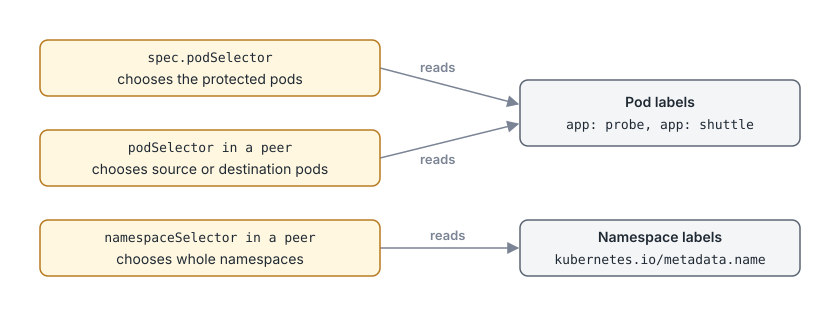
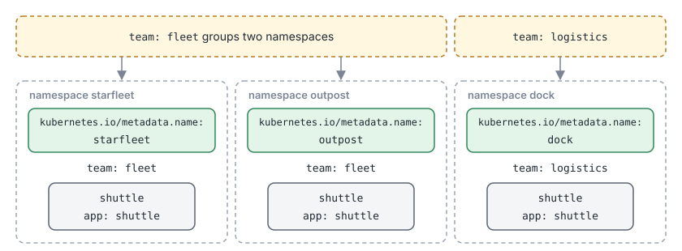

# Selectors Recap And The Namespace Name Label

Every peer in a policy rests on a label selector. When a selector does not match what you think it matches, the task fails, and this is the most common cause of a failed task.

This page recaps how label selectors work. It then shows which labels a namespace has by default. Finally, you add your own namespace labels, so you can see how they differ from the default one.

## What a selector matches

A label selector is a list of conditions on labels. Kubernetes compares these conditions with the labels of an object and decides whether the object matches. There are two forms:

- `matchLabels` lists key and value pairs. An object matches when it has all of them.
- `matchExpressions` lists conditions with the operators `In`, `NotIn`, `Exists` and `DoesNotExist`.

An empty selector `{}` has no conditions, so it matches every object in its scope.

A selector can appear in three places in a policy, and each place reads the labels of a different object:

- `spec.podSelector` chooses the pods the policy protects.
- A `podSelector` inside a peer chooses the source or destination pods.
- A `namespaceSelector` inside a peer chooses whole namespaces.



The drawing shows which object each selector reads. When a selector does not match, look at the labels of that object, not at another one.

## The automatic name label

Since Kubernetes 1.21, the API server sets the label `kubernetes.io/metadata.name` on every namespace. Its value is the name of the namespace. A user cannot set it to another name, so it is the safest way to select a namespace by name.

You can see this label on the playground namespaces. The first command lists all namespaces with their labels. The second prints the labels of `starfleet` only.

<!-- astrona:playground:renew -->

```sh
kubectl get namespaces --show-labels
kubectl get namespace starfleet -o jsonpath='{.metadata.labels}'
```

The output shows `kubernetes.io/metadata.name` on `starfleet`, `outpost` and `dock`, next to the labels the cluster adds itself. There is no label such as `name: starfleet`. A policy that selects `name: starfleet` matches nothing, and that is a frequent error.

## Pod labels

Namespace labels are only half of the picture. The pods carry the labels that a `podSelector` in a peer reads. List the pods in all namespaces with their labels:

```sh
kubectl get pods --all-namespaces --show-labels
```

The `shuttle` pods in all three namespaces have the same label, `app: shuttle`. So a selector for `app: shuttle` alone cannot tell them apart.

This is the key fact for the rest of the module. Two pods with the same labels in different namespaces differ only by their namespace. So whenever the namespace matters, a rule must name it.

## Labelling a namespace yourself

The automatic label selects one namespace by its name. A label that you add yourself can select a group of namespaces instead. Label `starfleet` and `outpost` as members of the team `fleet`, and `dock` as a member of the team `logistics`:

```sh
kubectl label namespace starfleet team=fleet
kubectl label namespace outpost team=fleet
kubectl label namespace dock team=logistics
kubectl get namespaces -l team=fleet
```

The last command lists `starfleet` and `outpost`. A policy with `namespaceSelector: {matchLabels: {team: fleet}}` would match both of them.



The drawing shows both kinds of namespace label. The name label points at exactly one namespace, and the `team` label groups several namespaces.

A group label is handy, but it has a cost. Anyone who can edit namespace labels can add a namespace to the group and gain the access. The automatic name label does not have this weakness.

## Trust in labels

The same risk applies to every selector, because a selector trusts labels. Anyone who can create a pod in an allowed namespace can give that pod the allowed label. Anyone who can label a namespace can put it into an allowed group.

So a policy protects against pods that do not have the label. It does not protect against users who can set the label. Give the right to label namespaces and pods only to the people who also own the policies.

You now know what each selector reads and which namespace labels exist. The open question is how to use them to let in a pod from another namespace, and only that pod.

## Common pitfalls

> [!WARNING]
> - **Selecting `name: starfleet`.** Namespaces have no `name` label by default. Use `kubernetes.io/metadata.name`.
> - **Reading the wrong object.** A `podSelector` reads pod labels, and a `namespaceSelector` reads namespace labels.
> - **Using a shared team label as a security boundary.** Anyone who can edit the label changes the result.
> - **Assuming equal pod labels mean one pod.** The same label in two namespaces matches pods in both, unless the rule names the namespace.
