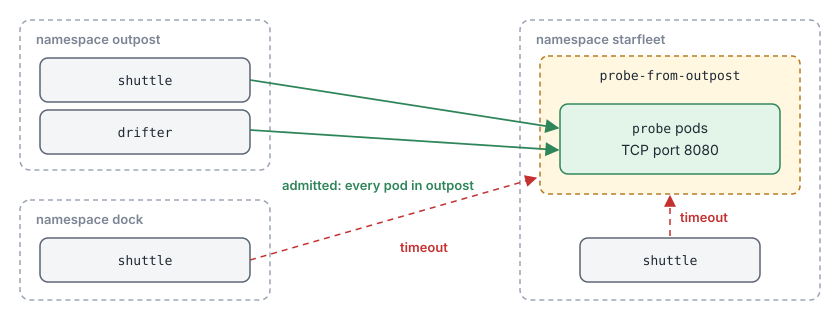
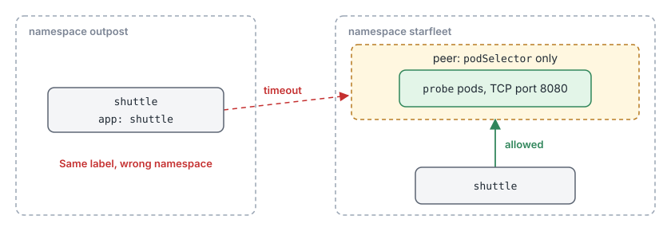

# Cross-Namespace Ingress

A `podSelector` in a peer matches only pods in the namespace of the policy. So to let in a pod from another namespace, the peer needs a `namespaceSelector`.

On this page, you protect the `probe` pods in `starfleet`. You then compare two peers: a `namespaceSelector` alone, and a `podSelector` alone. Each one has a different problem, and seeing both makes the correct form easy to understand.

## The problem to solve

The `shuttle` pod in `outpost` should reach the `probe` pods in `starfleet` on port 8080. No other pod in `outpost` should.

The first attempt selects the whole namespace. With this peer, every pod in `outpost` becomes an allowed source.

<!-- astrona:playground:renew -->

Save this as `networkpolicy-probe-from-outpost.yaml`:

```yaml
apiVersion: networking.k8s.io/v1
kind: NetworkPolicy
metadata:
  name: probe-from-outpost
  namespace: starfleet
spec:
  podSelector:
    matchLabels:
      app: probe
  policyTypes:
  - Ingress
  ingress:
  - from:
    - namespaceSelector:
        matchLabels:
          kubernetes.io/metadata.name: outpost
    ports:
    - protocol: TCP
      port: 8080
```

Apply it:

```sh
kubectl apply -f networkpolicy-probe-from-outpost.yaml
```

Then check the result. Both clients in `outpost` reach the `probe` Service, because the peer matches every pod in that namespace. The `shuttle` pod in `dock` does not match the peer. The policy now isolates the `probe` pods, so that request is dropped. The `shuttle` pod in `starfleet` does not match either.

```sh
kubectl -n outpost exec shuttle -- wget -q -T 3 -O- http://probe.starfleet/
kubectl -n outpost exec drifter -- wget -q -T 3 -O- http://probe.starfleet/
kubectl -n dock exec shuttle -- wget -q -T 3 -O- http://probe.starfleet/
```

The first two requests return the `probe` response. The third one times out. The policy is correct for "every pod in `outpost`", but it is too wide for "only the `shuttle` pod".



The drawing shows the result. The `namespaceSelector` lets in the whole `outpost` namespace, including the `drifter` pod that should stay out.

## A podSelector alone stays in its own namespace

The opposite attempt names only the pod. Replace the peer with a `podSelector` for `app: shuttle` and nothing else. Save this as `networkpolicy-probe-from-shuttle.yaml`:

```yaml
apiVersion: networking.k8s.io/v1
kind: NetworkPolicy
metadata:
  name: probe-from-outpost
  namespace: starfleet
spec:
  podSelector:
    matchLabels:
      app: probe
  policyTypes:
  - Ingress
  ingress:
  - from:
    - podSelector:
        matchLabels:
          app: shuttle
    ports:
    - protocol: TCP
      port: 8080
```

The file uses the same policy name. So applying it replaces the previous rule instead of adding a second policy. Apply it, then send one request from `shuttle` in `starfleet` and one from `shuttle` in `outpost`:

```sh
kubectl apply -f networkpolicy-probe-from-shuttle.yaml
kubectl -n starfleet exec shuttle -- wget -q -T 3 -O- http://probe/
kubectl -n outpost exec shuttle -- wget -q -T 3 -O- http://probe.starfleet/
```

The request from `shuttle` in `starfleet` works. The request from `shuttle` in `outpost` times out, even though that pod has the right label. A `podSelector` without a `namespaceSelector` matches only pods in the namespace of the policy, here `starfleet`.

The Calico plugin applies the rule this way because this is how the Kubernetes API defines the field. It is not a choice of the plugin.



The drawing shows that the peer never leaves the `starfleet` namespace. The label is right, but the `outpost` pod is outside the scope of the selector.

## What each peer form matches

The two attempts show two of the three forms of one peer entry. Reading these forms correctly is the main skill for this topic:

| Peer entry | Matches |
| --- | --- |
| `podSelector` only | Pods with the labels, in the namespace of the policy |
| `namespaceSelector` only | All pods in every namespace with the labels |
| Both in one entry | Pods with the pod labels, in namespaces with the namespace labels |

Empty selectors are wide. An empty `namespaceSelector: {}` matches all namespaces. An empty `podSelector: {}` matches all pods in the scope of that entry.

The third row is the form that solves the problem on this page. It is also easy to break: one extra dash turns it into a different, much wider rule.

The source address matters too. Calico sees the IP address of the sending pod, so the policy works on the identity of the pod as long as pods talk to each other directly.

You now know that a cross-namespace allowance needs a `namespaceSelector`, and that this selector alone opens the whole namespace. The open question is how to write both selectors so that only the one pod gets in.

## Common pitfalls

> [!WARNING]
> - **Expecting `podSelector` to cross namespaces.** It never leaves the policy namespace unless a `namespaceSelector` is in the same entry.
> - **Using `namespaceSelector` alone for one pod.** It admits every pod in the matching namespaces.
> - **Applying a second file under a new name.** A new name adds a policy, and the old, wider policy keeps working. Reuse the name to replace it.
> - **Testing only from the allowed namespace.** Run the request from a pod in another namespace too.
