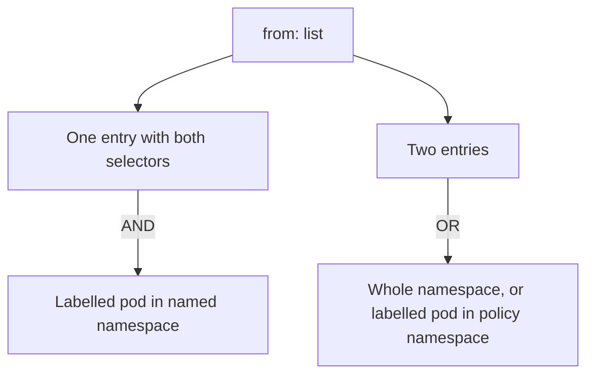

# One Entry Versus Two Entries

Two policies can contain the same two selectors and mean opposite things. The difference is one dash and two spaces of indentation. This is the most common error in written policies and in exam tasks, and Kubernetes accepts both forms without a warning. This part applies both forms to the same `probe` pods and shows with requests what each one allows.

## Two entries: OR

The goal is to allow only the `shuttle` pod of `outpost`. Start from a namespace without policies, then write the selectors as two separate list entries. Items in a `from` list are alternatives, so a connection that matches any one item is allowed.

<!-- astrona:playground:renew -->

```sh
kubectl -n starfleet delete networkpolicy --all
```

Save this as `networkpolicy-probe-two-entries.yaml`:

```yaml
apiVersion: networking.k8s.io/v1
kind: NetworkPolicy
metadata:
  name: probe-from-outpost
  namespace: starfleet
spec:
  podSelector:
    matchLabels:
      app: probe
  policyTypes:
  - Ingress
  ingress:
  - from:
    - namespaceSelector:
        matchLabels:
          kubernetes.io/metadata.name: outpost
    - podSelector:
        matchLabels:
          app: shuttle
    ports:
    - protocol: TCP
      port: 8080
```

Apply it:

```sh
kubectl apply -f networkpolicy-probe-two-entries.yaml
```

Then check the result. Four clients try the `probe` Service in `starfleet`. The first entry admits every pod in `outpost`. The second entry admits `app: shuttle` pods in the policy namespace, which is `starfleet`.

```sh
kubectl -n outpost exec shuttle -- wget -q -T 3 -O- http://probe.starfleet/
kubectl -n outpost exec drifter -- wget -q -T 3 -O- http://probe.starfleet/
kubectl -n starfleet exec shuttle -- wget -q -T 3 -O- http://probe/
kubectl -n dock exec shuttle -- wget -q -T 3 -O- http://probe.starfleet/
```

The first three requests return the `probe` response. Only the one from `dock` times out. The `drifter` in `outpost` and the `shuttle` in `starfleet` were not meant to get in, so the policy is too wide.

## One entry: AND

Move the two selectors into one list entry. Remove the dash in front of `podSelector`, so that both fields belong to the same item. Fields in one item must all match. Save this as `networkpolicy-probe-one-entry.yaml`:

```yaml
apiVersion: networking.k8s.io/v1
kind: NetworkPolicy
metadata:
  name: probe-from-outpost
  namespace: starfleet
spec:
  podSelector:
    matchLabels:
      app: probe
  policyTypes:
  - Ingress
  ingress:
  - from:
    - namespaceSelector:
        matchLabels:
          kubernetes.io/metadata.name: outpost
      podSelector:
        matchLabels:
          app: shuttle
    ports:
    - protocol: TCP
      port: 8080
```

Apply it. The name is unchanged, so the new content replaces the old rule:

```sh
kubectl apply -f networkpolicy-probe-one-entry.yaml
```

Then repeat the four requests. Now only the first must return the `probe` response. The other three must time out.

```sh
kubectl -n outpost exec shuttle -- wget -q -T 3 -O- http://probe.starfleet/
kubectl -n outpost exec drifter -- wget -q -T 3 -O- http://probe.starfleet/
kubectl -n starfleet exec shuttle -- wget -q -T 3 -O- http://probe/
kubectl -n dock exec shuttle -- wget -q -T 3 -O- http://probe.starfleet/
```

The `drifter` has the right namespace and the wrong pod label. The `shuttle` in `starfleet` has the right label and the wrong namespace. Only a pod that matches both conditions is allowed.



The diagram shows that fields inside one entry combine with AND, and separate entries combine with OR.

## How to read a policy for this mistake

Read the indentation of the dashes. In the `from` list, count the dashes: one dash before `namespaceSelector` and no dash before `podSelector` means one entry. Two dashes mean two entries. Then use `kubectl describe networkpolicy`, which prints each entry as a separate "From" block, and check the result with a request from a pod that has only one of the two properties.

You now know how to write the strict form and how to test for the wide form. The next topic is the peer type that matches addresses instead of pods.

## Common pitfalls

> [!WARNING]
> - **An extra dash.** One dash turns an AND into an OR and widens the access.
> - **Testing only the intended client.** The wide policy passes that test. Add a client that has only one property.
> - **Forgetting the default namespace of `podSelector`.** In the second entry it points to the policy namespace.
> - **Leaving the old policy under another name.** A second policy adds to the first. Replace by name or delete the old policy.
