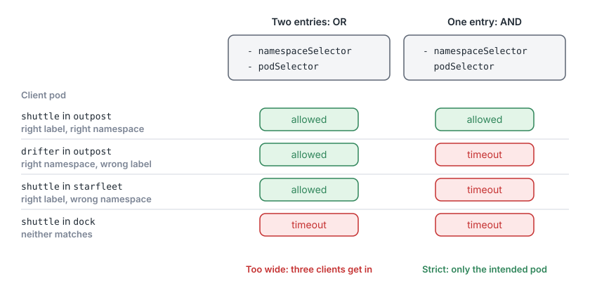

# One Entry Versus Two Entries

Two policies can contain the same two selectors and still mean opposite things. The difference is one dash and two spaces of indentation. Kubernetes accepts both forms without a warning, so this is the most common error in written policies and in exam tasks.

On this page, you apply both forms to the same `probe` pods. You then send requests from four clients and see what each form really allows.

## Two entries: OR

The goal is to allow only the `shuttle` pod in `outpost`. Start from a namespace without policies. Then write the two selectors as two separate list entries.

The items in a `from` list are alternatives. A connection that matches any one item is allowed. First remove all policies in `starfleet`:

<!-- astrona:playground:renew -->

```sh
kubectl -n starfleet delete networkpolicy --all
```

Save this as `networkpolicy-probe-two-entries.yaml`:

```yaml
apiVersion: networking.k8s.io/v1
kind: NetworkPolicy
metadata:
  name: probe-from-outpost
  namespace: starfleet
spec:
  podSelector:
    matchLabels:
      app: probe
  policyTypes:
  - Ingress
  ingress:
  - from:
    - namespaceSelector:
        matchLabels:
          kubernetes.io/metadata.name: outpost
    - podSelector:
        matchLabels:
          app: shuttle
    ports:
    - protocol: TCP
      port: 8080
```

Apply it:

```sh
kubectl apply -f networkpolicy-probe-two-entries.yaml
```

Then check the result. Four clients try the `probe` Service in `starfleet`. The first entry admits every pod in `outpost`. The second entry admits pods labelled `app: shuttle` in the policy namespace, which is `starfleet`.

```sh
kubectl -n outpost exec shuttle -- wget -q -T 3 -O- http://probe.starfleet/
kubectl -n outpost exec drifter -- wget -q -T 3 -O- http://probe.starfleet/
kubectl -n starfleet exec shuttle -- wget -q -T 3 -O- http://probe/
kubectl -n dock exec shuttle -- wget -q -T 3 -O- http://probe.starfleet/
```

The first three requests return the `probe` response. Only the request from `dock` times out. The `drifter` pod in `outpost` and the `shuttle` pod in `starfleet` were not meant to get in, so the policy is too wide.

## One entry: AND

The fix is to put both selectors into one list entry. Remove the dash in front of `podSelector`, so that both fields belong to the same item. All fields in one item must match at the same time. Save this as `networkpolicy-probe-one-entry.yaml`:

```yaml
apiVersion: networking.k8s.io/v1
kind: NetworkPolicy
metadata:
  name: probe-from-outpost
  namespace: starfleet
spec:
  podSelector:
    matchLabels:
      app: probe
  policyTypes:
  - Ingress
  ingress:
  - from:
    - namespaceSelector:
        matchLabels:
          kubernetes.io/metadata.name: outpost
      podSelector:
        matchLabels:
          app: shuttle
    ports:
    - protocol: TCP
      port: 8080
```

Apply it. The name has not changed, so the new content replaces the old rule:

```sh
kubectl apply -f networkpolicy-probe-one-entry.yaml
```

Then repeat the four requests. Now only the first one must return the `probe` response. The other three must time out.

```sh
kubectl -n outpost exec shuttle -- wget -q -T 3 -O- http://probe.starfleet/
kubectl -n outpost exec drifter -- wget -q -T 3 -O- http://probe.starfleet/
kubectl -n starfleet exec shuttle -- wget -q -T 3 -O- http://probe/
kubectl -n dock exec shuttle -- wget -q -T 3 -O- http://probe.starfleet/
```

Each blocked client misses one condition. The `drifter` pod has the right namespace but the wrong pod label. The `shuttle` pod in `starfleet` has the right label but the wrong namespace. Only a pod that matches both conditions gets in.



The drawing compares both forms with the same four clients. Fields inside one entry combine with AND, and separate entries combine with OR.

## How to read a policy for this mistake

You can find this mistake by reading the policy, before you send any request. Look at the dashes in the `from` list:

- One dash before `namespaceSelector` and no dash before `podSelector` means one entry. Both selectors must match.
- Two dashes mean two entries. Either selector is enough.

Then run `kubectl describe networkpolicy`. It prints each entry as a separate "From" block, so two blocks show two entries. Finally, test with a request from a pod that has only one of the two properties. In the wide form, that request gets in.

You now know how to write the strict form and how to test for the wide form. Both forms match pods by their labels. The open question is how to match a peer that has no labels at all, only an address.

## Common pitfalls

> [!WARNING]
> - **An extra dash.** One dash turns an AND into an OR and widens the access.
> - **Testing only the intended client.** The wide policy passes that test too. Add a client that has only one of the two properties.
> - **Forgetting the default namespace of `podSelector`.** In a separate entry, it points to the policy namespace.
> - **Leaving the old policy under another name.** A second policy adds to the first. Replace it by name or delete the old policy.
