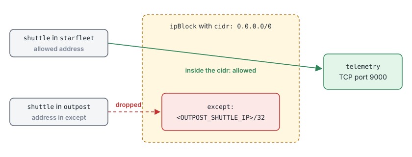

# ipBlock And Except

Some peers are not pods in the cluster. A database in a virtual network, a partner service or a company office has an IP address range, not a label. So a label selector cannot match it.

The `ipBlock` peer matches a source or destination by its address. It uses a Classless Inter-Domain Routing (CIDR) range. A CIDR range writes a group of addresses as a base address and a prefix length, such as `203.0.113.0/24`. On this page, you learn the `ipBlock` fields and its `except` list, and you see how they work with two pods.

## The fields

An `ipBlock` has two fields:

- `cidr` is required. It is the address range that the peer matches.
- `except` is optional. It lists smaller ranges that are removed from the match. Each `except` entry must lie inside the `cidr`.

An `ipBlock` is its own peer type. It cannot share one entry with a `podSelector` or a `namespaceSelector`.

The Kubernetes documentation says to use `ipBlock` for addresses outside the cluster. Pod IP addresses are short-lived, and they change when a pod is replaced. On this page you use it for pods only to see how the matching works.

## How the matching works with two pods

The example uses the range `0.0.0.0/0`, which matches every IPv4 address. One pod address is then removed with `except`. So two clients differ only by their address.

Start with no policy in `dock`. Then store the addresses of two `shuttle` pods and of the `telemetry` pod in shell variables:

<!-- astrona:playground:renew -->

```sh
kubectl -n dock delete networkpolicy --all
STARFLEET_SHUTTLE_IP=$(kubectl -n starfleet get pod shuttle -o jsonpath='{.status.podIP}')
OUTPOST_SHUTTLE_IP=$(kubectl -n outpost get pod shuttle -o jsonpath='{.status.podIP}')
TELEMETRY_IP=$(kubectl -n dock get pod telemetry -o jsonpath='{.status.podIP}')
echo "$STARFLEET_SHUTTLE_IP $OUTPOST_SHUTTLE_IP $TELEMETRY_IP"
```

The last command prints three different pod addresses. Next you write the policy. Replace `<OUTPOST_SHUTTLE_IP>` with the value of `echo $OUTPOST_SHUTTLE_IP`, and keep the `/32` suffix. A `/32` prefix selects exactly one address.

Save this as `networkpolicy-telemetry-ipblock.yaml`:

```yaml
apiVersion: networking.k8s.io/v1
kind: NetworkPolicy
metadata:
  name: telemetry-ipblock
  namespace: dock
spec:
  podSelector:
    matchLabels:
      app: telemetry
  policyTypes:
  - Ingress
  ingress:
  - from:
    - ipBlock:
        cidr: 0.0.0.0/0
        except:
        - <OUTPOST_SHUTTLE_IP>/32
    ports:
    - protocol: TCP
      port: 9000
```

Apply it:

```sh
kubectl apply -f networkpolicy-telemetry-ipblock.yaml
```

Then check the result with `nc`, the netcat tool in the `busybox` image. The `telemetry` pod answers every connection on TCP port 9000 with one line of text.

The request from `starfleet` should print that line. The request from `outpost` should print nothing and end after the limit of three seconds, because its address is on the `except` list.

```sh
kubectl -n starfleet exec shuttle -- nc -w 3 "$TELEMETRY_IP" 9000
kubectl -n outpost exec shuttle -- nc -w 3 "$TELEMETRY_IP" 9000
```

The exact exit status of `nc` depends on its version, so judge the result by the text it prints. The network plugin compared the source address of each packet with the `cidr` and the `except` entry. It did not use labels at all.



The drawing shows the range with one address removed. The plugin checks only the source address: inside the `cidr` and not in `except` means allowed.

## Pod IP addresses versus Service IP addresses

An `ipBlock` is compared with the real source or destination address of the packet. That address is not always the one the client used.

For traffic to a Service, the node first rewrites the Service cluster IP address to the address of one pod. In most plugins, including Calico, this happens before the policy rule is checked. So a rule for a Service cluster IP address does not match. Instead, allow the pod addresses or select the pods by label.

Traffic from outside the cluster has a similar problem. Its source address may change on the way in, for example when a load balancer or a node masks it. An `ipBlock` for client addresses then sees the masked address. Check the behaviour of your plugin and cloud before you rely on it, and test with a real request.

## Node and pod ranges in kind

A `kind` cluster has two separate address ranges. The nodes are containers and get addresses from a container network. The pods get addresses from a separate pod range.

You can read the node addresses with `kubectl get nodes -o wide` and the pod addresses with `kubectl get pods -o wide`. An `ipBlock` for the whole pod range admits every pod, so it is as wide as `namespaceSelector: {}`. The commands below show the node addresses and then remove the policy:

```sh
kubectl get nodes -o wide
kubectl -n dock delete networkpolicy telemetry-ipblock
```

You can now allow an address range and remove one address from it, and you know the limits of this form. A peer says who may connect. The open question is which ports and protocols that peer may use.

## Common pitfalls

> [!WARNING]
> - **Putting `ipBlock` and a selector in one entry.** They are separate peer types. Use separate entries.
> - **An `except` entry outside the `cidr`.** The API server rejects it.
> - **Using `ipBlock` for pods.** Pod addresses change when pods are replaced.
> - **Writing a rule for a Service IP address.** The plugin checks the pod address after the translation.
