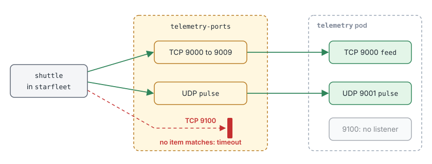

# Ports, Protocols And endPort

A peer says who may connect. The `ports` list says to which port and over which protocol. Both halves must be right: a rule with the correct peer and a wrong port blocks the application, and a rule without a `ports` list opens every port.

On this page, you write the port forms for the `telemetry` pod in `dock`, which listens on both TCP and UDP. The forms are a single port, a protocol, a port range with `endPort`, and a named port.

## What the telemetry pod listens on

Before you write a port rule, find out what the pod really listens on. The `telemetry` pod has two listeners:

- a TCP listener on port 9000, with the container port name `feed`;
- a UDP listener on port 9001, with the container port name `pulse`.

Both listeners answer each message with one line of text. Read the declared ports from the pod:

<!-- astrona:playground:renew -->

```sh
kubectl -n dock delete networkpolicy --all
kubectl -n dock get pod telemetry -o jsonpath='{.spec.containers[0].ports}'
TELEMETRY_IP=$(kubectl -n dock get pod telemetry -o jsonpath='{.status.podIP}')
```

The first command removes any policies left in `dock`. The second prints the container ports with their names, numbers and protocols. The third stores the pod address for the tests.

## The port forms

Each item of `ports` has up to three fields:

- `port` is a port number or the name of a container port.
- `protocol` is `TCP`, `UDP` or `SCTP`. It is optional and defaults to `TCP`.
- `endPort` is optional. It turns the number in `port` into an inclusive range from `port` to `endPort`.

Protocols are separate. A rule for TCP does not allow UDP on the same number, so a service that uses both needs two items.

The `endPort` field is stable since Kubernetes 1.25. It works only with a numeric `port`, and the network plugin must support it.

If a rule has no `ports` list, it applies to all ports and all protocols for its peers. An empty list and a missing list both mean "all ports". Many readers expect the opposite.

## Write the policy

The policy below allows the `shuttle` pod in `starfleet` to reach the `telemetry` pod on two paths: TCP ports 9000 to 9009, and the UDP port named `pulse`. The peer is one entry with the namespace name and the pod label, so both must match. Save this as `networkpolicy-telemetry-ports.yaml`:

```yaml
apiVersion: networking.k8s.io/v1
kind: NetworkPolicy
metadata:
  name: telemetry-ports
  namespace: dock
spec:
  podSelector:
    matchLabels:
      app: telemetry
  policyTypes:
  - Ingress
  ingress:
  - from:
    - namespaceSelector:
        matchLabels:
          kubernetes.io/metadata.name: starfleet
      podSelector:
        matchLabels:
          app: shuttle
    ports:
    - protocol: TCP
      port: 9000
      endPort: 9009
    - protocol: UDP
      port: pulse
```

Apply it:

```sh
kubectl apply -f networkpolicy-telemetry-ports.yaml
```

Then check the result. Each command runs from the `shuttle` pod in `starfleet`:

- The TCP request to port 9000 must print the text line of the listener.
- The UDP message goes to port 9001, and the listener must answer it.
- The TCP request to port 9100 is outside the range. It must end after the limit without any answer.

```sh
kubectl -n starfleet exec shuttle -- nc -w 3 "$TELEMETRY_IP" 9000
kubectl -n starfleet exec shuttle -- sh -c "echo ping | nc -u -w 3 $TELEMETRY_IP 9001"
kubectl -n starfleet exec shuttle -- nc -w 3 "$TELEMETRY_IP" 9100
```

Port 9100 has no listener in the pod. Without a policy, the request would get an immediate refusal from the pod. With the policy, it ends by timeout, because the plugin drops the packet before it reaches the pod. A timeout means a dropped packet, and a refusal means a closed port; here the same signal applies to a port.

UDP tests are weaker than TCP tests. A missing UDP answer can also mean that the reply was dropped. So when both results are available, rely on the TCP result.



The drawing shows the three tests. Two match a `ports` item and reach the pod, and the third matches no item, so the plugin drops it.

## Named ports

A named port ties the rule to the name in the pod specification, not to a number. If a Deployment changes the number behind `pulse`, the policy keeps working.

The plugin resolves the name for each destination pod. So pods that use the same name on different numbers are each matched on their own number. A name that no selected pod declares matches nothing, and the connection stays blocked.

## Several items in one list

Every item in `ports` is an alternative, just like every item in `from`. The rule above has two items and allows both of them.

Peers and ports in one rule combine as "any peer on any port of this rule". So if different peers need different ports, write two rules, each with its own `from` and `ports`. When you are done, remove the policy:

```sh
kubectl -n dock delete networkpolicy telemetry-ports
```

You can now write every port form and test it with a request. Up to now, the tests sent requests straight to pod addresses or used Services without asking how the plugin sees them. The open question is what a policy sees when a request goes through a Service, and what happens when pods change.

## Common pitfalls

> [!WARNING]
> - **Omitting `ports`.** The rule then allows every port for its peers.
> - **Assuming TCP covers UDP.** Protocols are separate. Add an item for each one.
> - **Using `endPort` with a named port.** A range needs numbers.
> - **Using the Service port.** Policies see the pod port after the Service forwards the request.
