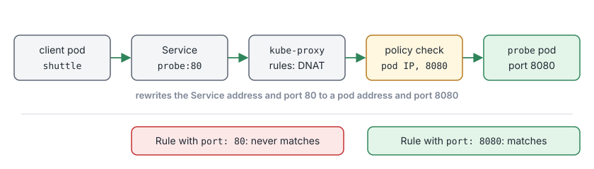
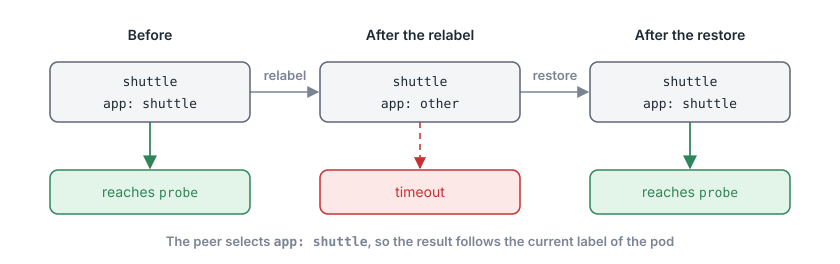

# Policies On Services And Replicas

Clients call Services, but policies select pods. Pods come and go during rollouts, and their labels can change. So it is worth knowing exactly what a policy sees.

On this page, you see what the network plugin checks when a request goes through a Service. You also see that a policy follows labels, not the identity of a pod. So it reacts when labels change and when pods are replaced.

## Policies do not know Services

A NetworkPolicy has no field for a Service. When the `shuttle` pod calls the `probe` Service on port 80, the node rewrites the destination to the address of one `probe` pod and to port 8080.

This rewrite is called destination network address translation (DNAT). The `kube-proxy` rules on the node do it. After the rewrite, the plugin checks the policy against the pod address and the pod port. So a rule for the Service port 80 never matches, and a rule for the pod port 8080 does.



The drawing shows the order. The `kube-proxy` rules rewrite the address first, and the policy check sees only the pod address and port 8080.

You can see this with a policy that makes the mistake on purpose. It allows the `shuttle` pod in `starfleet` to reach the `probe` pods on port 80. The pods listen on 8080, so the request through the Service fails. First remove the old policies:

<!-- astrona:playground:renew -->

```sh
kubectl -n starfleet delete networkpolicy --all
```

Save this as `networkpolicy-probe-service-port.yaml`:

```yaml
apiVersion: networking.k8s.io/v1
kind: NetworkPolicy
metadata:
  name: probe-from-shuttle
  namespace: starfleet
spec:
  podSelector:
    matchLabels:
      app: probe
  policyTypes:
  - Ingress
  ingress:
  - from:
    - podSelector:
        matchLabels:
          app: shuttle
    ports:
    - protocol: TCP
      port: 80
```

Apply it and send a request through the Service:

```sh
kubectl apply -f networkpolicy-probe-service-port.yaml
kubectl -n starfleet exec shuttle -- wget -q -T 3 -O- http://probe/
```

The request times out. The rule names port 80, but the packet arrives at the pod on port 8080.

To fix the policy, use the pod port. Save this as `networkpolicy-probe-pod-port.yaml`:

```yaml
apiVersion: networking.k8s.io/v1
kind: NetworkPolicy
metadata:
  name: probe-from-shuttle
  namespace: starfleet
spec:
  podSelector:
    matchLabels:
      app: probe
  policyTypes:
  - Ingress
  ingress:
  - from:
    - podSelector:
        matchLabels:
          app: shuttle
    ports:
    - protocol: TCP
      port: 8080
```

The policy name has not changed, so applying the file replaces the old rule. Apply it and repeat the request:

```sh
kubectl apply -f networkpolicy-probe-pod-port.yaml
kubectl -n starfleet exec shuttle -- wget -q -T 3 -O- http://probe/
```

The request now returns the `probe` response.

## Label drift

The port is now right, so the next question is about the peer. A policy selects pods by their current labels, and the plugin checks the policy again when labels change.

Change the label of the client to `app: other`, send a request, and then put the label back:

```sh
kubectl -n starfleet label pod shuttle app=other --overwrite
kubectl -n starfleet exec shuttle -- wget -q -T 3 -O- http://probe/
kubectl -n starfleet label pod shuttle app=shuttle --overwrite
```

The request in the middle times out, because `app: other` does not match the peer. After you restore the label, the allowance applies again. The access ends within seconds of the change, and it comes back just as fast.



The drawing shows the three states of the same pod. Only the label changes, and the result follows the label.

This is why label permissions matter. Anyone who can change a pod label can add the pod to a policy or remove it from one. A short delay after a label change is normal while the plugin updates its rules. So if a request fails right after the change, repeat it.

## Replicas and rollouts

Labels also explain how a policy treats new pods. A policy applies to every pod that matches its selector, including pods that do not exist yet.

When a Deployment creates new `probe` pods during a rollout, the new pods carry the label `app: probe`. So they are protected from the first moment. Restart the Deployment and send a request to the Service again:

```sh
kubectl -n starfleet rollout restart deployment/probe
kubectl -n starfleet rollout status deployment/probe --timeout=120s
kubectl -n starfleet exec shuttle -- wget -q -T 3 -O- http://probe/
```

The request still works, and the denied path still holds for other clients. The policy did not need a change. The new pods have new addresses, but they have the same labels.

Rules that depend on addresses, such as an `ipBlock` with a pod address, would break here. This is another reason to select pods by label.

You can now explain how a policy meets a Service, how a label change moves a pod into or out of a rule, and why a rollout needs no policy change. With these checks, you have seen every peer form and every port form. Remove the policy before you go on:

```sh
kubectl -n starfleet delete networkpolicy probe-from-shuttle
```

## Common pitfalls

> [!WARNING]
> - **Writing the Service port.** Use the pod port that the container listens on.
> - **Relabelling a pod for debugging.** The change moves the pod out of every rule that depends on the label.
> - **Testing straight after a change.** Wait a few seconds, then repeat the request.
> - **Using pod addresses in rules.** Addresses change at every rollout; labels do not.
