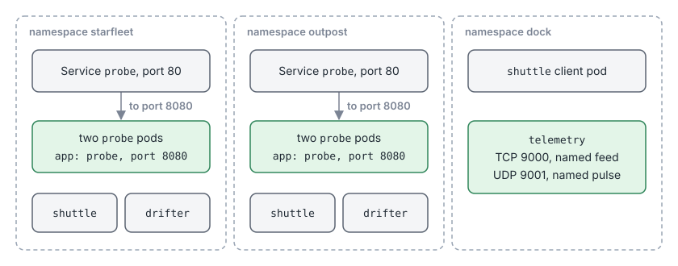

# Select Peers And Ports Precisely

Most mistakes in NetworkPolicy tasks are selector mistakes. A policy that selects the wrong peer can block a path the application needs. It can also open a path that an attacker can use.

A NetworkPolicy is a Kubernetes object that selects pods and lists the connections those pods may receive or make. A peer is one entry in the `from` or `to` list of a rule. It says which pods, namespaces or IP address ranges the rule applies to. The network plugin of the cluster, here Calico, reads the policy and enforces it on each node.

This module covers every peer form and every port form. For each one, you write the fields exactly and prove the effect with one request that must pass and one that must fail.

## What you will learn

After this module, you can:

- allow traffic from a pod in another namespace with the `kubernetes.io/metadata.name` label;
- tell one entry that holds both a `namespaceSelector` and a `podSelector` from two separate list entries;
- use `ipBlock` with `except` to allow a Classless Inter-Domain Routing (CIDR) address range and remove one address from it;
- use `ports`, `protocol` and `endPort`, and allow a port by its name;
- explain how a policy behaves when clients call a Service and when pods are replaced.

## How the module is laid out

You start with **Selectors Recap And The Namespace Name Label**, which shows what each selector reads and which labels a namespace has. **Cross-Namespace Ingress** then lets pods from another namespace in. **One Entry Versus Two Entries** compares the strict form of a peer with the wide form that looks almost the same.

**ipBlock And Except** moves from labels to address ranges. **Ports, Protocols And endPort** covers the second half of every rule: the ports and protocols a peer may use. **Policies On Services And Replicas** closes the module with what the network plugin sees when a request goes through a Service, and what happens when labels change or pods are replaced.

A lab follows each part, so you can practise the skill right away.

## Before you start

You should know pods, namespaces, labels and Services. You should be able to use `kubectl apply`, `kubectl get`, `kubectl label` and `kubectl exec`. You should also know two facts about NetworkPolicy: a policy isolates the pods it selects, and several policies add up.

## Your playground

Your playground is a `kind` cluster that runs Kubernetes v1.35 with the Calico network plugin. Calico enforces NetworkPolicy, so every policy you write has a real effect. No NetworkPolicy exists yet. The namespaces carry only the label that the cluster sets automatically. The cluster already runs these workloads:

| Namespace | Pod or Service | What it is |
| --- | --- | --- |
| `starfleet`, `outpost` | `probe` Deployment, two pods, label `app: probe` | A small web server that listens on port 8080 |
| `starfleet`, `outpost` | `probe` Service | Port 80, forwards to port 8080 of the `probe` pods |
| `starfleet`, `outpost` | `shuttle` and `drifter` pods, labels `app: shuttle` and `app: drifter` | Client pods with `wget` |
| `dock` | `shuttle` pod, label `app: shuttle` | A client pod with `wget` |
| `dock` | `telemetry` pod, label `app: telemetry` | Listens on TCP port 9000 (named `feed`) and UDP port 9001 (named `pulse`) and answers every message |

The drawing shows the three namespaces and the workloads in each one.

`kubectl` already points at the playground cluster. Start your playground now and keep it running while you read:

<!-- astrona:playground -->
