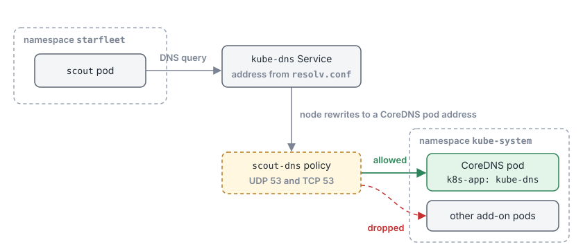

# DNS And CoreDNS Egress

Almost every connection starts with a name lookup. When a namespace denies egress, the lookup is the first thing that stops. Every service that a pod calls by name then looks as if it were down, even when it runs fine.

On this page, you see this symptom on the `scout` pod. You find out where the cluster DNS service runs, and you write the egress rule that brings name resolution back.

## The symptom

The `scout` pod runs a test script that does three separate things. It sends a DNS query, it calls the `probe` Service, and it calls the Kubernetes API server. The script prints `ok` or `fail` for each step. Each step has a limit of three seconds, so the script never hangs. Run it now:

<!-- astrona:playground:renew -->

```sh
kubectl -n starfleet exec scout -- python /app/check.py
```

The line must show `dns=fail`. Other steps may fail for other reasons, and you fix those later in the module. The DNS step fails because the `default-deny-all` policy isolates every pod in `starfleet` for egress. No rule allows the DNS query to leave the pod yet.

## Where DNS runs

Before you can allow DNS, you need to know where the queries go. CoreDNS is the DNS server of the cluster. It runs as pods in the `kube-system` namespace, behind a Service named `kube-dns`. Pods learn the address of this Service from the file `/etc/resolv.conf`.

A DNS query is an ordinary outgoing connection from the pod, so egress policy applies to it. Find the labels you can select on:

```sh
kubectl -n kube-system get pods -l k8s-app=kube-dns --show-labels
kubectl -n starfleet exec scout -- cat /etc/resolv.conf
kubectl get namespace kube-system --show-labels
```

The output gives you three facts:

- The CoreDNS pods carry the label `k8s-app: kube-dns`.
- The `resolv.conf` file lists the address of the cluster DNS Service as the name server.
- The namespace carries the automatic label `kubernetes.io/metadata.name: kube-system`.

The pod sends its query to the Service address. But the node rewrites the Service address to the address of one CoreDNS pod before the network plugin checks the policy. So the rule must select the CoreDNS pods, not the Service address.



The drawing shows the path of one lookup. The policy check happens after the address was rewritten, so it sees the CoreDNS pod in `kube-system`, not the Service.

## Why both UDP and TCP

The rule also needs the right ports. DNS normally uses UDP on port 53. When an answer is too large for one UDP message, or when the client chooses it, DNS switches to TCP on port 53.

A rule with only UDP works for most lookups and fails for large answers. The fault then comes and goes, and it is hard to find. Always allow both protocols.

## The egress rule

Now you can write the rule. It needs one peer entry with two selectors in the same entry: the namespace by its automatic name label, and the pods by `k8s-app: kube-dns`. In one entry, the two selectors combine, so the rule means "CoreDNS pods in `kube-system`". In two entries, it would mean "all pods in `kube-system`, or any pod with that label in the policy's namespace".

Add the rule as a separate policy that selects only `scout`. Policies add up, so the new policy does not replace the existing ones.

Save this as `networkpolicy-scout-dns.yaml`:

```yaml
apiVersion: networking.k8s.io/v1
kind: NetworkPolicy
metadata:
  name: scout-dns
  namespace: starfleet
spec:
  podSelector:
    matchLabels:
      app: scout
  policyTypes:
  - Egress
  egress:
  - to:
    - namespaceSelector:
        matchLabels:
          kubernetes.io/metadata.name: kube-system
      podSelector:
        matchLabels:
          k8s-app: kube-dns
    ports:
    - protocol: UDP
      port: 53
    - protocol: TCP
      port: 53
```

Apply it:

```sh
kubectl apply -f networkpolicy-scout-dns.yaml
```

Then check the result. The line must now show `dns=ok`. Other steps may still show `fail`.

```sh
kubectl -n starfleet exec scout -- python /app/check.py
```

## Common variations

Not every cluster sends DNS queries to CoreDNS pods. Some clusters run a node-local DNS cache. Pods then send their queries to an address on their own node, and the rule must allow that address instead.

Read `/etc/resolv.conf` and the list of pods in `kube-system` to see which design your cluster uses. Then test with a real lookup instead of guessing.

You can now bring back name resolution under an egress baseline with one precise rule. The open question is which other destinations a pod needs outside its namespace, and the API server is the first of them.

## Common pitfalls

> [!WARNING]
> - **Allowing only UDP.** Large answers use TCP port 53.
> - **Selecting the whole `kube-system` namespace.** That opens every control plane add-on to the pod. Add the `k8s-app: kube-dns` pod selector in the same entry.
> - **Putting the selectors in two entries.** Two entries combine with OR and widen the rule.
> - **Allowing the Service address.** The plugin matches the CoreDNS pod address after the address was rewritten.
