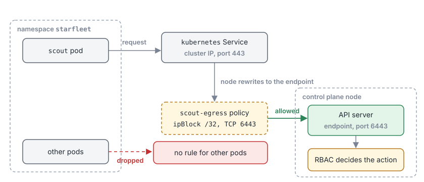

# Egress To The API Server And Other Dependencies

Some pods call the Kubernetes API server. Controllers, operators and monitoring agents all do this. Other pods call services outside the cluster. Under an egress baseline, both kinds of traffic need a rule, and you cannot write either rule with a label selector.

On this page, you find the address that a policy must allow for the API server. You read the rule that the playground already uses for it. Then you learn the `ipBlock` form for services outside the cluster.

## The kubernetes Service and its endpoint

To allow the API server, you first need its address. Every cluster has a Service named `kubernetes` in the `default` namespace. Its cluster IP address is the address that pods get in the environment variable `KUBERNETES_SERVICE_HOST`.

The Service forwards to the real address of the API server. That address is listed in an EndpointSlice, the object that stores the addresses behind a Service. Look at both:

<!-- astrona:playground:renew -->

```sh
kubectl get service kubernetes
kubectl get endpointslice -l kubernetes.io/service-name=kubernetes
kubectl get endpointslice -l kubernetes.io/service-name=kubernetes -o jsonpath='{.items[0].endpoints[0].addresses[0]}{"\n"}{.items[0].ports[0].port}{"\n"}'
```

Each command shows one piece:

- The first command shows the cluster IP address of the Service and port 443.
- The second command shows the EndpointSlice.
- The third command prints the endpoint address and its port.

In a `kind` cluster, the endpoint address is normally the address of the control plane node container, and the port is normally 6443.

## Which address to allow

You now have two addresses, and the policy must use the right one. The node rewrites the Service address to the endpoint address before the network plugin applies the policy. So Calico matches the endpoint address and port. A rule that allows only the Service address `10.x.x.x:443` may therefore not match.

Allow the endpoint address with its port. Network plugins differ here, and managed clusters often place the API server behind a load balancer address. So check the behaviour in the cluster you use by testing the call.

The API server is not a pod, so you cannot select it by label. Instead, you use an `ipBlock` peer with the address and a `/32` prefix, which selects exactly one address, together with the port.



The drawing shows why the rule names the endpoint. The policy check happens after the node rewrote the Service address, and only then does the request reach the API server, where role-based access control decides what it may do.

## Read the rule that exists

The playground already allows `scout` to reach the API server. Read the policy that does it, and run the script again:

```sh
kubectl -n starfleet get networkpolicy scout-egress -o yaml
kubectl -n starfleet exec scout -- python /app/check.py
```

The policy lists one `ipBlock` with the control plane address and TCP port 6443 under `egress`. The script step `api` must show `ok`. This means the call to the API server with the ServiceAccount token worked, and that this rule is correct.

The call also needs a second, separate permission. The ServiceAccount must be allowed to list pods in `starfleet`. That is role-based access control (RBAC), a different layer: NetworkPolicy lets the connection through, and RBAC decides what the request may do.

## Why only one pod gets the rule

The rule selects the `scout` pod, not the whole namespace, and this choice matters. A pod that holds a ServiceAccount token and can reach the API server is a target for an attacker.

When only one workload gets the API server rule, the other pods cannot reach the API server. They stay cut off even if one of them is taken over and holds a token.

## External services

The API server was one fixed address. A service outside the cluster is similar: it has an address range and no labels. The rule uses `ipBlock` for it too. A fragment inside an `egress` rule looks like this:

```yaml
  - to:
    - ipBlock:
        cidr: 203.0.113.0/24
        except:
        - 203.0.113.99/32
    ports:
    - protocol: TCP
      port: 443
```

The fragment allows HTTPS to the whole range and excludes one address. The range `203.0.113.0/24` belongs to a block of addresses reserved for documentation, and it serves here only as an example.

Sometimes the external service is reached by a DNS name whose addresses change. A plain NetworkPolicy cannot follow the name, because it has no field for names. Teams use one of these instead:

- an egress gateway;
- a proxy with a fixed address;
- a policy type of the network plugin itself.

You can now find and allow the API server address, and you can write a rule for an external address range. The open question is which traffic a policy never sees at all.

## Common pitfalls

> [!WARNING]
> - **Allowing the Service cluster IP address.** The plugin may match the endpoint address after the address was rewritten.
> - **Giving the API server rule to the whole namespace.** Select only the pods that need the API.
> - **Reading NetworkPolicy as authorization.** It opens the network path; RBAC still decides what the request may do.
> - **Expecting a rule for a DNS name.** The API has no field for names, only addresses.
