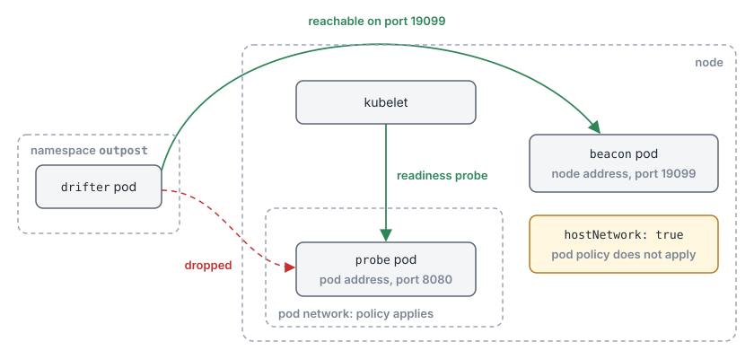

# Probes, hostNetwork And Node Traffic

A set of policies can look complete and still leave some traffic outside its reach. Some connections come from the node itself. Some pods share the network of the node and have no pod address of their own.

On this page, you find out what a NetworkPolicy applies to and what it does not. You look at two cases: the health probes that the kubelet sends, and a pod that runs with `hostNetwork: true`.

## Kubelet probes under a baseline

The kubelet is the agent on each node that starts pods and runs their health checks. A readiness or liveness probe of type HTTP is an HTTP request that the kubelet sends from the node to the pod.

The `probe` pods use an HTTP readiness probe on port 8080. The namespace has a default-deny policy. So if policy applied to the probe request, the network plugin would drop it. Look at the pods and the policies:

<!-- astrona:playground:renew -->

```sh
kubectl -n starfleet get pods -o wide
kubectl -n starfleet get networkpolicy
```

The pod list shows the `probe` pods as ready, even though `default-deny-all` isolates them for ingress. The probes pass because Calico lets a node reach the pods that run on it.

Not every network plugin behaves this way. If a plugin applies policy to traffic from the node to a pod, the probes fail under a baseline, and the pods never become ready. You must then add a rule for the address range of the nodes. Check the documentation of your plugin, and test with a baseline before you roll it out.

## hostNetwork pods

The probe is traffic from the node. A `hostNetwork` pod is a different case: it is a pod that lives on the node's own network. A pod with `hostNetwork: true` uses the network namespace of the node. It has no pod address of its own, and it listens on the node address.

The `beacon` pod is such a pod. Read its address and compare it with the node addresses:

```sh
kubectl -n starfleet get pod beacon -o jsonpath='{.spec.hostNetwork}{"\n"}{.status.podIP}{"\n"}'
kubectl get nodes -o wide
```

The pod address that the first command prints is the address of the node that runs the pod. The Kubernetes documentation says that the network plugin decides how NetworkPolicy treats `hostNetwork` pods.

Calico does not apply pod policy to them, because they have no workload interface of their own. A workload interface is the separate network interface that Calico creates for each normal pod. For traffic to and from the node, Calico uses a separate kind of policy, called host endpoint policy.



The drawing shows the three paths on one node. Policy covers the `probe` pod, which has its own pod address. The `beacon` pod sits on the node address, outside pod policy, and the kubelet probe passes under Calico.

## See it with a request

You can prove this gap with one request. The namespace `starfleet` is under a baseline, so a request from `outpost` to any normal pod in `starfleet` times out.

Now request the `beacon` pod from the `drifter` pod in `outpost`, which no policy selects. The `beacon` pod serves a web page on port 19099.

```sh
BEACON_IP=$(kubectl -n starfleet get pod beacon -o jsonpath='{.status.podIP}')
kubectl -n outpost exec drifter -- wget -q -T 3 -O- "http://$BEACON_IP:19099/"
```

With Calico, the request is expected to succeed, even though the baseline selects every pod. If your result differs, write it down and check how your plugin treats pods on the host network. The lesson holds either way: a baseline is not proof that every workload is closed.

## Writing a policy for the beacon

A baseline did not stop the request, so try a policy that names the `beacon` pod directly. The policy below selects `beacon` and allows no ingress. If policy applied to the pod, the request above would stop.

Save this as `networkpolicy-beacon-deny.yaml`:

```yaml
apiVersion: networking.k8s.io/v1
kind: NetworkPolicy
metadata:
  name: beacon-deny
  namespace: starfleet
spec:
  podSelector:
    matchLabels:
      app: beacon
  policyTypes:
  - Ingress
```

Apply it and repeat the request:

```sh
kubectl apply -f networkpolicy-beacon-deny.yaml
kubectl -n outpost exec drifter -- wget -q -T 3 -O- "http://$BEACON_IP:19099/"
```

With Calico, the request is expected to work as before, because pod policy does not apply to the pod on the host network. Remove the policy with `kubectl -n starfleet delete networkpolicy beacon-deny` when you are done.

## What a NetworkPolicy does not cover

The `beacon` pod is one limit of NetworkPolicy, and there are more. Four limits matter for the exam and for real clusters:

- **Host traffic.** It does not filter `hostNetwork` pods and node traffic in the way it filters pods.
- **Application-layer rules.** It works on addresses, ports and protocols. It cannot allow one HTTP path or method and deny another; that needs a service mesh or a gateway.
- **Logging.** The core API has no logging and no counters. Without features of the plugin, you cannot see which rule dropped a packet.
- **Encryption and identity.** It does not encrypt traffic or check who the peer is. An allowed connection is a plain connection.

To protect traffic at the node level, use the host firewall of the node or the host endpoint policy of the plugin.

You now know what a policy covers and where it stops. The open question is how to prove, path by path, that a set of policies does what you expect.

## Common pitfalls

> [!WARNING]
> - **Assuming a baseline covers every pod.** `hostNetwork` pods are outside pod policy in the plugin used here.
> - **Assuming probes always pass.** Some plugins apply policy to node traffic. Test before a rollout.
> - **Expecting HTTP-level rules.** NetworkPolicy stops at address, port and protocol.
> - **Looking for drop logs in the API.** NetworkPolicy has no logging field.
