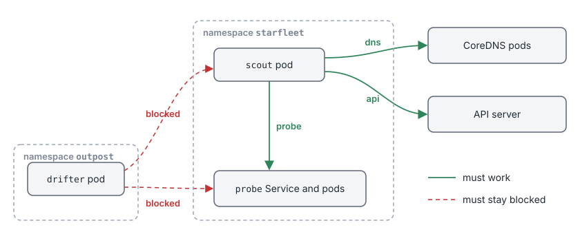

# Test Matrix For A Policy Set

A set of policies is correct when two things are true. Every path that should work does work, and every path that should fail does fail. One request proves only one of those paths.

On this page, you write down all the paths of the `starfleet` application as a table, called a test matrix. You run the table with requests that have a time limit. Then you use the result to see which paths of the broken set still fail.

## Write the expected table first

A test matrix lists each source, each destination and the expected result. Write it before you test, so the test result cannot change your expectation. The application has three needs, and several paths must stay closed:

| Source | Destination | Expected |
| --- | --- | --- |
| `scout` | DNS query to CoreDNS | works |
| `scout` | `probe` Service on port 80 | works |
| `scout` | Kubernetes API server | works |
| `drifter` in `outpost` | `probe` pods in `starfleet` | blocked |
| `drifter` in `outpost` | `scout` pod | blocked |

The `scout` script covers the first three rows. The last two rows need a request from the `drifter` pod to a pod address.



The drawing shows the same table as paths. Green solid lines are the paths that must work, and red dashed lines are the paths that must stay blocked.

## Bounded requests with readable results

Before you run the table, you need a safe way to send each request. A request without a time limit can hang the shell. A plain `wget` failure also says little about what happened.

So wrap the request in a small shell function. The function sets a time limit and prints one word. Define it in your shell, then use it for every row. It uses `wget -T 3`, so each request ends within about three seconds.

<!-- astrona:playground:renew -->

```sh
check_path() {
  namespace="$1"; pod="$2"; url="$3"
  if kubectl -n "$namespace" exec "$pod" -- wget -q -T 3 -O /dev/null "$url" 2>/dev/null; then
    echo "reachable: $pod -> $url"
  else
    echo "blocked:   $pod -> $url"
  fi
}
```

The function prints `reachable` when the request returns a successful status, and `blocked` for any failure. It cannot tell a timeout from a refusal. When a row needs that difference, run the plain `wget` command and read its message.

## Run the matrix

Now run the table. Collect the pod addresses of the destinations. Then run the two rows for `drifter` and the script for `scout`:

```sh
PROBE_IP=$(kubectl -n starfleet get pod -l app=probe -o jsonpath='{.items[0].status.podIP}')
SCOUT_IP=$(kubectl -n starfleet get pod scout -o jsonpath='{.status.podIP}')
check_path outpost drifter "http://$PROBE_IP:8080/"
check_path outpost drifter "http://$SCOUT_IP:8080/"
kubectl -n starfleet exec scout -- python /app/check.py
```

The two `drifter` rows must show `blocked`. The `scout` line shows one result for each of `dns`, `probe` and `api`. A row that differs from the table is a fault, and the two kinds of fault are not equally serious:

- A row that should be reachable but is blocked is a fault to repair.
- A row that should be blocked but is reachable is a leak. A leak is the more serious fault.

The playground set has faults of the first kind. So the `probe` step of `scout` is expected to fail until you repair the set.

## Why use addresses for the blocked rows

The two `drifter` rows use pod addresses, not names, and there is a reason for that. No policy selects the `drifter` pod in `outpost`, and DNS works for it, so it could use names.

But a pod address removes one cause of failure. The request cannot fail because of name resolution, so a block is a block by policy. For a client under an egress baseline, names fail for DNS reasons first. An address then shows whether the connection itself is allowed.

## Counters and evidence

You may wonder where to see the drops themselves. NetworkPolicy has no counters. Plugins may offer them. In Calico, packet counters, drop counters and flow logs are features of the plugin, not part of the Kubernetes API, and they depend on how Calico is installed.

In the exam and in this playground, the evidence is the result of the request. Write down each row with its time, source, destination and result. A later change can then be compared with the same table.

Run the matrix before and after every change. You now have a repeatable test, and the failing `probe` step shows that the set is still broken. The open question is why it is broken.

## Common pitfalls

> [!WARNING]
> - **Testing only the allowed rows.** Leaks show up in the blocked rows.
> - **Running a request without a time limit.** A dropped packet then hangs the shell.
> - **Writing the expectation after the test.** The result then only confirms itself.
> - **Treating a refusal as a block.** A refusal means a pod answered. Only a timeout shows a drop.
