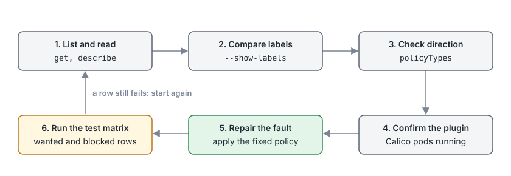
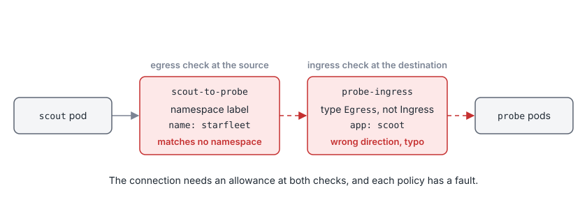

# Audit And Troubleshoot Policies

When a request fails, or works when it should not, guessing wastes time. A fixed method finds the cause in a few commands. You list the policies, read what each one selects, compare the selectors with the real labels, check the policy types, and confirm that the network plugin enforces policy.

On this page, you use this method on the `starfleet` namespace. You find the faults that still break the `probe` step of `scout`, and you repair them.



The drawing shows the method as a loop. After each repair, you run the test matrix, and if a row still fails, you start again at the first step.

## Step one: list and read

Start with what exists. List every policy in the cluster, then describe the ones that touch the failing path. The list shows the name and the pod selector of each policy. The `describe` output shows what each policy allows.

<!-- astrona:playground:renew -->

```sh
kubectl get networkpolicy --all-namespaces
kubectl -n starfleet describe networkpolicy scout-to-probe
kubectl -n starfleet describe networkpolicy probe-ingress
```

The `scout-to-probe` policy allows egress from `scout` to pods labelled `app: probe`, in a namespace that it selects by a label. The `probe-ingress` policy selects the `probe` pods. Read the type line of each policy: one of them reports an egress rule where an ingress rule is needed.

## Step two: compare selectors with real labels

The policies now look plausible, but a selector can still miss. A selector that matches nothing is valid. The policy then protects nothing or allows nothing, and Kubernetes gives no warning. So compare the labels in the policies with the labels in the cluster:

```sh
kubectl get namespace starfleet --show-labels
kubectl -n starfleet get pods --show-labels
```

The output shows two facts:

- The namespace has the label `kubernetes.io/metadata.name: starfleet` and no `name` label. A namespace selector on `name` therefore matches nothing.
- The `scout` pod carries `app: scout`. A peer that selects any other value for the `app` label matches no pod.

## Step three: policy types and direction

Next, check the direction. A policy affects only the directions listed in its `policyTypes`. Take a policy for `probe` that lists `Egress` and has an `egress` section. It controls what the `probe` pods send. It adds nothing for what they receive, so the ingress side stays closed by the baseline.

Check two things for each policy. The type must match the direction of the traffic you want to allow. The rules must sit under the matching section, `ingress` or `egress`.



The drawing shows the path from `scout` to `probe` with its two checks. The connection needs an allowance at the source and at the destination, and on this path both policies are broken.

## Step four: the plugin

The last check is the network plugin itself. Policies have an effect only if the plugin enforces them. The default plugin of `kind` does not. Confirm which plugin runs, and test a deny:

```sh
kubectl -n kube-system get pods -o wide
```

The list contains the Calico pods. Some clusters run only a plugin without policy support. The API server then accepts every policy, nothing is blocked, and no `kubectl` command reports the problem. A deny test that fails to deny is the only signal.

## Repair

The method has found three faults:

- The probe rule in `scout-to-probe` selects the namespace by a label that does not exist.
- The `probe-ingress` policy has the wrong direction.
- The peer in `probe-ingress` selects a mistyped pod label.

First, replace the egress policy so that it selects the namespace by the correct label. Save this as `networkpolicy-scout-to-probe.yaml`:

```yaml
apiVersion: networking.k8s.io/v1
kind: NetworkPolicy
metadata:
  name: scout-to-probe
  namespace: starfleet
spec:
  podSelector:
    matchLabels:
      app: scout
  policyTypes:
  - Egress
  egress:
  - to:
    - namespaceSelector:
        matchLabels:
          kubernetes.io/metadata.name: starfleet
      podSelector:
        matchLabels:
          app: probe
    ports:
    - protocol: TCP
      port: 8080
```

Then save the corrected ingress policy as `networkpolicy-probe-ingress.yaml`. It uses the type `Ingress`, an `ingress` section and the correct label `app: scout`:

```yaml
apiVersion: networking.k8s.io/v1
kind: NetworkPolicy
metadata:
  name: probe-ingress
  namespace: starfleet
spec:
  podSelector:
    matchLabels:
      app: probe
  policyTypes:
  - Ingress
  ingress:
  - from:
    - podSelector:
        matchLabels:
          app: scout
    ports:
    - protocol: TCP
      port: 8080
```

Apply both files and run the script again:

```sh
kubectl apply -f networkpolicy-scout-to-probe.yaml
kubectl apply -f networkpolicy-probe-ingress.yaml
kubectl -n starfleet exec scout -- python /app/check.py
```

The line must show `ok` for `dns`, `probe` and `api`. If a step still fails, repeat the method.

Then run the test matrix again. A repair that opens the wanted paths must not open other paths too. The two rows for `drifter` must still show `blocked`.

## Find pods that no policy protects

A repaired set is not the end of an audit. An audit also looks for pods that no policy selects, because those pods accept all traffic. List the pods and the policies in each namespace, and compare them:

```sh
kubectl get pods --all-namespaces
kubectl get networkpolicy --all-namespaces
```

The two namespaces give different answers:

- The `outpost` namespace has a pod but no policy, so the `drifter` pod is open in both directions.
- The `starfleet` namespace has a baseline, so every pod in it is isolated. The exception is the `beacon` pod, which runs on the host network, where pod policy does not apply.

Check the same for each namespace of a cluster.

You can now use one method for any policy problem and repair a broken set. The method is: list, read, compare labels, check types and direction, confirm the plugin, and test. The question that stays open in every real cluster is which namespaces still run without any policy at all.

## Common pitfalls

> [!WARNING]
> - **Trusting the policy name.** A name such as `probe-ingress` can hide an egress rule. Read the types and sections.
> - **Fixing two faults and testing once.** Faults hide each other. Test after each change.
> - **Assuming enforcement.** A cluster whose plugin ignores policy accepts every policy without a warning.
> - **Auditing only namespaces with policies.** A namespace with no policy is the biggest gap.
