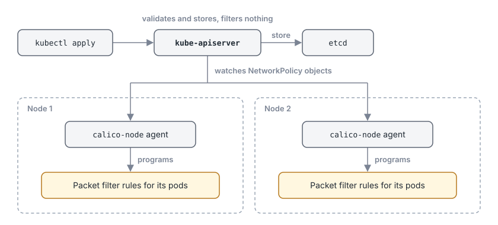
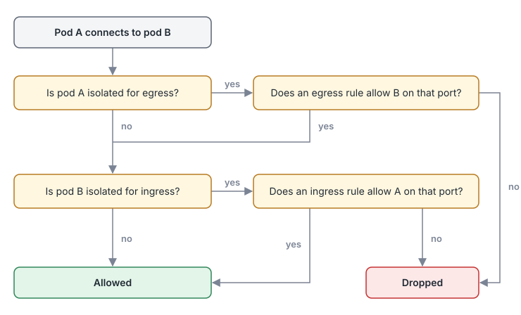

# How NetworkPolicy Isolation Works

Out of the box, a Kubernetes cluster has a flat network. Any pod can reach any other pod by its pod IP address, in any namespace. A Service does not change this: it only adds a stable name and spreads requests over its pods.

A flat network is easy while you build an application, but it is risky in production. On this page, you see what a NetworkPolicy changes, which component enforces it, and the rules that decide whether a connection is allowed.

## The cluster before any policy

Start by looking at what runs in the playground. Policies pick pods and namespaces by their labels, so the labels matter as much as the names.

```sh
kubectl -n starfleet get pods --show-labels
kubectl -n outpost get pods --show-labels
kubectl get namespaces --show-labels
```

The `starfleet` namespace has the two `probe` pods and the `shuttle` pod. The `outpost` namespace has the `drifter` pod.

Look at the namespace labels too. Every namespace has the label `kubernetes.io/metadata.name`, and its value is the name of the namespace. Kubernetes adds this label by itself, so a policy can pick a namespace by its name without you adding a label first.

Now check what the network allows today. Send a request from each client pod to the `probe` Service. The command `wget -q -T 3 -O-` prints the response and gives up after three seconds.

```sh
kubectl -n starfleet exec shuttle -- wget -q -T 3 -O- http://probe/
kubectl -n outpost exec drifter -- wget -q -T 3 -O- http://probe.starfleet/
```

Both requests work. The `probe` server answers with one line that contains `version=v1`, the name of the pod that answered, and `greeting=hello`.

The second request is the interesting one. The `drifter` pod lives in another namespace, yet it reaches the `probe` Service without any problem, because nothing stops it.

## Who does what: the API server and the network plugin

To change this, you create a NetworkPolicy. But it is important to know which part of the cluster acts on it, because the answer is not the API server.

The API server checks that the policy is valid and stores it in etcd. That is all it does: it does not filter any traffic. The network plugin does the real work. It runs an agent on every node, which for Calico is the `calico-node` pod. The agent watches NetworkPolicy objects and turns them into packet filtering rules for the pods on its node. When a packet is dropped, the plugin drops it.



The drawing shows the split. The API server only stores the policy, and the `calico-node` agent on each node turns it into packet filter rules for the pods on that node.

Not every network plugin supports NetworkPolicy. The simple `flannel` plugin, for example, does not. On such a cluster, `kubectl apply` still succeeds, but traffic keeps flowing as before. So the first thing to check is which plugin runs in the cluster:

```sh
kubectl get pods --all-namespaces
kubectl get networkpolicy --all-namespaces
```

The first command lists every pod in the cluster. Look for the `calico-node` pods; they are the agents that enforce policies. Their namespace depends on how Calico was installed.

The second command lists the policies. There are none in `starfleet` or `outpost`, which is why both requests worked.

## Isolation: the rule that changes the default

A pod stays fully open until a policy selects it. Once a policy selects it, the pod becomes isolated, and only the traffic that a policy allows can pass. This is called isolation, and it works in two directions:

- A pod is **isolated for ingress** (incoming traffic) when at least one NetworkPolicy selects it and lists `Ingress` in its `policyTypes`.
- A pod is **isolated for egress** (outgoing traffic) in the same way, with `Egress`.

The two directions are independent. A pod can be isolated for ingress and still send traffic anywhere, because it is not isolated for egress.

Policies never contain deny rules; they only allow traffic. When several policies select the same pod, the allowed traffic is everything that any of them allows. This means two policies can never conflict, and adding a policy can only open more traffic. To take an allowance away, edit or delete the policy that gives it.

The field `spec.policyTypes` sets which directions a policy isolates. If you leave it out, Kubernetes always sets `Ingress`, and sets `Egress` only when the policy has an `egress` section. So a policy that should block all outgoing traffic, and therefore has no egress rules, must list `Egress` itself.

## How one connection is decided

Every connection has two sides, and both must allow it. When pod A connects to pod B, the egress side of A must allow the connection, and the ingress side of B must allow it too. A side that is not isolated allows everything.



The diagram shows that a connection needs an allowance on every isolated side, and that a side without isolation lets everything through. You do not need a rule for the replies. The plugin tracks each allowed connection and lets its reply packets back in.

Services add one more detail. A client sends its request to the Service IP address on port 80. Before the policy filter sees the packet, the node rewrites the destination to a pod IP address and port 8080. A policy therefore matches the pod IP address and the pod port (`containerPort` or `targetPort`), never the Service name or the Service port.

## What a NetworkPolicy cannot do

It is just as important to know the limits. A standard NetworkPolicy works with pod and namespace labels, IP address ranges (`ipBlock`), protocols (TCP, UDP and SCTP) and port numbers. Nothing more.

It does not read HTTP paths or methods, it does not know which user sent a request, and it does not encrypt traffic. It applies to pods, not to Services or nodes. Cluster-wide default policies, deny rules and logging need extra features of a specific plugin; they are not part of the Kubernetes API.

You now know what a policy changes, who enforces it and how a connection is decided. The open question is how to write a policy that lets a single caller in and keeps everyone else out.

## Common pitfalls

> [!WARNING]
> - **Assuming the API server enforces policies.** A policy applied to a cluster whose network plugin ignores NetworkPolicy is accepted and does nothing. Check the plugin first.
> - **Expecting deny rules.** NetworkPolicy has only allow rules. To deny, select the pods and leave out the allowance.
> - **Matching the Service port.** Policies see the pod port after the Service rewrote the destination. Use the container port in the rule.
> - **Forgetting that two sides decide.** An ingress allowance on the destination does not help when the source is isolated for egress and has no matching egress rule.
