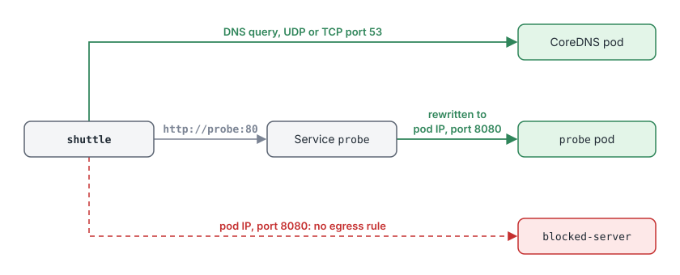

# Restrict Egress And Allow DNS

An ingress policy protects a destination. It does not stop a client from sending requests to anything it can reach. If an attacker takes over a client pod, that pod can still contact every other pod.

An egress policy closes this gap: it limits what a selected pod may send. It takes more care to write than an ingress policy. Once a client is isolated, it also loses things it quietly relied on, above all name resolution (DNS). On this page, you build an egress policy for the `shuttle` pod. It keeps DNS and one application dependency, and it blocks every other destination.

## A second listener to prove the block

To prove a block, you need a destination that works but must stay blocked. If the test target is broken, a failed request proves nothing. So first, create a second web server in `starfleet`. It is labelled `app: blocked-server` and listens on port 8080, like `probe`.

Save this as `pod-blocked-server.yaml`:

```yaml
apiVersion: v1
kind: Pod
metadata:
  name: blocked-server
  namespace: starfleet
  labels:
    app: blocked-server
spec:
  restartPolicy: Never
  containers:
  - name: web
    image: docker.io/library/python:3.13-alpine
    command:
    - python
    - -m
    - http.server
    - '8080'
```

Apply it:

```sh
kubectl apply -f pod-blocked-server.yaml
```

Then check the result. Wait until the pod is ready, store its IP address, and request it from `shuttle`. No policy selects `shuttle` for egress yet, and none selects `blocked-server` for ingress, so the request succeeds and returns a directory listing.

```sh
kubectl -n starfleet wait --for=condition=Ready pod/blocked-server --timeout=120s
BLOCKED_IP=$(kubectl -n starfleet get pod blocked-server -o jsonpath='{.status.podIP}')
kubectl -n starfleet exec shuttle -- wget -q -T 3 -O- "http://$BLOCKED_IP:8080/"
```

The request works today. After the egress policy, the same request must fail, and that failure will be your proof.

## What the egress policy must contain

The `shuttle` pod needs two allowances.

The first is name resolution. To find the address of `probe`, the pod sends a DNS query to the cluster DNS service. CoreDNS, the cluster DNS server, answers it from pods labelled `k8s-app: kube-dns` in the `kube-system` namespace. DNS uses UDP port 53, and TCP port 53 for large answers, so the rule needs both protocols.

The second allowance is the application connection itself: the `probe` pods on TCP port 8080.

Do not skip the DNS rule. Without it, the client never even tries the application connection, because every name lookup fails first. The client then reports a name resolution problem, not a connection problem. So when an isolated client suddenly cannot reach anything by name, DNS is the first rule to check.

Save this as `networkpolicy-shuttle-egress.yaml`:

```yaml
apiVersion: networking.k8s.io/v1
kind: NetworkPolicy
metadata:
  name: shuttle-egress
  namespace: starfleet
spec:
  podSelector:
    matchLabels:
      app: shuttle
  policyTypes:
  - Egress
  egress:
  - to:
    - namespaceSelector:
        matchLabels:
          kubernetes.io/metadata.name: kube-system
      podSelector:
        matchLabels:
          k8s-app: kube-dns
    ports:
    - protocol: UDP
      port: 53
    - protocol: TCP
      port: 53
  - to:
    - podSelector:
        matchLabels:
          app: probe
    ports:
    - protocol: TCP
      port: 8080
```

Look at the two rules before you apply the file. In the DNS rule, the `namespaceSelector` and the `podSelector` sit in the same item, so they combine with AND. The rule allows only the DNS pods in `kube-system`, not every pod in that namespace. The second rule has only a `podSelector`, so it matches `probe` pods in the policy's own namespace.

Apply it:

```sh
kubectl apply -f networkpolicy-shuttle-egress.yaml
```

Then check the result. The lookup and the request to `probe` must work. The request to `blocked-server` must time out, although the server is healthy and nothing selects it for ingress.

```sh
kubectl -n starfleet exec shuttle -- nslookup probe.starfleet.svc.cluster.local
kubectl -n starfleet exec shuttle -- wget -q -T 3 -O- http://probe/
kubectl -n starfleet exec shuttle -- wget -q -T 3 -O- "http://$BLOCKED_IP:8080/"
```

The last command needs the `BLOCKED_IP` variable from the earlier step. If you opened a new shell, run the `BLOCKED_IP=` line again first.

## Why the port is 8080 and not 80

The policy allows port 8080, but the `shuttle` pod sends its request to the Service on port 80. Both are correct, and the reason is the order in which the node handles the packet.

First, the node replaces the Service address with the address of one `probe` pod and port 8080. Only then does the egress filter see the packet. So the egress rule is checked against the pod address and port 8080. A rule that allowed port 80 would not match, and the request would time out even though the application is healthy.



The green arrows are the two allowed paths. The dashed red arrow is dropped because no egress rule names `blocked-server`.

## Egress to other namespaces and to the outside

The same rules extend to destinations outside the namespace. To reach a pod in another namespace, the egress peer needs a `namespaceSelector`, often with a `podSelector` in the same item. To reach addresses outside the cluster, use an `ipBlock` with a `cidr`.

There is one difference to keep in mind. Pod destinations are compared after the Service address was replaced. Rules with an `ipBlock` for outside addresses are compared with the real destination address.

Egress policies also have limits. They do not apply to traffic a pod sends to itself on its loopback address. In most plugins, they also do not stop the node from reaching the pod for health checks, and the details depend on the plugin.

You now have an egress policy that gives a client name resolution and one dependency, and that blocks a healthy listener. The open question is what to do when a connection fails, and how to find the policy, selector or label that causes it.

## Common pitfalls

> [!WARNING]
> - **No DNS rule.** After egress isolation every name lookup fails, and the application looks broken. Allow UDP and TCP port 53 to the DNS pods.
> - **Opening all of `kube-system`.** A `namespaceSelector` without the `podSelector` in the same item allows every pod in that namespace. Put both in one item.
> - **Testing against a broken target.** Check that the blocked listener is `Ready` first, or a timeout proves nothing.
> - **Allowing port 80 instead of 8080.** The filter sees the pod port after the Service rewrote the destination.
