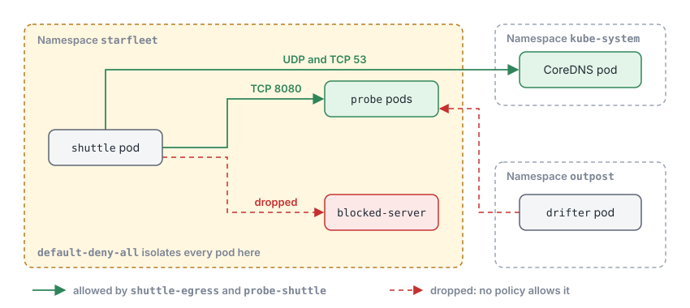
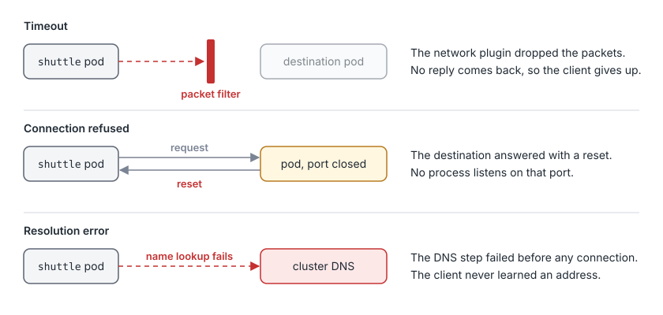
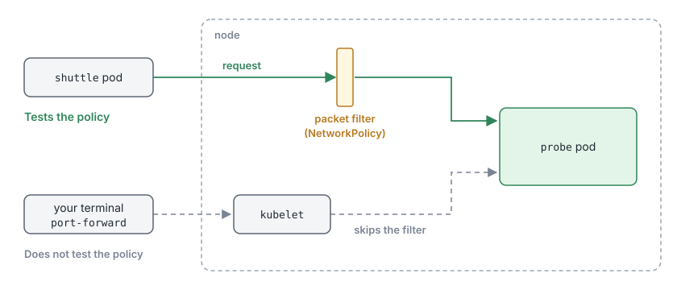

# Default Deny And Troubleshooting Policies

So far, each policy protected one named application. A secure namespace works the other way around. It first denies all traffic, and then it adds one allowance for each real need.

On this page, you write such a default-deny policy and see what it changes. Then you learn a fixed method to find the cause when a request is blocked, or when it is allowed although it should not be.

## Default deny

A default-deny policy selects every pod in a namespace and allows nothing. The selector `podSelector: {}` matches all pods in the namespace, and the policy has no rules. As a result, every pod becomes isolated for both directions.

This does not break the policies you already have. Allowances from all policies add up, so the existing allow policies keep working. The real gain is for new pods: a new application pod is protected from its first second, even before anyone writes a policy for it.

Save this as `networkpolicy-default-deny-all.yaml`:

```yaml
apiVersion: networking.k8s.io/v1
kind: NetworkPolicy
metadata:
  name: default-deny-all
  namespace: starfleet
spec:
  podSelector: {}
  policyTypes:
  - Ingress
  - Egress
```

Apply it:

```sh
kubectl apply -f networkpolicy-default-deny-all.yaml
```

Then check the result. The two policies you created before are still present, and the new policy isolates every pod in `starfleet` for ingress and egress. The `shuttle` pod already has an egress allowance, so the lookup and the request still work. The new policy also isolates `blocked-server`, which now has no ingress rule at all.

```sh
kubectl -n starfleet get networkpolicy
kubectl -n starfleet exec shuttle -- wget -q -T 3 -O- http://probe/
```

The request to `probe` still works. On the source side, `shuttle-egress` allows it. On the destination side, `probe-shuttle` allows it. What decides is the combination of all policies, not the newest one.



The drawing shows the namespace after the default-deny policy. Only the connections that another policy allows still pass: the DNS lookup and the request from `shuttle` to `probe`. Everything else, such as the request to `blocked-server` or from `drifter`, is dropped.

## Reading a blocked request step by step

With several policies in place, a failed request can have many causes. Do not guess. Follow the same order every time, and the cause shows itself.

First, name the three facts of the connection: the source pod, the destination pod, and the port the destination pod listens on.

Second, list the policies in both namespaces and read which pods each one selects:

```sh
kubectl get networkpolicy --all-namespaces
kubectl -n starfleet describe networkpolicy probe-shuttle
```

Third, compare the selectors with the real labels. A typing error in a label selects no pods, and the policy then protects nothing:

```sh
kubectl -n starfleet get pods --show-labels
kubectl get namespaces --show-labels
```

Fourth, check both sides of the connection. Start with the source: is it isolated for egress, and does a rule allow this destination and port? Then check the destination the same way for ingress.

Fifth, read the type of failure. Each type points to a different cause:

- A **timeout** means a packet filter dropped the packets.
- A **refused** connection means the destination answered, but no process listens on that port.
- A **resolution error** means the DNS lookup failed, before any connection started.



The drawing shows where each failure happens. Only a timeout points to a NetworkPolicy.

## Proving the cause by removing it

Reading policies gives you a suspect. To prove it, remove the suspect policy and repeat the request. A deleted policy stops working within seconds, and you can apply the same file again afterwards.

The `default-deny-all` policy was only a demonstration, so delete it now. Then check that the other two policies are still there:

```sh
kubectl -n starfleet delete -f networkpolicy-default-deny-all.yaml
kubectl -n starfleet get networkpolicy
```

The list shows the two policies `probe-shuttle` and `shuttle-egress` again.

The same test works for any request. If the request starts to work after you delete a policy, that policy was the block. If it still fails, the cause is somewhere else: a label, a port, DNS or another policy.

## Where the checks run

A test only counts if it sends the request the same way the real traffic does. So always test from the client pod that matters for the question.

Do not use `kubectl port-forward` for this. A port-forward connection does not come from another pod. The kubelet on the node opens it, so it says nothing about a policy. In an exam task, always test from a pod in the namespace the task names.



The drawing shows the two paths. Only the request from a pod goes through the same packet filter as real traffic.

Also remember that policies are namespaced objects. A policy in `outpost` selects only pods in `outpost`. To isolate pods in `starfleet`, the policy must be in `starfleet`, even when the allowed source lives in another namespace.

You can now write allow policies and a default-deny policy, and you have a method to explain any blocked or allowed request. Run these checks every time before you trust a policy.

## Common pitfalls

> [!WARNING]
> - **Applying default deny without DNS.** Egress default deny also blocks name resolution. Every pod in the namespace then fails to resolve names until a DNS rule exists.
> - **Putting the policy in the wrong namespace.** A policy selects only pods in its own namespace.
> - **Believing the newest policy wins.** Policies add up. Remove the policy that grants the unwanted access.
> - **Reading the policy name.** A policy named `allow-probe` can allow more than the name says. Read the selectors and ports.
