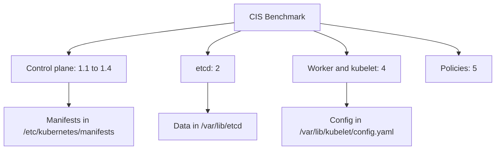

# The Benchmark And Where The Settings Live

A benchmark recommendation names a setting, but a reviewer must know where that setting is stored. On a cluster built by `kubeadm`, the settings are spread over a few directories on each node. This part explains how the CIS benchmark is organised, and then walks through the node to find the manifests, the configuration files and the certificates it refers to.

## How the benchmark is organised

The CIS Kubernetes Benchmark is a numbered document. Each recommendation has an identifier, a description, a rationale, an audit procedure and a remediation. The sections follow the components:

- Section 1 covers the control plane: configuration file permissions (1.1), the API server (1.2), the controller manager (1.3) and the scheduler (1.4).
- Section 2 covers the `etcd` data store.
- Section 3 covers control plane configuration such as authentication and audit logging.
- Section 4 covers worker nodes: configuration file permissions (4.1) and the kubelet (4.2).
- Section 5 covers policies: role-based access control (RBAC), pod security, network policies and secrets.

Every recommendation has a **profile level**. Level 1 recommendations are practical for most clusters. Level 2 recommendations add stronger protection and can reduce functionality. Every recommendation is also **automated** or **manual**. An automated recommendation has an audit that a tool can run and judge. A manual recommendation needs a person to decide, for example whether the RBAC permissions of a group are justified.

The benchmark has editions for Kubernetes versions. A check written for an old flag can give a wrong answer on a newer cluster, so a review states the benchmark edition it used.

## Who owns the component

A review also depends on who can change the component. On a cluster that you run yourself, you can read and change static pod manifests and node files. On a managed service the provider runs the control plane. You then have no access to the API server flags or etcd, and you review only what you own, such as worker node settings and workloads. Never report a setting you cannot see as passed.

## The layout of a kubeadm node

Set the names of the two node containers once. The variables are used by the commands in this part.

<!-- astrona:playground:renew -->

```sh
NODE=astro-ats-031-playground-020-01-control-plane
WORKER=astro-ats-031-playground-020-01-worker
```

On a control plane node, `kubeadm` places the control plane components as **static pods**. A static pod is a pod that the kubelet starts from a manifest file in a directory on the node, without the API server. The directory is `/etc/kubernetes/manifests`. List it, together with the owner and the permission mode of each file:

```sh
podman exec $NODE ls /etc/kubernetes/manifests
podman exec $NODE sh -c "stat -c '%a %U:%G %n' /etc/kubernetes/manifests/*"
```

You should see four files: `etcd.yaml`, `kube-apiserver.yaml`, `kube-controller-manager.yaml` and `kube-scheduler.yaml`. The `stat` format prints the mode in octal (for example `600`), then the owner and group, then the path. The benchmark (checks 1.1.1 to 1.1.8) asks for mode `600` or stricter and owner `root:root` for these files.

The certificates and keys live in `/etc/kubernetes/pki`, the credentials of the administrator and of the components in `/etc/kubernetes/*.conf`, and the etcd data in `/var/lib/etcd`. The kubelet reads its settings from `/var/lib/kubelet/config.yaml` and its credentials from `/etc/kubernetes/kubelet.conf`.

```sh
podman exec $NODE sh -c "stat -c '%a %U:%G %n' /etc/kubernetes/*.conf /var/lib/etcd /var/lib/kubelet/config.yaml"
podman exec $WORKER sh -c "stat -c '%a %U:%G %n' /etc/kubernetes/kubelet.conf /var/lib/kubelet/config.yaml /etc/kubernetes/pki/ca.crt"
```

Compare each mode with what the benchmark asks: configuration files `600` or stricter, certificate files `644` or stricter, key files `600`, the etcd data directory `700` or stricter and owned by the `etcd` user. A `kubeadm` cluster does not always meet every file check. Some findings are expected until you change a mode or create the `etcd` user, and some are accepted exceptions.

## DNS in the cluster

The benchmark has no section only for DNS. The cluster DNS runs as the `coredns` Deployment in the `kube-system` namespace. Its configuration is the `coredns` ConfigMap, and the review of this component is the review of an ordinary workload: image, service account permissions and exposure. Look at it:

```sh
kubectl -n kube-system get deployment coredns
kubectl -n kube-system get configmap coredns -o yaml
```

The ConfigMap holds the `Corefile`, the file that lists the CoreDNS plugins. A change to this ConfigMap changes name resolution for every pod, so only trusted administrators should be allowed to edit it.



The diagram shows that each benchmark section points to files or manifests on the node, so a review always ends with reading a file on a node.

You now know where the settings live and who owns them. The next question is how a single check reads and how to repeat its audit by hand.

## Common pitfalls

> [!WARNING]
> - **Reporting a setting you cannot see.** On a managed control plane you have no access to the API server flags. Mark it as not assessable, not as passed.
> - **Using the wrong edition.** A check written for an older Kubernetes version can misjudge a newer cluster. Record the edition.
> - **Treating the benchmark as a repair script.** Some recommendations stop a workload or a component if you apply them without thought.
> - **Looking at the wrong node.** Control plane files exist on the control plane node. The worker has no static pod manifests.
