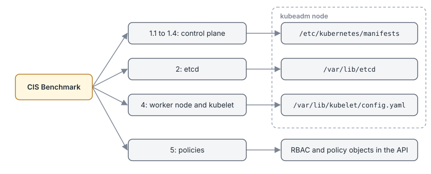
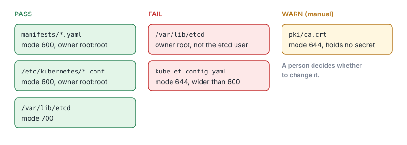

# The Benchmark And Where The Settings Live

A benchmark recommendation names a setting, but it does not tell you where that setting is stored on your machine. A reviewer must know both. On a cluster built by `kubeadm`, the settings are spread over a few directories on each node.

This page first explains how the CIS benchmark is organised. Then you walk through the playground node and find the manifests, the configuration files and the certificates that the benchmark refers to.

## How the benchmark is organised

The CIS Kubernetes Benchmark is a numbered document. Each recommendation has an identifier, a description, a rationale (the reason for it), an audit procedure (how to check it) and a remediation (how to fix it). The sections follow the components of the cluster:

- Section 1 covers the control plane: configuration file permissions (1.1), the API server (1.2), the controller manager (1.3) and the scheduler (1.4).
- Section 2 covers the `etcd` data store.
- Section 3 covers control plane configuration such as authentication and audit logging.
- Section 4 covers worker nodes: configuration file permissions (4.1) and the kubelet (4.2).
- Section 5 covers policies: role-based access control (RBAC), pod security, network policies and secrets.



The drawing shows where each benchmark section leads you on a kubeadm node. Most sections end at a file or a manifest on the node, so a review almost always ends with reading a file on a node.

Each recommendation also has two labels. The first is the **profile level**. Level 1 recommendations are practical for most clusters. Level 2 recommendations add stronger protection, but they can reduce what the cluster can do.

The second label says whether the recommendation is **automated** or **manual**. An automated recommendation has an audit that a tool can run and judge by itself. A manual recommendation needs a person to decide. For example, a person must judge whether the RBAC permissions of a group are justified.

The benchmark has separate editions for different Kubernetes versions. A check written for an old flag can give a wrong answer on a newer cluster. For this reason, a review always states which benchmark edition it used.

## Who owns the component

What you can review also depends on who can change the component. On a cluster that you run yourself, you can read and change the static pod manifests and the files on the node.

On a managed service, the cloud provider runs the control plane. You then have no access to the API server flags or to etcd. You review only what you own, such as worker node settings and workloads. Never report a setting you cannot see as passed.

## The layout of a kubeadm node

The files of a kubeadm node belong to `root`, so you read them from a shell on the node with `sudo`. Open a shell on the playground node. You log in as the `student` user, and the second command shows that `kubectl` points at this cluster:

<!-- astrona:playground:renew -->

```sh
astrona ssh astro-ats-031-playground-020-01
kubectl config current-context
```

The context is `kubernetes-admin@astro-ats-031-playground-020-01`. Run every other command on this page in that shell. Commands with `sudo` change only the playground VM, not your own computer.

On a control plane node, `kubeadm` runs the control plane components as **static pods**. A static pod is a pod that the kubelet starts from a manifest file in a directory on the node, without the API server. The directory is `/etc/kubernetes/manifests`. List it, together with the owner and the permission mode of each file:

```sh
sudo ls /etc/kubernetes/manifests
sudo sh -c "stat -c '%a %U:%G %n' /etc/kubernetes/manifests/*"
```

The output on the playground node:

```text
etcd.yaml
kube-apiserver.yaml
kube-controller-manager.yaml
kube-scheduler.yaml
600 root:root /etc/kubernetes/manifests/etcd.yaml
600 root:root /etc/kubernetes/manifests/kube-apiserver.yaml
600 root:root /etc/kubernetes/manifests/kube-controller-manager.yaml
600 root:root /etc/kubernetes/manifests/kube-scheduler.yaml
```

The `stat` format prints three things: the mode in octal (for example `600`), then the owner and group, then the path. The benchmark (checks 1.1.1 to 1.1.8) asks for mode `600` or stricter and owner `root:root` for these files. All four files pass.

The other files sit in a few more places:

- The certificates and keys live in `/etc/kubernetes/pki`.
- The credentials of the administrator and of the components live in `/etc/kubernetes/*.conf`.
- The etcd data lives in `/var/lib/etcd`.
- The kubelet reads its settings from `/var/lib/kubelet/config.yaml` and its credentials from `/etc/kubernetes/kubelet.conf`.

In a cluster with several nodes, the kubelet files exist on every node. In the playground, one node holds both the control plane files and the kubelet files. Check the modes and owners of these files too:

```sh
sudo sh -c "stat -c '%a %U:%G %n' /etc/kubernetes/*.conf /var/lib/etcd /var/lib/kubelet/config.yaml /etc/kubernetes/pki/ca.crt"
```

The output on the playground node:

```text
600 root:root /etc/kubernetes/admin.conf
600 root:root /etc/kubernetes/controller-manager.conf
600 root:root /etc/kubernetes/kubelet.conf
600 root:root /etc/kubernetes/scheduler.conf
600 root:root /etc/kubernetes/super-admin.conf
700 root:root /var/lib/etcd
644 root:root /var/lib/kubelet/config.yaml
644 root:root /etc/kubernetes/pki/ca.crt
```

Compare each mode with what the benchmark asks for. Configuration files need `600` or stricter, and key files need `600`. The etcd data directory needs `700` or stricter, and it must be owned by the `etcd` user.

Certificate files such as `ca.crt` also have a `600` rule, but it is a manual check. A certificate holds no secret. So kube-bench reports the kubeadm mode `644` as `[WARN]`, not `[FAIL]`, and a reviewer decides whether to change it.



The drawing sums up the file checks on the playground node. Green files pass, red files fail a check, and the amber file is a manual check that a person must judge.

A `kubeadm` cluster does not meet every file check. On this node the etcd data directory has the right mode, but it belongs to `root`, because kubeadm creates no `etcd` user. The kubelet configuration file has mode `644`, which is wider than `600`. Some findings like these stay until you change a mode or create the `etcd` user, and some are accepted exceptions.

## DNS in the cluster

The benchmark has no section only for DNS. The cluster DNS runs as the `coredns` Deployment in the `kube-system` namespace. Its configuration is the `coredns` ConfigMap. You review this component in the same way as an ordinary workload: its image, the permissions of its service account, and how it is exposed. Look at it:

```sh
kubectl -n kube-system get deployment coredns
kubectl -n kube-system get configmap coredns -o yaml
```

The ConfigMap holds the `Corefile`, the file that lists the CoreDNS plugins. A change to this ConfigMap changes name resolution for every pod. So only trusted administrators should be allowed to edit it.

You now know how the benchmark is organised, where each setting lives on a kubeadm node, and who owns which component. The open question is how a single check reads, and how to repeat its audit by hand.

## Common pitfalls

> [!WARNING]
> - **Reporting a setting you cannot see.** On a managed control plane you have no access to the API server flags. Mark the check as not assessable, not as passed.
> - **Using the wrong edition.** A check written for an older Kubernetes version can misjudge a newer cluster. Record the edition you used.
> - **Treating the benchmark as a repair script.** Some recommendations stop a workload or a component if you apply them without thought.
> - **Looking at the wrong node.** Control plane files exist on the control plane node. On a cluster with separate worker nodes, a worker has no static pod manifests.
