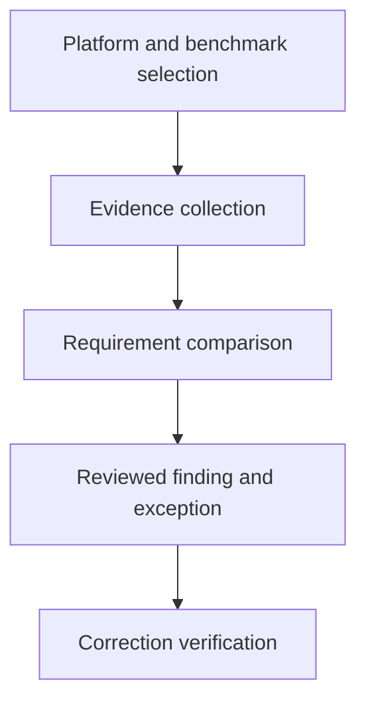

# Reviewing A Cluster Against A Security Benchmark

A benchmark tool reports a compliant setting, but the cluster uses a different component layout from the selected benchmark profile. A result needs a supported target and meaningful evidence before it describes the actual system.

## Learning objectives

- Select a benchmark matching component versions and deployment ownership.
- Distinguish automated findings from manual security judgment.
- Trace a failed recommendation to effective configuration.

## Before you start

This chapter is standalone reading material; no running cluster or installed tools are required. A Pod is the Kubernetes unit for running one or more containers, and a namespace groups namespaced objects. Treat the worked configurations as teaching examples rather than recorded observations from a provisioned environment.

## Responsible components and behavior

A security benchmark turns broad goals into concrete recommendations that can be assessed. The CIS Kubernetes Benchmark is a versioned collection of such recommendations. It is useful for examining control-plane and worker configuration, but it is not a universal script that can safely rewrite every cluster. An assessment starts by identifying the Kubernetes release, benchmark edition, deployment model and ownership of each component.

## Match The Assessment To The Deployment

An administrator of a self-managed control plane may inspect static Pod manifests, component arguments and host file permissions. A user of a managed service may not have access to those resources. The latter needs provider documentation or assurance evidence for provider-owned controls, together with direct assessment of customer-owned settings. Marking an inaccessible control as passed would confuse unavailable evidence with demonstrated protection.

Benchmarks can distinguish different recommendation levels and automated or manual assessment procedures. More restrictive recommendations can require operational tradeoffs. Select a profile appropriate to the system's risk and supported architecture. Record the selected edition so another reviewer can interpret the result and reproduce the reasoning rather than guess which defaults the report assumed.

## Follow Effective Configuration

A finding about the API server might concern anonymous authentication, authorization or admission. A kubelet finding might concern authentication, authorization or an exposed endpoint. Etcd assessment includes authenticated transport and access to data or credentials. File ownership and permissions protect component configuration from modification. DNS security also involves the supported DNS implementation, service permissions and exposure rather than treating a historical component name as a current architecture requirement.

The relevant setting is the value the running component actually uses. A secure value in an unused configuration file does not protect a component launched with different arguments. Conversely, a check that expects an older flag may misinterpret a newer structured configuration. Trace startup definitions, active configuration and documented defaults before deciding whether a recommendation is satisfied.

## Interpret Findings Before Remediation

Suppose a report identifies overly permissive access to a kubelet configuration file. First establish the actual file loaded, owner, allowed readers and writers, and the host identities that need access. A correction should remove unnecessary authority without preventing the kubelet from reading its configuration. A permission change that stops the service is not an acceptable security outcome merely because one check becomes green.

Some checks require human review, such as whether granted API permissions are justified. An automated assessment can enumerate bindings but cannot infer every team's business responsibility. Distinguish a tool's observation from the security decision made from it. Tools such as kube-bench evaluate supported benchmark checks; their report still needs interpretation and does not perform every application security assessment.

## Preserve Evidence And Exceptions

Record the finding, observed effective state, intended correction, responsible owner and verification evidence. Where a recommendation cannot be adopted, explain the reason, remaining risk and compensating controls. Exceptions should have review ownership and a lifecycle, especially after upgrades that change available settings.

Reassessment should confirm both the security setting and required component behavior. Authentication changes need evidence that legitimate callers can still authenticate; authorization changes need evidence of the intended permitted and denied operations. A passing benchmark result does not establish secure application code, complete network isolation or trustworthy build artifacts. Those require their own controls and evidence.

## Work through the decision

A security benchmark defines checks against a particular platform and version model. A tool gathers available evidence and compares it with those requirements. A check that cannot inspect a managed control-plane setting is not automatically a confirmed compliance result or a confirmed violation.

Record the selected benchmark version, component layout, checked setting and evidence source. Review exceptions through the operating requirement rather than suppressing findings to improve a score. A compliant snapshot does not prove future configuration remains unchanged or that the application has no vulnerable behavior. Verification should connect each finding to a responsible setting and a justified correction.

A benchmark result is defensible when its target, evidence and interpretation fit the actual platform.

A benchmark result is defensible when its target, evidence and interpretation fit the actual platform.

## Common pitfalls

> [!WARNING]
> A benchmark pass is scoped evidence. An inaccessible setting, an unused configuration file and an unsupported check must not be reported as verified runtime protection.
