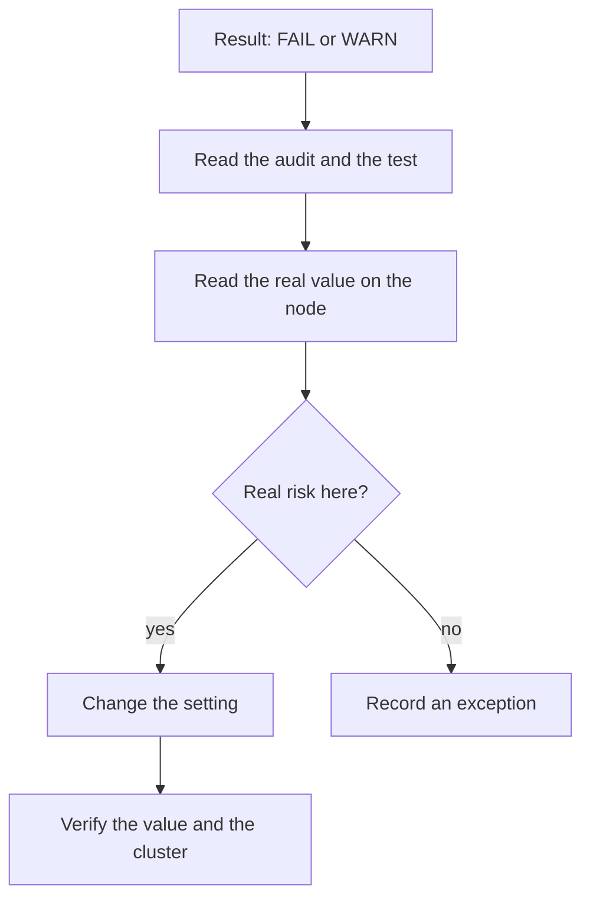

# Read A Check: kube-bench And The Manual Audit

A benchmark report lists dozens of results, and some of them are wrong for the cluster being reviewed. A reviewer who only reads the colour of a result cannot tell which. This part shows what `kube-bench` runs for each check, how to read its result, and how to repeat the audit by hand for the API server and etcd so that you see the value the component really uses.

## What kube-bench does

`kube-bench` is a program written in Go that reads the benchmark checks from configuration files and runs them on the node where it runs. It needs access to the node's processes and files, so you run it on the node itself, or as a Kubernetes Job that mounts the host paths and shares the host process namespace. It detects the Kubernetes version and loads the matching benchmark edition. The flag `--benchmark` selects an edition by name when detection is wrong.

You choose what to check with targets. The target `master` covers the control plane checks in sections 1 and 3, `etcd` covers section 2, `node` covers section 4, and `policies` covers section 5. These commands show the usual forms. They need the `kube-bench` binary, which the kind node image does not contain, so they are listed here for the machine that has it:

```sh
kube-bench run --targets master
kube-bench run --targets node
kube-bench run --targets etcd --check 2.2
```

The `--check` option limits the run to one check or a list of checks. Each result has one of four states. `PASS` means the audit found the expected value. `FAIL` means it found a different value. `WARN` means the check is manual or could not be decided, so a person must judge it. `INFO` is a note. The report ends with a remediation text for every `FAIL` and `WARN`, and a count of each state.

## Anatomy of one check

Every check in `kube-bench` has the same parts. An **identifier** such as `1.2.15` matches the benchmark number. The **audit** is a shell command that gets the real value, usually from the process arguments or from a file. The **test** compares that value with an expected one. The **remediation** says what to change.

Take the recommendation that asks for `--profiling=false` on the API server. Its number differs between benchmark editions, so find a check by the flag it names, not by memorising its number. The audit searches the running API server's arguments for the flag. The test passes when the flag is present with the value `false`. If the audit finds no flag, the API server runs with the default, and the default of `--profiling` is `true`, so the check fails. A missing flag is not the same as a safe default.

The same logic applies to every flag check. For a flag you must know the default value, because the check reads the absence of a flag as the default.

## Repeat the audit by hand

You do not need the tool to audit a flag. On a kubeadm control plane the arguments of the API server are in its static pod manifest. Look for three flags that the benchmark checks: `--profiling`, `--anonymous-auth` and `--authorization-mode`.

<!-- astrona:playground:renew -->

```sh
NODE=astro-ats-031-playground-020-01-control-plane
podman exec $NODE grep -e '--profiling' -e '--anonymous-auth' -e '--authorization-mode' /etc/kubernetes/manifests/kube-apiserver.yaml
```

`grep` prints only the lines that exist. A kubeadm cluster sets `--authorization-mode=Node,RBAC`, which is what the benchmark wants. It prints no line for `--profiling`, so the API server uses the default value `true` and the profiling check does not pass. For `--anonymous-auth` the benchmark prefers `false`, but a kubeadm cluster leaves the default `true` and relies on RBAC to deny anonymous users. The health probes that kubeadm configures for the API server send anonymous requests, so disabling anonymous authentication can break them. The benchmark therefore treats it as a manual decision.

The manifest shows what the kubelet was told to start. The running process can differ if somebody started the component another way. Read the arguments of the live pod as the API server reports them:

```sh
kubectl -n kube-system get pod kube-apiserver-$NODE -o jsonpath='{.spec.containers[0].command}'
```

The kubelet creates this pod object from the manifest, so for a static pod both views agree, and a difference means that the manifest changed after the last restart.

## Audit etcd

`etcd` stores every Kubernetes object, including Secrets. The benchmark section 2 asks for client certificate authentication (`--client-cert-auth=true`), peer certificate authentication (`--peer-client-cert-auth=true`) and no automatic self-signed certificates (`--auto-tls` must not be `true`). It also asks for a separate certificate authority for etcd, which is check 2.7 and a manual one.

```sh
podman exec $NODE grep -e 'client-cert-auth' -e 'auto-tls' -e 'data-dir' /etc/kubernetes/manifests/etcd.yaml
podman exec $NODE stat -c '%a %U:%G %n' /var/lib/etcd
```

You should see `--client-cert-auth=true` and `--peer-client-cert-auth=true`, and no `--auto-tls` line. The data directory is `/var/lib/etcd`. The benchmark asks that its mode is `700` or stricter and that the `etcd` user owns it (checks 1.1.11 and 1.1.12). The `stat` line shows the real mode and owner, so you can decide whether the file check passes on this node.

## Interpret before you fix

A `FAIL` is a question, not an order. For profiling the answer is clear: profiling exposes debug data, so you turn it off. For the owner of the etcd data directory, the fix means creating an `etcd` user on the node and changing the owner, and the etcd process must keep read and write access afterwards. A change that makes a check green and stops etcd is a worse result than the finding.



The diagram shows that every result goes through the real value on the node before a decision to change the setting or to record an exception.

You can now read a check and repeat its audit. One component is still open, because the kubelet keeps its settings in a file, and the running value can differ from the file.

## Common pitfalls

> [!WARNING]
> - **Reading a missing flag as safe.** The audit treats an absent flag as its default. Check the default before you decide.
> - **Trusting the result colour.** A `WARN` is not a pass. A `PASS` only covers what the audit looked at.
> - **Auditing a file that is not used.** Check the manifest the kubelet really loads, not a copy in another folder.
> - **Fixing a file check by stopping the component.** After a permission or owner change, confirm the component still starts.
