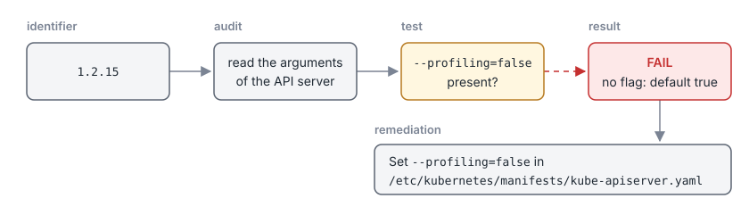
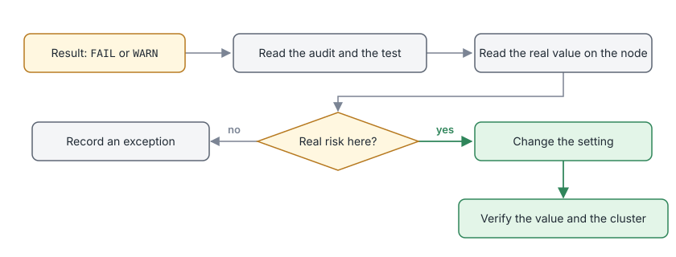

# Read A Check: kube-bench And The Manual Audit

A benchmark report lists dozens of results, and some of them are wrong for the cluster you review. If you only look at the colour of a result, you cannot tell which ones. You need to know what each check really looked at.

This page shows what `kube-bench` runs for each check and how to read its result. Then you repeat the audit by hand for the API server and etcd, so that you see the value the component really uses.

## What kube-bench does

`kube-bench` is a program written in Go. It reads the benchmark checks from configuration files and runs them on the node where it runs. It needs access to the processes and files of the node. So you run it on the node itself, or as a Kubernetes Job that mounts the host paths and shares the host process namespace.

The tool detects the Kubernetes version and loads the matching benchmark edition. When the detection is wrong, the flag `--benchmark` selects an edition by name.

You choose what to check with **targets**. Each target covers one section of the benchmark:

- `master` covers the control plane component checks in section 1.
- `etcd` covers section 2.
- `controlplane` covers section 3.
- `node` covers section 4.
- `policies` covers section 5.

The playground node has the `kube-bench` binary in `/usr/local/bin/kube-bench` and the benchmark files in `/etc/kube-bench/cfg`. Open a shell with `astrona ssh astro-ats-031-playground-020-01` and run the control plane checks. kube-bench reads files that only `root` can read, so run it with `sudo`:

<!-- astrona:playground:renew -->

```sh
sudo kube-bench run --targets master | tail -5
```

The full report is long. This output shows only its last lines, the totals:

```text
== Summary total ==
39 checks PASS
9 checks FAIL
11 checks WARN
0 checks INFO
```

The other targets work the same way. `sudo kube-bench run --targets node` checks the kubelet, and `sudo kube-bench run --targets etcd` checks etcd. On the playground node, kube-bench maps Kubernetes `1.35` to the benchmark edition `cis-1.10`.

The `--check` option limits the run to one check or a list of checks. Each result has one of four states:

- `PASS` means the audit found the expected value.
- `FAIL` means the audit found a different value.
- `WARN` means the check is manual or could not be decided, so a person must judge it.
- `INFO` is a note.

At the end, the report gives a remediation text for every `FAIL` and `WARN`, and a count of each state.

## Anatomy of one check

Every check in `kube-bench` has the same four parts:

- The **identifier**, such as `1.2.15`, matches the number in the benchmark.
- The **audit** is a shell command that gets the real value, usually from the process arguments or from a file.
- The **test** compares that value with the expected one.
- The **remediation** says what to change.



The drawing follows one check through its parts. The audit finds no `--profiling` flag, so the test sees the default value `true`, and the check fails.

Take the recommendation that asks for `--profiling=false` on the API server. Its number differs between benchmark editions, so find a check by the flag it names, not by its number. In the `cis-1.10` edition it is check `1.2.15`. Run only that check:

```sh
sudo kube-bench run --check 1.2.15
```

This output is shortened to the first lines of the report. The summaries of the other sections, which all show zero, are left out:

```text
[INFO] 1 Control Plane Security Configuration
[INFO] 1.2 API Server
[FAIL] 1.2.15 Ensure that the --profiling argument is set to false (Automated)

== Remediations master ==
1.2.15 Edit the API server pod specification file /etc/kubernetes/manifests/kube-apiserver.yaml
on the control plane node and set the below parameter.
--profiling=false
```

The audit searches the arguments of the running API server for the flag. The test passes when the flag is present with the value `false`. If the audit finds no flag, the API server runs with the default value. The default of `--profiling` is `true`, so the check fails. A missing flag is not the same as a safe default.

The same logic applies to every flag check. For each flag you must know the default value, because the check reads a missing flag as the default.

## Repeat the audit by hand

You do not need the tool to audit a flag. On a kubeadm control plane, the arguments of the API server are in its static pod manifest. Look for three flags that the benchmark checks: `--profiling`, `--anonymous-auth` and `--authorization-mode`.

```sh
sudo grep -e '--profiling' -e '--anonymous-auth' -e '--authorization-mode' /etc/kubernetes/manifests/kube-apiserver.yaml
```

On the playground node `grep` prints one line:

```text
    - --authorization-mode=Node,RBAC
```

`grep` prints only the lines that exist, so read the result flag by flag:

- `--authorization-mode`: a kubeadm cluster sets `Node,RBAC`, which is what the benchmark wants.
- `--profiling`: there is no line, so the API server uses the default value `true`, and the profiling check does not pass.
- `--anonymous-auth`: there is no line either. The benchmark prefers `false`, but a kubeadm cluster keeps the default `true` and relies on RBAC to deny anonymous users.

The `--anonymous-auth` case needs a person to decide. The health probes that kubeadm sets up for the API server send anonymous requests, so turning off anonymous authentication can break them. The benchmark therefore treats this as a manual decision.

The manifest shows what the kubelet was told to start. The running process can differ if somebody started the component another way. Read the arguments of the live pod as the API server reports them:

```sh
kubectl -n kube-system get pod kube-apiserver-astro-ats-031-playground-020-01 -o jsonpath='{.spec.containers[0].command}'
```

The name of a static pod is the component name followed by the node name. The output is one long JSON list of the arguments. On the playground node it starts with `["kube-apiserver","--advertise-address=10.0.2.15","--allow-privileged=true","--authorization-mode=Node,RBAC",` and has no `--profiling` entry.

The kubelet creates this pod object from the manifest. So for a static pod both views agree, and a difference means that the manifest changed after the last restart.

## Audit etcd

`etcd` stores every Kubernetes object, including Secrets, so its settings matter a lot. Section 2 of the benchmark asks for these settings:

- client certificate authentication (`--client-cert-auth=true`);
- peer certificate authentication (`--peer-client-cert-auth=true`), for the connections between etcd members;
- no automatic self-signed certificates (`--auto-tls` must not be `true`);
- a separate certificate authority for etcd, which is check 2.7 and a manual one.

Read the flags from the etcd manifest, and the mode and owner of the data directory:

```sh
sudo grep -e 'client-cert-auth' -e 'auto-tls' -e 'data-dir' /etc/kubernetes/manifests/etcd.yaml
sudo stat -c '%a %U:%G %n' /var/lib/etcd
```

The output on the playground node:

```text
    - --client-cert-auth=true
    - --data-dir=/var/lib/etcd
    - --peer-client-cert-auth=true
700 root:root /var/lib/etcd
```

The flags are as the benchmark wants, and there is no `--auto-tls` line. The data directory is `/var/lib/etcd`. The benchmark asks that its mode is `700` or stricter (check 1.1.11), and that the `etcd` user owns it (check 1.1.12).

The mode passes, but `root` owns the directory, so check 1.1.12 fails on this node. Still, all seven checks of the `etcd` target pass. They test the etcd flags, not the owner of the directory, which belongs to section 1.

## Interpret before you fix

A `FAIL` is a question, not an order. For profiling the answer is clear: profiling exposes debug data, so you turn it off.

The owner of the etcd data directory is harder. The fix means creating an `etcd` user on the node and changing the owner, and the etcd process must keep read and write access afterwards. A change that makes a check green and stops etcd is a worse result than the finding.



The drawing shows that every result goes through the real value on the node before you decide. You then either change the setting and verify it, or record an exception.

You can now read a check, know what its audit looked at, and repeat the audit by hand for the API server and etcd. One component is still open: the kubelet keeps its settings in a file, and the value it really runs with can differ from that file.

## Common pitfalls

> [!WARNING]
> - **Reading a missing flag as safe.** The audit treats a missing flag as its default value. Check the default before you decide.
> - **Trusting the result colour.** A `WARN` is not a pass. A `PASS` only covers what the audit looked at.
> - **Auditing a file that is not used.** Check the manifest the kubelet really loads, not a copy in another folder.
> - **Fixing a file check by stopping the component.** After a permission or owner change, confirm that the component still starts.
