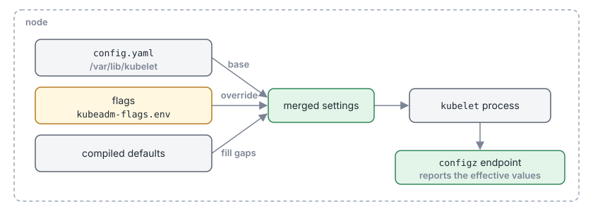
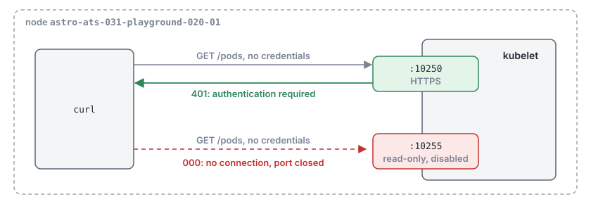

# Review The Kubelet: Effective Configuration And File Permissions

The kubelet is the agent that runs on every node and starts the containers of the pods. It also runs an HTTPS server on port 10250. Through this server, a caller can list pods, read logs and run commands inside containers.

A kubelet that accepts anonymous or unauthorised requests gives an attacker control over every pod on the node. The benchmark checks this in section 4. This page shows where the kubelet gets its settings, how to read the settings it really uses, and how to fix a file permission finding.

## Three sources of kubelet settings

The kubelet gets its settings from three places, and they have an order of priority:

- The **configuration file** `/var/lib/kubelet/config.yaml`. It holds a `KubeletConfiguration` object.
- **Command-line flags**. On a kubeadm node, the flags come from the systemd drop-in file and from `/var/lib/kubelet/kubeadm-flags.env`. A flag that is set overrides the same field in the file.
- The **compiled defaults** of the kubelet. A default applies when neither the flags nor the file set a field.



The drawing shows how the kubelet merges the three sources into the settings it runs with. The `configz` endpoint reports the result of that merge, not the content of any single file.

So a reviewer who reads only the file can be wrong, because a flag may override it. There is one more setting to know about. The kubelet has a read-only HTTP port, 10255, controlled by the field `readOnlyPort`. This port serves pod information without authentication. The benchmark wants it disabled, which is the value `0`.

## Read the effective configuration

The API server can proxy a request to the kubelet of a node: it passes the request on and returns the answer. Through this proxy, you can ask the kubelet for the configuration it is running with. This shows the merged result of the three sources.

Open a shell with `astrona ssh astro-ats-031-playground-020-01`. Then request the configuration of the node `astro-ats-031-playground-020-01`, and format the JSON with `python3 -m json.tool`:

<!-- astrona:playground:renew -->

```sh
kubectl get --raw "/api/v1/nodes/astro-ats-031-playground-020-01/proxy/configz" | python3 -m json.tool | grep -A2 -e '"anonymous"' -e '"authorization"'
```

The output on the playground node:

```text
            "anonymous": {
                "enabled": false
            }
--
        "authorization": {
            "mode": "Webhook",
            "webhook": {
```

Look for three results:

- Under `anonymous`, the field `enabled` should be `false`. This matches benchmark recommendation 4.2.1.
- Under `authorization`, the field `mode` should be `Webhook`, not `AlwaysAllow` (4.2.2). With `Webhook`, the kubelet asks the API server whether the caller may make the request.
- The key `readOnlyPort` should be absent or `0` (4.2.4). The kubelet leaves out a zero value, so both mean that the port is disabled. On the playground node the key is absent.

Now compare this with the file the kubelet was started with, and with the extra flags:

```sh
sudo cat /var/lib/kubelet/config.yaml
sudo cat /var/lib/kubelet/kubeadm-flags.env
```

The configuration file is long. This output is shortened to its first lines:

```text
apiVersion: kubelet.config.k8s.io/v1beta1
authentication:
  anonymous:
    enabled: false
  webhook:
    cacheTTL: 0s
    enabled: true
  x509:
    clientCAFile: /etc/kubernetes/pki/ca.crt
authorization:
  mode: Webhook
```

The last line of the output is the content of `kubeadm-flags.env`:

```text
KUBELET_KUBEADM_ARGS=""
```

In the file, the `authentication` block holds `anonymous` and `webhook`, and the `authorization` block holds the mode. The `kubeadm-flags.env` file holds the extra flags that kubeadm gives the kubelet. On this node it is empty, so the file and the defaults decide every setting.

If a flag such as `--anonymous-auth` appeared in `kubeadm-flags.env`, it would override the file. So when a value differs between the file and the `configz` output, look for such a flag.

## Check the API behind the settings

A setting is only worth something if the endpoint behaves as the setting says. From the shell on the node, send an anonymous request to the kubelet HTTPS port and to the read-only port. Print only the HTTP status code:

```sh
curl -sk -o /dev/null -w '%{http_code}\n' https://127.0.0.1:10250/pods
curl -s -o /dev/null -w '%{http_code}\n' http://127.0.0.1:10255/pods
```

The output on the playground node:

```text
401
000
```

The first request returns `401`: the kubelet requires authentication, and the request carries none. The second prints `000`. This is the code curl prints when it could not make a connection at all, because the read-only port is closed.



The drawing shows the two anonymous requests and what the kubelet does with each one. Both results are the safe ones.

The unsafe results would look different. If the first request printed `200`, anonymous access would be on. If the second printed `200`, the read-only port would be open and would show pod specifications to anybody who can reach the node.

## The file permission finding

Section 4.1 asks that the kubelet configuration file and the kubeconfig have mode `600` or stricter, and that `root` owns them. In recent editions these are recommendations 4.1.5 to 4.1.10, but the numbers can change. Check the current state on the node:

```sh
sudo stat -c '%a %U:%G %n' /var/lib/kubelet/config.yaml /etc/kubernetes/kubelet.conf
```

The output on the playground node:

```text
644 root:root /var/lib/kubelet/config.yaml
600 root:root /etc/kubernetes/kubelet.conf
```

The kubeconfig `kubelet.conf` passes. The mode of `config.yaml` is `644`, which is wider than `600`, so every local user on the node can read it. kube-bench reports this as a `FAIL` for check 4.1.9 in the `cis-1.10` edition.

The file holds no secret in this cluster, but a writable file would let a user change authentication. Fix the mode with `chmod`, check the file again, and run the kube-bench check:

```sh
sudo chmod 600 /var/lib/kubelet/config.yaml
sudo stat -c '%a %U:%G %n' /var/lib/kubelet/config.yaml
sudo kube-bench run --check 4.1.9 | grep 4.1.9
```

The output on the playground node:

```text
600 root:root /var/lib/kubelet/config.yaml
[PASS] 4.1.9 If the kubelet config.yaml configuration file is being used validate permissions set to 600 or more restrictive (Automated)
```

The kubelet runs as `root` and reads the file as `root`, so the stricter mode does not stop it. The kubelet reads the configuration file only when it starts. So a change to the file content needs `systemctl restart kubelet` on the node before it takes effect. A change to the mode needs no restart.

You can now read the settings the kubelet really uses, test its endpoints, and fix a permission finding on its files. One question is still open: how to change a control plane setting without stopping the cluster.

## Common pitfalls

> [!WARNING]
> - **Reading only `config.yaml`.** A flag can override the file. Read `configz` for the effective values.
> - **Editing the file and not restarting.** The kubelet reads its configuration when it starts. A changed value has no effect until the kubelet restarts.
> - **Setting a mode the kubelet cannot read.** The file must stay readable by `root`. Use `600` with the owner `root`, not a different owner.
> - **Checking only the control plane node.** Every node runs a kubelet. In a cluster with several nodes, review each worker node too.
