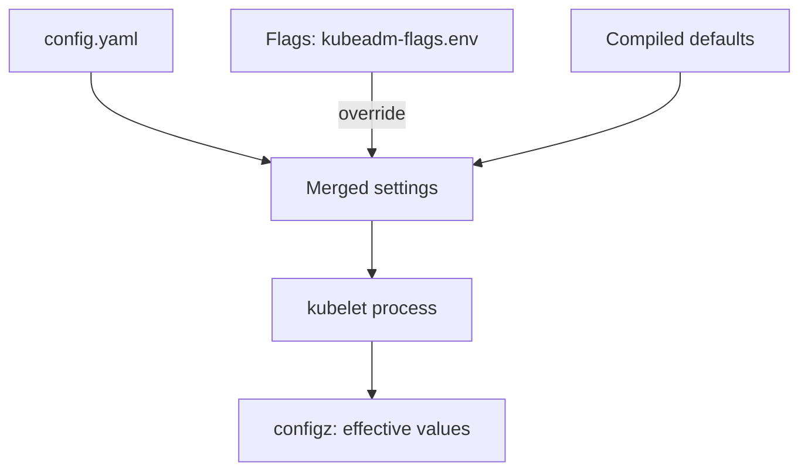

# Review The Kubelet: Effective Configuration And File Permissions

The kubelet is the agent on every node. It starts the containers, and it also runs an HTTPS server on port 10250 that can list pods, read logs and run commands inside containers. A kubelet that accepts anonymous or unauthorised requests gives an attacker control over every pod on the node. The benchmark checks this in section 4. This part shows where the kubelet gets its settings, how to read the settings it really uses, and how to fix a file permission finding.

## Three sources of kubelet settings

The kubelet gets its settings from three places. The first is the configuration file `/var/lib/kubelet/config.yaml`, a `KubeletConfiguration` object. The second is command-line flags. On a kubeadm node the flags come from the systemd drop-in file and from `/var/lib/kubelet/kubeadm-flags.env`. A flag that is set overrides the same field in the file. The third is the default compiled into the kubelet, which applies when neither the flags nor the file set a field.

A reviewer who reads only the file can be wrong, because a flag may override it. The kubelet also has a read-only HTTP port 10255, controlled by `readOnlyPort`. It serves pod information without authentication. The benchmark wants it disabled, which is the value `0`.

## Read the effective configuration

The API server can proxy a request to the kubelet of a node and return the configuration that the kubelet is running with. This shows the merged result of the three sources. Set the node names, then request the configuration for the worker node and format the JSON:

<!-- astrona:playground:renew -->

```sh
NODE=astro-ats-031-playground-020-01-control-plane
WORKER=astro-ats-031-playground-020-01-worker
kubectl get --raw "/api/v1/nodes/$WORKER/proxy/configz" | python3 -m json.tool | grep -A2 -e '"anonymous"' -e '"authorization"'
```

Find three results. Under `anonymous`, the field `enabled` should be `false`, which matches benchmark recommendation 4.2.1. Under `authorization`, the field `mode` should be `Webhook`, not `AlwaysAllow` (4.2.2). With `Webhook` the kubelet asks the API server whether the caller may do the request. The key `readOnlyPort` should be absent or `0`; the kubelet omits a zero value, so both mean the port is disabled (4.2.4).

Now compare with the file the kubelet was started with, and with the extra flags:

```sh
podman exec $WORKER cat /var/lib/kubelet/config.yaml
podman exec $WORKER cat /var/lib/kubelet/kubeadm-flags.env
```

In the file, find the `authentication` block with `anonymous` and `webhook`, and the `authorization` block. The `kubeadm-flags.env` file holds flags such as the container runtime endpoint. If a flag such as `--anonymous-auth` appeared here, it would override the file. A value that differs between the file and the `configz` output is a sign of such an override.

## Check the API behind the settings

A setting is only worth something if the endpoint behaves as the setting says. From inside the control plane node, send an anonymous request to the kubelet HTTPS port and to the read-only port, and print only the HTTP status code:

```sh
podman exec $NODE curl -sk -o /dev/null -w '%{http_code}\n' https://127.0.0.1:10250/pods
podman exec $NODE curl -s -o /dev/null -w '%{http_code}\n' http://127.0.0.1:10255/pods
```

The first request must return `401`: the kubelet requires authentication and the request carries none. The second prints `000`, which is the code curl uses when no connection could be made, because the read-only port is closed. If the first printed `200`, anonymous access would be on. If the second printed `200`, the read-only port would be open and would show pod specifications to anybody who can reach the node.

## The file permission finding

Section 4.1 asks that the kubelet configuration file and the kubeconfig have mode `600` or stricter and that `root` owns them (recommendations 4.1.5 to 4.1.10 in recent editions; numbers can change). Check the current state on the worker:

```sh
podman exec $WORKER stat -c '%a %U:%G %n' /var/lib/kubelet/config.yaml /etc/kubernetes/kubelet.conf
```

If the mode of `config.yaml` is wider than `600`, such as `644`, then every local user on the node can read it. The file holds no secret in this cluster, but a writable file would let a user change authentication. Fix the mode with `chmod`, and check again:

```sh
podman exec $WORKER chmod 600 /var/lib/kubelet/config.yaml
podman exec $WORKER stat -c '%a %U:%G %n' /var/lib/kubelet/config.yaml
```

The kubelet runs as `root` and reads the file as `root`, so the stricter mode does not stop it. The kubelet reads the configuration file only at start, so a change to the file content needs `systemctl restart kubelet` on the node before it takes effect, and a change to the mode needs no restart.



The diagram shows that the kubelet merges three sources, and that `configz` reports the result of the merge.

You can now read the real kubelet settings and fix a permission finding. One question is still open: how to change a control plane setting without stopping the cluster.

## Common pitfalls

> [!WARNING]
> - **Reading only `config.yaml`.** A flag can override the file. Read `configz` for the effective values.
> - **Editing the file and not restarting.** The kubelet reads its configuration at start. A changed value has no effect until the kubelet restarts.
> - **Setting a mode the kubelet cannot read.** The file must stay readable by `root`. Use `600` with the owner `root`, not a different owner.
> - **Checking only the control plane node.** Every node runs a kubelet. Review the worker too.
