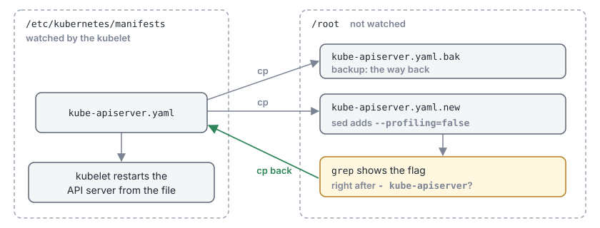
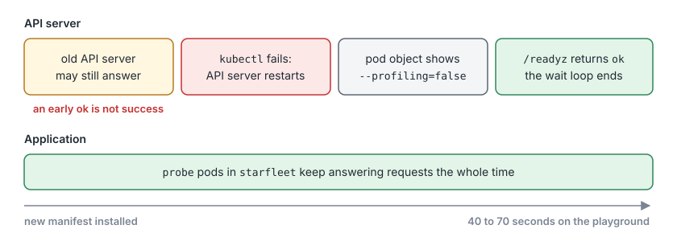

# Correct A Finding Safely And Record It

A finding is only closed when three things are true. The setting has changed, the component runs with the new value, and the cluster still works.

Changing the API server is the risky case. Every `kubectl` command talks to it, and a mistake in its manifest leaves you without a working API. This page corrects the `--profiling` finding in the API server static pod manifest. You wait for the new instance, verify the result, and record the decision.

## What happens when you edit a static pod manifest

The kubelet on the control plane node watches the directory `/etc/kubernetes/manifests`. When a file in it changes, the kubelet stops the pod and starts it again from the new file.

While the API server restarts, `kubectl` fails with a connection error for a short time. The other control plane pods keep running and reconnect when the API server returns. The application pods in `starfleet` keep serving requests, because they do not need the API server to answer traffic.

Three rules follow from this:

- Keep every backup outside the manifests directory, because the kubelet loads every file in it as a pod.
- Change one flag at a time.
- Know the way back before you start: the original file.

## The profiling flag

The `--profiling` flag of the API server turns on the `/debug/pprof` endpoints. These endpoints expose performance profiles. An attacker can use them to learn about the internal state of the API server or to cause load. The default is `true`, and the benchmark recommends `false`.

Before you change anything, look at what is exposed. A cluster administrator can read this endpoint through `kubectl`. Open a shell with `astrona ssh astro-ats-031-playground-020-01` and run:

<!-- astrona:playground:renew -->

```sh
kubectl get --raw /debug/pprof/
```

With profiling turned on, the API server answers with an HTML page that lists the available profiles. The output is long. Its first lines are:

```text
<html>
<head>
<title>/debug/pprof/</title>
```

## Make the change

You never edit the live manifest directly. Instead, you work on copies in `/root`, which is outside the manifests directory, and install the result only when it is correct.



The drawing shows the path of the change. The backup and the working copy stay in `/root`, where the kubelet does not look, and only the checked working copy goes back into the manifests directory.

Take a backup, make a working copy, and add the flag in the working copy right below the `kube-apiserver` command. The `sed` command inserts the line `- --profiling=false` after the line `- kube-apiserver`, with the same indentation.

```sh
sudo cp /etc/kubernetes/manifests/kube-apiserver.yaml /root/kube-apiserver.yaml.bak
sudo cp /etc/kubernetes/manifests/kube-apiserver.yaml /root/kube-apiserver.yaml.new
sudo sed -i 's/^    - kube-apiserver$/    - kube-apiserver\n    - --profiling=false/' /root/kube-apiserver.yaml.new
sudo grep -n -e 'kube-apiserver$' -e 'profiling' /root/kube-apiserver.yaml.new
```

The output on the playground node:

```text
7:    component: kube-apiserver
9:  name: kube-apiserver
14:    - kube-apiserver
15:    - --profiling=false
55:    name: kube-apiserver
```

The `grep` output must show the flag on the line right after `kube-apiserver`. If it shows no `profiling` line, do not install the file: the pattern did not match the indentation of your manifest. Install the new file only when the flag is in place:

```sh
sudo cp /root/kube-apiserver.yaml.new /etc/kubernetes/manifests/kube-apiserver.yaml
```

## Wait for the new instance

The kubelet notices the change after a short delay, so the old API server can still answer for a few seconds. Do not treat an early `ok` as success. You must wait for two things:

- the pod object that the new instance registers shows the new flag;
- the API server reports that it is ready.

The pod object can show the new flag a few seconds before the new API server is ready, so the loop below checks both. `kubectl` fails while the API server is down, so the loop ignores errors and tries again, at most 60 times:

```sh
for attempt in $(seq 1 60); do
  if kubectl --request-timeout=3s -n kube-system get pod kube-apiserver-astro-ats-031-playground-020-01 -o jsonpath='{.spec.containers[0].command}' 2>/dev/null | grep -q -e '--profiling=false' && kubectl --request-timeout=3s get --raw=/readyz >/dev/null 2>&1; then echo "new flag visible and API server ready"; break; fi
  sleep 3
done
```

The loop prints `new flag visible and API server ready`. On the playground node this took between 40 and 70 seconds.



The drawing shows what happens during the wait. An early `ok` can still come from the old API server, so only the new flag together with a ready API server ends the wait. The `starfleet` pods answer requests the whole time.

Then verify four things: the API server is ready, the profiling endpoint is gone, the application still answers, and kube-bench now passes the check.

```sh
kubectl get --raw=/readyz; echo
kubectl get --raw /debug/pprof/
kubectl -n starfleet exec shuttle -- wget -q -T 3 -O- http://probe/
sudo kube-bench run --check 1.2.15 | grep 1.2.15
```

The output on the playground node (the pod name in the `host=` field differs on your node):

```text
ok
Error from server (NotFound): the server could not find the requested resource
version=v1 host=probe-7db6ffd7d6-5pkl9 greeting=hello
[PASS] 1.2.15 Ensure that the --profiling argument is set to false (Automated)
```

Read the four lines one by one:

- The first command prints `ok`. The `echo` only adds a line break after it.
- The second command now fails with a `NotFound` error from the API server, because the endpoint is no longer served.
- The third command prints the `probe` response, which proves that the application kept running.
- The fourth command shows that kube-bench sees the new flag.

kube-bench reads the arguments of the running API server process. If it still shows `[FAIL]`, the old API server process has not stopped yet. Wait a few seconds and run the check again. A new run of the `master` target on this node shows 40 PASS and 8 FAIL instead of 39 PASS and 9 FAIL.

If the loop never printed its message, the API server did not start with the new manifest. Read the kubelet log on the node with `sudo journalctl -u kubelet --no-pager -n 50`. Or copy the backup back to `/etc/kubernetes/manifests/kube-apiserver.yaml` with `sudo cp` to return to the earlier state.

## Record the decision

A review needs a trail: which component, which control, and what was done. A ConfigMap is a simple form of such a record.

Save this as `configmap-benchmark-review.yaml`:

```yaml
apiVersion: v1
kind: ConfigMap
metadata:
  name: benchmark-review
  namespace: starfleet
data:
  component: kube-apiserver
  control: disable-profiling
  result: corrected
```

Apply it:

```sh
kubectl apply -f configmap-benchmark-review.yaml
```

Then check the result:

```sh
kubectl -n starfleet get configmap benchmark-review -o yaml
```

A real report keeps more than this. It also records the benchmark edition, the date, the value before and after, who approved the change, and the evidence of the check.

For a recommendation that you decide not to follow, record the reason, the risk that remains and any control that reduces it. Give the exception a review date. After a Kubernetes upgrade the manifests are replaced and flags can change, so run the review again.

One corrected flag does not make the cluster compliant. It closes one finding. The benchmark has many more, and a passing score does not cover application code, network isolation or the supply chain of images and binaries.

You now know how to change a control plane flag without losing the cluster: back up outside the manifests directory, change a copy, install it, wait for the new instance, and verify the result. The question that stays open after every review is which findings remain and who accepts the risk for each one.

## Common pitfalls

> [!WARNING]
> - **Keeping the backup in the manifests directory.** The kubelet starts a pod from every file in it. Store backups somewhere else.
> - **Declaring success too early.** The old API server may still answer. Wait for the new flag in the pod object.
> - **A wrong indentation in YAML.** The API server will not start. Compare the file with the backup before you install it.
> - **Counting one fix as compliance.** Record the single control that changed.
