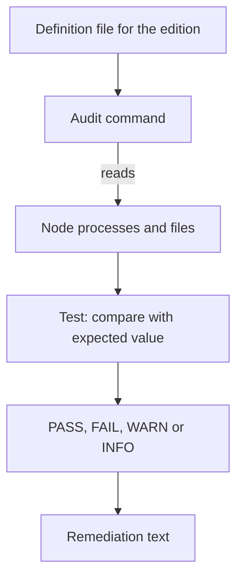

# What kube-bench Does Under The Hood

A report that says `FAIL` is only useful if you know where the word came from. When a result looks wrong, the only way to judge it is to know what the tool read and what it compared. This part opens `kube-bench` and shows its three inputs: the processes on the node, the files on the node, and its own definition files for each benchmark edition.

## Checks are data, not code

`kube-bench` is a program written in Go. It does not have the benchmark rules built into its code. The rules live in YAML definition files that ship with the program, one directory for each benchmark edition. Inside an edition there is one file for each target: the control plane (`master`), the worker node (`node`), `etcd`, the control plane configuration (`controlplane`) and `policies`. A top-level file named `config.yaml` maps Kubernetes versions to editions, so the program can choose an edition by itself.

Each recommendation in a definition file is a small record. The shape below is a simplified example written for this lesson, not a copy of a real check:

```yaml
- id: 1.2.15
  text: "Ensure that the --profiling argument is set to false"
  audit: "/bin/ps -ef | grep kube-apiserver | grep -v grep"
  tests:
    test_items:
    - flag: "--profiling"
      compare:
        op: eq
        value: false
      set: true
  remediation: "Edit the API server pod specification file and set --profiling=false."
  scored: true
```

The `audit` field is a shell command. The `tests` field says how to judge the text that the command prints: which flag to find, how to compare its value, and whether the flag must be present (`set`). The `remediation` field is the text the report prints for a failing check. The `scored` field says if the result counts in the totals. The identifier in this example is only an illustration, because the numbers change between benchmark editions.

## What the audit reads

Most audit commands read one of two things. Flag checks read the arguments of a running process, such as the API server. File checks run `stat` on a file and compare its mode and owner. The program also reads the kubelet configuration file and, for some checks, asks the `kubectl` binary for objects.

This explains a requirement that surprises many learners: `kube-bench` must run where the processes and files are. Run in an ordinary pod, it sees only its own container. To audit a node, the pod must share the process namespace of the node (`hostPID: true`) and it must mount the host directories that the audits read, such as `/etc/kubernetes` and `/var/lib/kubelet`.



The diagram shows that the result comes from a definition file, an audit command that reads the node, and a test that compares the output with an expected value.

## Look inside the image

The `kube-bench` image keeps its definition files in one directory. You can read them without running an audit, by starting a short pod that lists the directory. The image is already loaded on the nodes, so the pod starts without a download.

<!-- astrona:playground:renew -->

```sh
kubectl run kube-bench-list --rm -i --restart=Never --image-pull-policy=IfNotPresent --image=docker.io/aquasec/kube-bench:v0.10.6 --command -- ls /opt/kube-bench/cfg
```

The command prints the names of the edition directories and the file `config.yaml`. The path `/opt/kube-bench/cfg` is where the project's image keeps them. If the command reports that the directory does not exist, the image layout differs, and the same listing is available from the program documentation of that version. Now print the mapping file:

```sh
kubectl run kube-bench-config --rm -i --restart=Never --image-pull-policy=IfNotPresent --image=docker.io/aquasec/kube-bench:v0.10.6 --command -- cat /opt/kube-bench/cfg/config.yaml
```

Look for the part that maps versions to editions, and for the part that maps targets to definition files. Read the highest Kubernetes version in the mapping and compare it with the cluster version, which is 1.35. The mapping lags behind new Kubernetes releases, because a new benchmark edition appears after the Kubernetes version it targets. The next parts return to this limit.

You now know that a result is the output of an audit command, judged by a test from a definition file for one benchmark edition. The next question is how to run the program against a node when it is not installed there.

## Common pitfalls

> [!WARNING]
> - **Running the tool in a plain pod.** Without `hostPID` and the host mounts, the audits read the container, not the node, and many checks fail for the wrong reason.
> - **Trusting a check number.** Identifiers differ between editions. Find a check by the setting it names.
> - **Assuming the tool is the benchmark.** The tool follows a definition file. If the file has a mistake or follows an older edition, the result carries the mistake.
