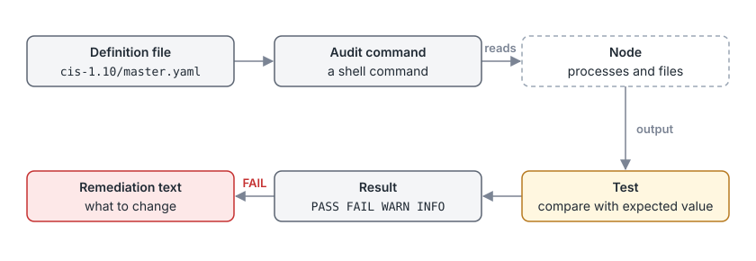
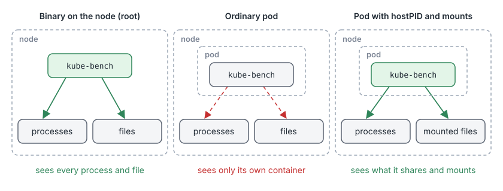

# What kube-bench Does Under The Hood

A report that says `FAIL` is only useful if you know where the word came from. Sooner or later a result looks wrong. Then the only way to judge it is to know what the tool read and what it compared.

This page opens up `kube-bench` and shows its three inputs. The first is the processes that run on the node. The second is the files on the node. The third is the tool's own definition files, one set for each benchmark edition.

## Checks are data, not code

`kube-bench` is a program written in the Go language. The benchmark rules are not built into its code. Instead, the rules live in YAML definition files that ship with the program.

The files are grouped by benchmark edition, with one directory per edition. Inside an edition there is one file for each target. A target is a group of checks for one kind of component:

- `master` holds the control plane checks;
- `node` holds the worker node checks;
- `etcd` holds the checks of the etcd data store;
- `controlplane` holds the checks of the control plane configuration;
- `policies` holds the checks of cluster policies.

A top-level file named `config.yaml` maps Kubernetes versions to editions. With this map, the program can choose an edition by itself.

Each recommendation in a definition file is a small record. The shape below is a simplified example written for this lesson. It is not a copy of a real check:

```yaml
- id: 1.2.15
  text: "Ensure that the --profiling argument is set to false"
  audit: "/bin/ps -ef | grep kube-apiserver | grep -v grep"
  tests:
    test_items:
    - flag: "--profiling"
      compare:
        op: eq
        value: false
      set: true
  remediation: "Edit the API server pod specification file and set --profiling=false."
  scored: true
```

Each field has one job:

- `audit` is a shell command that the program runs on the node.
- `tests` says how to judge the text that the command prints: which flag to find, how to compare its value, and whether the flag must be present (`set`).
- `remediation` is the text the report prints for a failing check. It says what to change.
- `scored` says whether the result counts in the totals.

The identifier `1.2.15` in this example is only an illustration. The numbers change between benchmark editions, so never rely on them across editions.

## What the audit reads

Most audit commands read one of two things. Flag checks read the arguments of a running process, such as the API server. File checks run `stat` on a file and compare its mode and its owner. The program also reads the kubelet configuration file, and for some checks it asks the `kubectl` binary for objects.



The drawing shows the path of one check: the definition file gives the audit command, the command reads the node, the test turns the output into a result, and a failing result points to its remediation text.

This explains a rule that surprises many learners: `kube-bench` must run where the processes and files are. When it runs as root on the node itself, it sees every process and file. When it runs in an ordinary pod, it sees only its own container.

To audit a node from a pod, the pod needs two things. It must share the process namespace of the node, which you turn on with `hostPID: true`. It must also mount the host directories that the audits read, such as `/etc/kubernetes` and `/var/lib/kubelet`.



The drawing compares the three places where `kube-bench` can run and what it can see from each one.

## Look inside the definition files

The definition files are plain text, so you can read them without running an audit. On the playground node they are in `/etc/kube-bench/cfg`. The `kube-bench` container image keeps the same files in `/opt/kube-bench/cfg`.

<!-- astrona:playground:renew -->

Open a shell on the node and list the directories of the CIS editions:

```sh
astrona ssh astro-ats-031-playground-020-02
ls /etc/kube-bench/cfg | grep '^cis-'
```

The output has one line per edition directory:

```text
cis-1.10
cis-1.20
cis-1.23
cis-1.24
cis-1.24-microk8s
cis-1.5
cis-1.6
cis-1.6-k3s
cis-1.7
cis-1.8
cis-1.9
```

The other directories in `/etc/kube-bench/cfg` hold benchmarks for managed services and other Kubernetes distributions, such as `eks-1.5.0` and `gke-1.6.0`. Now look inside one edition. It has one file for each target:

```sh
ls /etc/kube-bench/cfg/cis-1.10
```

```text
config.yaml
controlplane.yaml
etcd.yaml
master.yaml
node.yaml
policies.yaml
```

The top-level `config.yaml` holds the map from Kubernetes versions to editions, in a block named `version_mapping`. Print the newest Kubernetes versions in that block:

```sh
grep -E '^  "1\.(2[89]|3[0-9])"' /etc/kube-bench/cfg/config.yaml
```

```text
  "1.28": "cis-1.9"
  "1.29": "cis-1.9"
  "1.30": "cis-1.10"
  "1.31": "cis-1.10"
```

The highest version in the map is 1.31, but the cluster runs 1.35. The map lags behind new Kubernetes releases, because a new benchmark edition appears only after the Kubernetes version it covers. When the version is not in the map, `kube-bench` tries the next lower minor version until it finds one. So this node is judged with the edition `cis-1.10`. Keep this limit in mind: it matters every time you read a result.

You now know that a result is the output of an audit command, judged by a test from a definition file for one benchmark edition. The open question is how to run the program against a node: as a binary on the node, or as a pod in the cluster.

## Common pitfalls

> [!WARNING]
> - **Running the tool in a plain pod.** Without `hostPID` and the host mounts, the audits read the container, not the node, and many checks fail for the wrong reason.
> - **Trusting a check number.** Identifiers differ between editions. Find a check by the setting it names.
> - **Assuming the tool is the benchmark.** The tool follows a definition file. If the file has a mistake or follows an older edition, the result carries the mistake.
