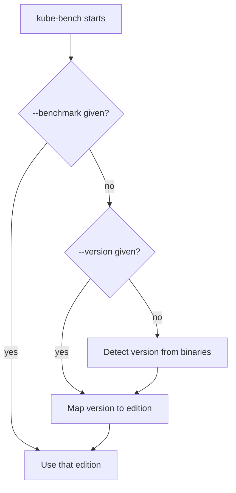

# Targets, Benchmarks And Versions

Running the tool is easy. Running it against the right set of checks is the part that decides if the report means anything. Two choices control this: the target, which says which part of the benchmark to run, and the benchmark edition, which says which version of the rules to use. This part explains both, and what to do when the automatic choice does not fit the cluster.

## Targets

A target is a group of checks that belong to one kind of component. The `--targets` option takes one target or a comma-separated list.

- `master` runs the control plane checks: file permissions, the API server, the controller manager and the scheduler.
- `etcd` runs the checks of the `etcd` data store.
- `controlplane` runs the checks about control plane configuration, such as authentication and audit logging. Most of these are manual.
- `node` runs the worker node checks: kubelet files and the kubelet configuration.
- `policies` runs the checks about cluster policies, such as RBAC and network policies. Nearly all of these are manual.

Which targets exist depends on the edition. Run the tool with a target that the edition does not define, and it reports an error instead of a result. Because the benchmark checks `etcd` as its own target, a control plane Job with `--targets master` does not include the etcd checks. A complete review of a control plane node therefore names `master`, `etcd`, `controlplane` and `policies`, and a review of a worker names `node`.

## Benchmark editions and version detection

Without an option, the program asks for the Kubernetes version and uses its `config.yaml` mapping to choose an edition. The version comes from the `kubectl` or kubelet binary that it can find, or from the `--version` option, which sets the Kubernetes version by hand. The `--benchmark` option skips the mapping and names an edition directly.



The diagram shows the order in which the program decides: an edition named with `--benchmark` wins, then a version given with `--version`, then the version it detects itself.

This is where a mismatch can start. A benchmark edition is written after a Kubernetes release, and the tool needs a release that adds the new edition and mapping. For a cluster at Kubernetes 1.35, the newest edition in your copy of the tool may have been written for an older Kubernetes version. The tool can then pick the newest edition that it knows, report that it cannot map the version, or stop with an error. The exact behaviour depends on the tool version, so read the first lines of the log and note which edition judged the cluster.

When the editions are close, the result is still useful. Most API server and kubelet recommendations are stable for many releases. When the edition is much older, some flags that the benchmark checks no longer exist, and a check can fail only because the flag was removed. The review must say which edition was used and mention the gap.

## Run the etcd target

Run the `etcd` target as its own Job, to see a target that the first Job did not cover. The etcd data directory and the etcd manifest are on the control plane node, so this Job has the same placement and mounts as the control plane Job.

<!-- astrona:playground:renew -->

Save this as `job-kube-bench-etcd.yaml`:

```yaml
apiVersion: batch/v1
kind: Job
metadata:
  name: kube-bench-etcd
  namespace: default
spec:
  backoffLimit: 0
  template:
    spec:
      hostPID: true
      restartPolicy: Never
      nodeSelector:
        node-role.kubernetes.io/control-plane: ""
      tolerations:
      - key: node-role.kubernetes.io/control-plane
        operator: Exists
        effect: NoSchedule
      containers:
      - name: kube-bench
        image: docker.io/aquasec/kube-bench:v0.10.6
        imagePullPolicy: IfNotPresent
        command: ["kube-bench", "run", "--targets", "etcd"]
        volumeMounts:
        - {name: var-lib-etcd, mountPath: /var/lib/etcd, readOnly: true}
        - {name: etc-kubernetes, mountPath: /etc/kubernetes, readOnly: true}
        - {name: usr-bin, mountPath: /usr/local/mount-from-host/bin, readOnly: true}
      volumes:
      - {name: var-lib-etcd, hostPath: {path: /var/lib/etcd}}
      - {name: etc-kubernetes, hostPath: {path: /etc/kubernetes}}
      - {name: usr-bin, hostPath: {path: /usr/bin}}
```

Apply it and print the start and the end of the log:

```sh
kubectl apply -f job-kube-bench-etcd.yaml
kubectl -n default wait --for=condition=complete job/kube-bench-etcd --timeout=180s
kubectl -n default logs job/kube-bench-etcd | head -n 6
kubectl -n default logs job/kube-bench-etcd | tail -n 8
```

The log has only section 2 of the benchmark, and the summary counts only those checks. The check numbers in this log start with 2, because the benchmark keeps the etcd checks in its own section. To choose the edition yourself, add `--benchmark` and the edition name to the `command` line of the Job. List the edition names with `ls /opt/kube-bench/cfg` in a short pod that uses the `kube-bench` image, and remember that a wrong name makes the program stop with an error.

Target and edition now decide which checks run. The next step is to read what the program prints for them.

## Common pitfalls

> [!WARNING]
> - **Auditing a control plane without `etcd`.** The `master` target does not include the etcd checks. Name every target you need.
> - **Not noting the edition.** A report without the edition name cannot be compared or repeated.
> - **Forcing an edition to get green results.** Choose the edition closest to the cluster version, not the one with the fewest failures.
> - **Assuming 1.35 has its own edition.** A new Kubernetes release can lack a matching edition. State that gap in the review.
