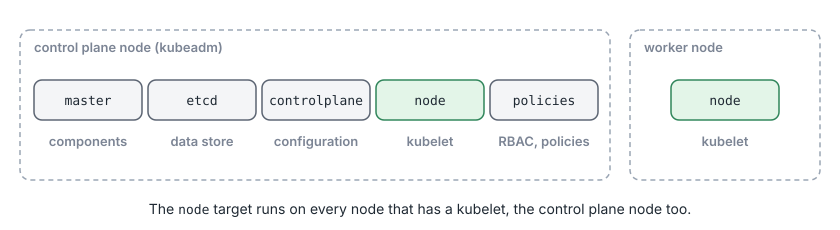
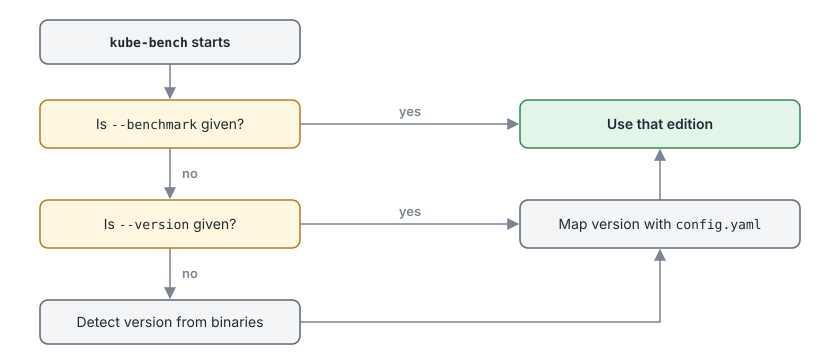
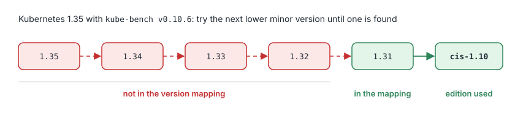

# Targets, Benchmarks And Versions

Running the tool is easy. Running it against the right set of checks is what decides whether the report means anything. Two choices control this.

The target says which part of the benchmark to run. The benchmark edition says which version of the rules to use. This page explains both choices, and what to do when the automatic choice does not fit the cluster.

## Targets

A target is a group of checks that belong to one kind of component. The `--targets` option takes one target or a comma-separated list of targets:

- `master` runs the control plane checks: file permissions, the API server, the controller manager and the scheduler.
- `etcd` runs the checks of the `etcd` data store.
- `controlplane` runs the checks about the control plane configuration, such as authentication and audit logging. Most of these checks are manual.
- `node` runs the node checks: the kubelet files and the kubelet configuration. The benchmark calls them worker node checks, but every node that runs a kubelet needs them, the control plane node too.
- `policies` runs the checks about cluster policies, such as role-based access control (RBAC) and network policies. Nearly all of these checks are manual.

Which targets exist depends on the edition. If you name a target that the edition does not define, the tool reports an error instead of a result.

The benchmark checks `etcd` as its own target, so a run with `--targets master` does not include the etcd checks. A complete review of a kubeadm control plane node therefore names `master`, `etcd`, `controlplane`, `node` and `policies`. A review of a worker node names `node`.



The drawing shows which targets belong to which kind of node.

## Benchmark editions and version detection

The second choice is the edition. Without an option, the program finds the Kubernetes version and uses the map in its `config.yaml` file to choose an edition. It reads the version from the `kubectl` or `kubelet` binary that it can find.

Two options change this. The `--version` option sets the Kubernetes version by hand, and the program still uses the map. The `--benchmark` option skips the map and names an edition directly.



The drawing shows the order in which the program decides: an edition named with `--benchmark` wins, then a version given with `--version`, then the version it detects itself.

This order is where a mismatch can start. A benchmark edition is written after a Kubernetes release. Then the tool needs its own new release that adds the new edition and its map entry. `kube-bench` v0.10.6 maps Kubernetes versions only up to 1.31.

For a version that is not in the map, the tool tries the next lower minor version until it finds one. So a 1.35 cluster is judged with `cis-1.10`, the edition for Kubernetes 1.30 and 1.31. Other tool versions can behave differently, so always check which edition judged the cluster.



The drawing shows the search from 1.35 down to 1.31, the first version in the map.

When the editions are close, the result is still useful. Most API server and kubelet recommendations stay the same for many releases. When the edition is much older, some flags that the benchmark checks no longer exist, and a check can fail only because the flag was removed. The review must say which edition was used and mention the gap.

## Run the etcd target and choose an edition

The etcd data store holds the whole state of the cluster, and the benchmark checks it in its own section. Run the `etcd` target now, to see a target that a `master` run does not cover. The etcd manifest and the etcd data directory are on the control plane node, so you run it there.

<!-- astrona:playground:renew -->

Open a shell on the node and print the start and the end of the report:

```sh
astrona ssh astro-ats-031-playground-020-02
sudo kube-bench run --targets etcd | head -n 6
sudo kube-bench run --targets etcd | tail -n 6
```

```text
[INFO] 2 Etcd Node Configuration
[INFO] 2 Etcd Node Configuration
[PASS] 2.1 Ensure that the --cert-file and --key-file arguments are set as appropriate (Automated)
[PASS] 2.2 Ensure that the --client-cert-auth argument is set to true (Automated)
[PASS] 2.3 Ensure that the --auto-tls argument is not set to true (Automated)
[PASS] 2.4 Ensure that the --peer-cert-file and --peer-key-file arguments are set as appropriate (Automated)
== Summary total ==
7 checks PASS
0 checks FAIL
0 checks WARN
0 checks INFO
```

The report has only section 2 of the benchmark, and the summary counts only those checks. kubeadm starts etcd with client certificates and peer certificates, so all seven checks pass.

To choose the edition yourself, add `--benchmark` and the name of an edition directory. Run the `master` target with the older edition `cis-1.9`:

```sh
sudo kube-bench run --targets master --benchmark cis-1.9 | tail -n 6
```

```text
== Summary total ==
39 checks PASS
9 checks FAIL
11 checks WARN
0 checks INFO
```

On this node, the two editions give the same totals for the `master` target. That is not always true. When you change the edition, compare the failing checks, not only the totals.

A wrong edition name, or a target that the edition does not define, stops the program with an error:

```sh
sudo kube-bench run --targets master --benchmark cis-9.9
sudo kube-bench run --targets kubelet
```

```text

error validating targets: No targets configured for cis-9.9

The specified --targets "kubelet" are not configured for the CIS Benchmark cis-1.10\n Valid targets [master node controlplane etcd policies]
```

Each message starts with an empty line. The second message lists the valid targets of the edition. The program prints the `\n` in it as two plain characters, not as a new line.

You now know how the target and the edition decide which checks run, and how to see which edition the tool chose. The open question is how to read what the program prints for those checks.

## Common pitfalls

> [!WARNING]
> - **Auditing a control plane without `etcd`.** The `master` target does not include the etcd checks. Name every target you need.
> - **Not noting the edition.** A report without the edition name cannot be compared or repeated.
> - **Forcing an edition to get green results.** Choose the edition closest to the cluster version, not the one with the fewest failures.
> - **Assuming 1.35 has its own edition.** `kube-bench` v0.10.6 judges 1.35 with `cis-1.10`. State that gap in the review.
