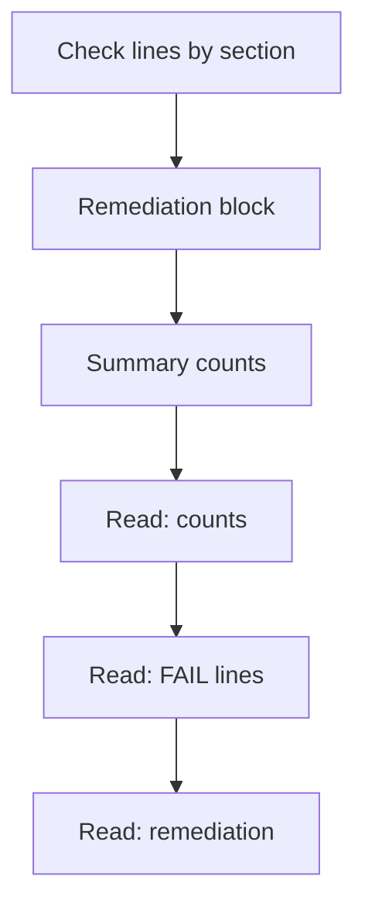

---
exam_objectives:
- Use CIS benchmark to review the security configuration of Kubernetes components
  (etcd, kubelet, kubedns, kubeapi)
---
# Read A Result

A report of several hundred lines is useless if you read it from the top without a plan. A reviewer reads the counts first, then the failures, then the remediation of the failures that matter. This part shows the layout of the text report and the order in which to read it, using a report of the control plane checks from the playground node.

## Four states

Every check line starts with a state in square brackets, then the check number and the title. The states mean different things:

- `[PASS]` means the audit found the expected value.
- `[FAIL]` means the audit ran and found a different value, or found no value where one is required.
- `[WARN]` means the check is manual, or the audit could not decide. A person must judge it.
- `[INFO]` is a note about something the tool does not score.

The log has three blocks. First come the check lines, grouped by section. Then comes the remediation block, which holds the text for every `FAIL` and `WARN`. Last comes the summary, with a count of each state per target and a total.



The diagram shows the three blocks of the log in the order the tool prints them, and the order in which a reviewer reads them: counts, failures, remediation.

## Read the counts and the failures

The commands in this part read a report of the `master` target that you save in a file on the node. A file lets you search the same report many times without running the audit again.

<!-- astrona:playground:renew -->

Open a shell on the node, save the report and read the summary at its end:

```sh
astrona ssh astro-ats-031-playground-020-02
sudo kube-bench run --targets master > master.txt
tail -n 10 master.txt
```

```text
9 checks FAIL
11 checks WARN
0 checks INFO

== Summary total ==
39 checks PASS
9 checks FAIL
11 checks WARN
0 checks INFO

```

The first lines belong to the summary of the `master` target, and the block under `== Summary total ==` adds up all targets of the run. With one target the two are the same. Note how many checks passed, failed and warned. Then list only the failures:

```sh
grep '^\[FAIL\]' master.txt
```

```text
[FAIL] 1.1.12 Ensure that the etcd data directory ownership is set to etcd:etcd (Automated)
[FAIL] 1.2.5 Ensure that the --kubelet-certificate-authority argument is set as appropriate (Automated)
[FAIL] 1.2.15 Ensure that the --profiling argument is set to false (Automated)
[FAIL] 1.2.16 Ensure that the --audit-log-path argument is set (Automated)
[FAIL] 1.2.17 Ensure that the --audit-log-maxage argument is set to 30 or as appropriate (Automated)
[FAIL] 1.2.18 Ensure that the --audit-log-maxbackup argument is set to 10 or as appropriate (Automated)
[FAIL] 1.2.19 Ensure that the --audit-log-maxsize argument is set to 100 or as appropriate (Automated)
[FAIL] 1.3.2 Ensure that the --profiling argument is set to false (Automated)
[FAIL] 1.4.1 Ensure that the --profiling argument is set to false (Automated)
```

On a cluster with the kubeadm defaults, most `FAIL` lines belong to the API server, for settings such as profiling and audit logging that kubeadm does not set. The controller manager (`1.3.2`) and the scheduler (`1.4.1`) also run with profiling turned on. One file check fails too: `1.1.12` expects the etcd data directory to belong to an `etcd` user.

Choose one failure and read its remediation. The remediation block repeats the check number and prints the flag on a line of its own, so you can search by the setting instead of by a number:

```sh
grep -B2 -- '^--profiling=false' master.txt
```

```text
1.2.15 Edit the API server pod specification file /etc/kubernetes/manifests/kube-apiserver.yaml
on the control plane node and set the below parameter.
--profiling=false
--
1.3.2 Edit the Controller Manager pod specification file /etc/kubernetes/manifests/kube-controller-manager.yaml
on the control plane node and set the below parameter.
--profiling=false
--
1.4.1 Edit the Scheduler pod specification file /etc/kubernetes/manifests/kube-scheduler.yaml file
on the control plane node and set the below parameter.
--profiling=false
```

The text names the file to edit, which is the static pod manifest of each component on the control plane node, and the flag to set. When the file changes, the kubelet restarts the component with the new flag. The `--` lines come from `grep` and separate the matches. The remediation text is general advice for a standard installation. It does not know the layout of your cluster, so check each path before you use it.

## Count by section

The check number tells you the component, because the benchmark sections follow the components. A quick way to see where the failures are is to count the failing lines by the first two parts of the number.

```sh
grep '^\[FAIL\]' master.txt | awk '{print $2}' | cut -d. -f1,2 | sort | uniq -c
```

```text
      1 1.1
      6 1.2
      1 1.3
      1 1.4
```

Section `1.1` holds the file checks, `1.2` the API server, `1.3` the controller manager and `1.4` the scheduler. Six of the nine failures are API server settings. This view tells you where to spend time, and it gives you a before and after comparison once you fix settings.

You can now read the text report. The log is long, so the next step is to run only some checks and how to keep a machine-readable copy.

## Common pitfalls

> [!WARNING]
> - **Reading the log from the top.** Read the summary, then the failures, then the remediation of the failures you will fix.
> - **Treating `[WARN]` as `[PASS]`.** A warning means that nobody has judged the check yet.
> - **Copying the remediation blindly.** The text describes a standard layout. Confirm the real file path and the current value first.
> - **Searching by number across editions.** Search by the setting name, because numbers change.
