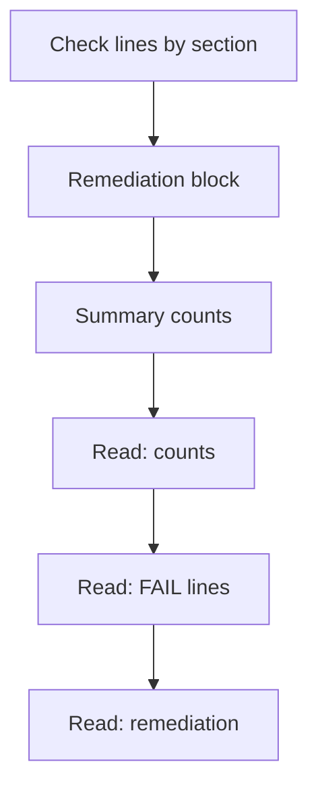

# Read A Result

A report of several hundred lines is useless if you read it from the top without a plan. A reviewer reads the counts first, then the failures, then the remediation of the failures that matter. This part shows the layout of the text report and the order in which to read it, using the log of the control plane Job that already exists in the playground.

## Four states

Every check line starts with a state in square brackets, then the check number and the title. The states mean different things:

- `[PASS]` means the audit found the expected value.
- `[FAIL]` means the audit ran and found a different value, or found no value where one is required.
- `[WARN]` means the check is manual, or the audit could not decide. A person must judge it.
- `[INFO]` is a note about something the tool does not score.

The log has three blocks. First come the check lines, grouped by section. Then comes the remediation block, which holds the text for every `FAIL` and `WARN`. Last comes the summary, with a count of each state per target and a total.



The diagram shows the three blocks of the log in the order the tool prints them, and the order in which a reviewer reads them: counts, failures, remediation.

## Read the counts and the failures

Start with the summary at the end of the control plane log. The commands in this part read the log of a Job named `kube-bench-master` in the `default` namespace, which runs `kube-bench run --targets master` on the control plane node. If the playground does not have this Job, run the control plane audit as a Job with that name first.

<!-- astrona:playground:renew -->

```sh
kubectl -n default logs job/kube-bench-master | tail -n 10
```

Note how many checks passed, failed and warned. Then list only the failures:

```sh
kubectl -n default logs job/kube-bench-master | grep '^\[FAIL\]' | head -n 15
```

On a cluster with the kubeadm defaults, several `FAIL` lines belong to the API server, for settings such as profiling and admission plugins that kubeadm does not set. File permission lines can also appear. Choose one failure and read its remediation. The remediation block repeats the check number, so search the log for the check you chose. This example searches for the profiling setting by name, which avoids relying on a number:

```sh
kubectl -n default logs job/kube-bench-master | grep -i -B1 -A3 'profiling'
```

The text names the file to edit, which is the API server pod specification file on the control plane node, and the flag to set. It also describes how to restart: for a static pod the kubelet restarts the component when the file changes. The remediation text is general advice for a standard installation. It does not know the layout of your cluster, so check each path before you use it.

## Count by section

The check number tells you the component, because the benchmark sections follow the components. A quick way to see where the failures are is to count the failing lines by the first two parts of the number.

```sh
kubectl -n default logs job/kube-bench-master | grep '^\[FAIL\]' | awk '{print $2}' | cut -d. -f1,2 | sort | uniq -c
```

The output lists, for each section such as the file permissions or the API server, how many checks failed. This view tells you where to spend time, and it gives you a before and after comparison once you fix settings.

You can now read the text report. The log is long, so the next step is to run only some checks and how to keep a machine-readable copy.

## Common pitfalls

> [!WARNING]
> - **Reading the log from the top.** Read the summary, then the failures, then the remediation of the failures you will fix.
> - **Treating `[WARN]` as `[PASS]`.** A warning means that nobody has judged the check yet.
> - **Copying the remediation blindly.** The text describes a standard layout. Confirm the real file path and the current value first.
> - **Searching by number across editions.** Search by the setting name, because numbers change.
