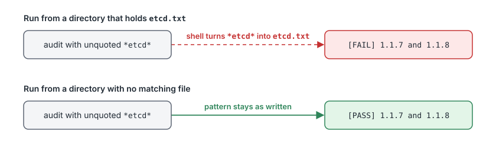
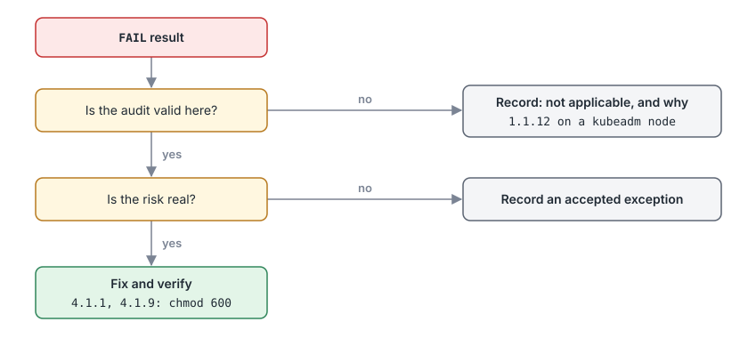

# Manual Checks And False Findings

An automated report ends with counts, and a manager may read only those counts. A reviewer must know what the counts leave out. Some results need a person to decide, and some results are simply wrong for the cluster in front of you.

This page explains what `WARN` and `INFO` mean in practice, and why a `PASS` can still hide a risk. It shows why some `FAIL` results are not real findings on a kubeadm node, and how to separate the score from the risk. The page has no commands, because the reasoning applies to the reports you already have.

## Manual checks

Some recommendations cannot be decided by a command. The benchmark marks these checks as manual. `kube-bench` prints them as `WARN` and shows the audit text for a person to follow. Some examples of manual questions:

- Does the audit policy cover the right resources?
- Does the cluster use a separate certificate authority for etcd?
- Are secrets read from files instead of environment variables?
- Do network policies exist in every namespace?

A `WARN` is a task. It is not a pass and not a failure. The reviewer follows the audit text, decides, and records the decision.

`INFO` lines carry context, for example a note that a check does not apply to this installation. They are not scored and need no action. Still, they can explain why a count looks the way it does.

## A pass is as good as its audit

Each automated check looks at one thing only. Take an audit that searches the process arguments. A `PASS` means the flag has the right value in the running process. It does not mean that the setting works as intended, that the file named in the flag exists, or that the rest of the configuration is safe.

For example, an audit policy flag that points to an empty policy file passes the "flag is set" check. Yet the API server records nothing useful.

Two more limits apply. First, the tool reads the state at the moment of the run, so a later change can undo a fix. Second, the tool trusts what it reads. A process can get a setting in a way that the audit command does not match, for example through a configuration file instead of a flag. Then the tool can report a `FAIL` for a setting that is in fact correct, or a `PASS` for one that is overridden.

## False findings on a kubeadm node

A false finding is a `FAIL` that does not describe a real risk on this cluster. The audit ran, but its expectation does not fit the installation, or something else changed its result. The playground node is a kubeadm node with Kubernetes 1.35, judged by the edition `cis-1.10`, and it shows two kinds of false finding.

### An expectation the installation does not share

Check `1.1.12` expects the etcd data directory `/var/lib/etcd` to belong to the user and group `etcd:etcd`. kubeadm runs etcd as a static pod and creates no `etcd` user on the node. So the directory belongs to `root:root` with mode `700`, and only root can read it.

The audit is not wrong for an installation that runs etcd as its own user. On a kubeadm node, though, the right record is "not applicable". A `chown` to a user that does not exist is not the answer.

### A result changed by the way the tool runs

The audits of checks `1.1.7` and `1.1.8` contain the pattern `*etcd*` without quotes. The shell matches such a pattern against the files of the current directory first. On the playground node, running `kube-bench` from a directory that held a file named `etcd.txt` turned both checks into `FAIL`. Running it from another directory gave `PASS` again.

The drawing shows how the same audit gives two results, depending only on the files in the current directory.

Other ways of running the tool cause the same kind of problem. A Job with missing host mounts reports `WARN` for checks whose files it cannot see. And when the benchmark edition is older than the Kubernetes version, a check can fail because it looks for a flag or a file that no longer exists.

## Real findings

Not every `FAIL` from the node checks is false. Check `4.1.1` fails because the kubelet systemd unit file `/lib/systemd/system/kubelet.service` has mode `644`. Check `4.1.9` fails because `/var/lib/kubelet/config.yaml` has mode `644`. Those are real settings on a real host, and `chmod 600` fixes both.

Some real findings need a decision before a fix. Check `1.2.5` wants the flag `--kubelet-certificate-authority` on the API server. With it, the API server verifies the serving certificate of each kubelet, which is the certificate the kubelet shows when the API server connects to it.

By default, each kubelet of a kubeadm cluster creates its own serving certificate. That certificate is signed by a certificate authority that only that kubelet knows. If you add the flag without first changing how the kubelets get their certificates, requests from the API server to the kubelet fail. Those requests include `kubectl logs` and `kubectl exec`. The risk is real, but the fix is a project, so the reviewer records it as an accepted exception with a plan.

## Decide before you change anything

For each false finding, the reviewer does not change the cluster to turn the line green. The reviewer reads the audit, finds the real value on the node, and writes down why the finding does not apply. This record is as important as a fix. A reviewer who changes a working cluster to satisfy a mismatched check creates a risk just to remove a warning.

The drawing shows the two questions to ask before any change: whether the audit fits this cluster, and whether the risk is real.

## Score versus risk

The summary counts treat all checks the same, so a cluster with fewer failures is not always safer. One failing check on the exposed kubelet port can matter more than ten failing checks on log retention.

The benchmark also gives each check two labels. A check is either scored or not scored. And it belongs to profile level 1 or level 2. Level 2 settings can make the cluster harder to use, and they are meant for environments that need stronger protection.

A useful review therefore reports three lists:

- the findings that were fixed, with the evidence;
- the findings that were accepted or are not applicable, with the reason;
- the manual checks, with the decision a person made.

The raw counts are an attachment, not the result.

You can now read a `kube-bench` result with its limits in mind. The tool finds candidates. A person decides which findings are real and proves each fix.

## Common pitfalls

> [!WARNING]
> - **Reporting the pass rate as the security level.** The rate says nothing about the risk of the failing checks.
> - **Skipping `WARN` lines.** They are the checks nobody has judged yet.
> - **Changing a working cluster to clear a false finding.** Record the reason instead.
> - **Reporting a managed control plane as checked.** On a managed service you cannot read the control plane, so those results are not yours to claim.
