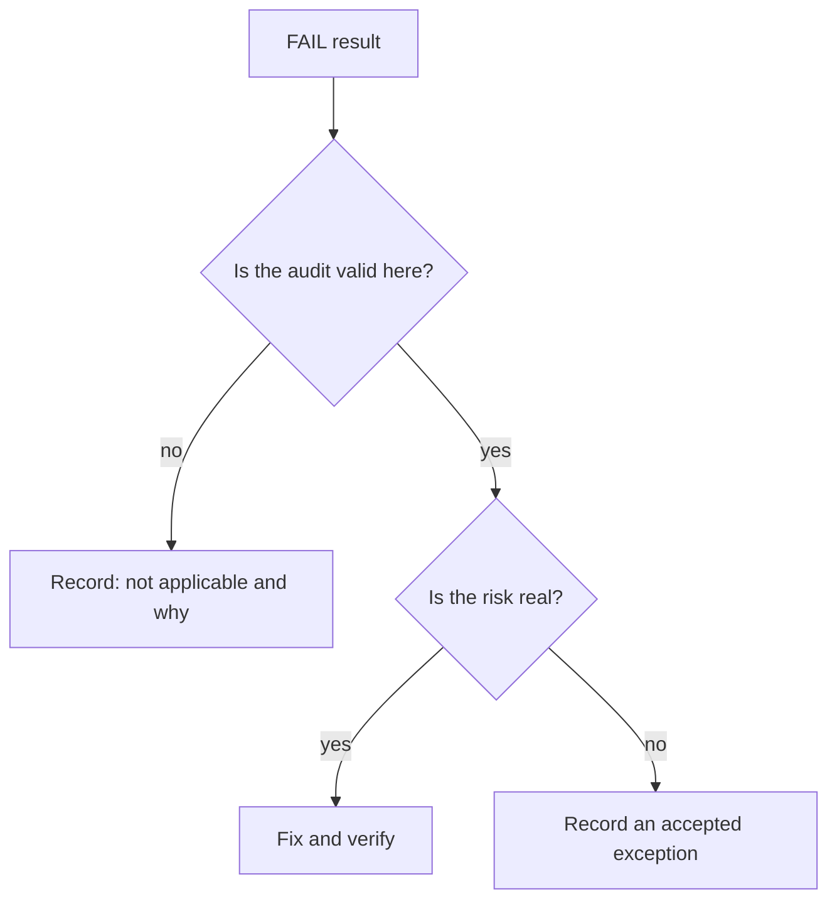

# Manual Checks And False Findings

An automated report ends with counts, and a manager may read only the counts. A reviewer must know what those counts leave out. This part explains what `WARN` and `INFO` mean in practice, why a `PASS` can still hide a risk, why some `FAIL` results are not real findings in a kind cluster, and how to separate score from risk. It has no commands, because the reasoning applies to the logs you already have.

## Manual checks

Some recommendations cannot be decided by a command. The benchmark marks these as manual. `kube-bench` prints them as `WARN` and shows the audit text for a person to follow. Examples are the questions whether the audit policy covers the right resources, whether the cluster uses a separate certificate authority for etcd, whether secrets are read from files instead of environment variables, and whether network policies exist in every namespace.

A `WARN` is a task, not a pass and not a failure. The reviewer follows the audit text, decides, and records the decision. `INFO` lines carry context, for example a note that a check does not apply to this installation. They are not scored and need no action, but they can explain why a count looks as it does.

## A pass is as good as its audit

Each automated check looks at one thing. A `PASS` for an audit that searches the process arguments means the flag has the right value in the running process. It does not mean that the setting works as intended, that the file in the flag exists, or that the rest of the configuration is safe. An audit policy flag that points to an empty policy file passes the "flag is set" check and records nothing useful.

Two more limits apply. The tool reads the state at the moment of the run, so a later change can undo a fix. And the tool trusts what it reads: a process started with a flag that the audit command does not match, for example through a configuration file instead of a flag, can produce a `FAIL` for a setting that is in fact correct, or a `PASS` for one that is overridden.

## False findings in a kind cluster

A kind node is a container that runs a kubeadm style cluster. Several `FAIL` results come from this setup and not from a design error. File ownership checks expect users and groups of a real host. Checks about the container network interface read files that the kind network plugin lays out differently. Checks about the kubelet service file read systemd paths that the node image may not keep where the audit expects. When the benchmark edition is older than Kubernetes 1.35, a check can fail because it looks for a flag or a file that no longer exists.

For each such result, the reviewer does not change the cluster to turn the line green. The reviewer reads the audit, finds the real value on the node, and writes down why the finding does not apply. This record is as important as a fix. A reviewer who changes a working cluster to satisfy a mismatched check creates a risk to remove a warning.

The diagram shows two questions before any change: whether the audit fits this cluster, and whether the risk is real.

## Score versus risk

The summary counts treat all checks equally, and a cluster with fewer failures is not always safer. One failing check on the exposed kubelet port can matter more than ten failing checks on log retention. The benchmark also marks checks as scored or not scored, and profile level 1 or level 2. Level 2 settings can reduce usability and are meant for environments that need stronger protection.

A useful review therefore reports three lists: findings fixed with the evidence, findings accepted or not applicable with the reason, and manual checks decided by a person. The raw counts are an attachment, not the result.

You can now read a `kube-bench` result with its limits in mind. The tool finds candidates. A person decides which findings are real and proves each fix.

## Common pitfalls

> [!WARNING]
> - **Reporting the pass rate as the security level.** The rate says nothing about the risk of the failing checks.
> - **Skipping `WARN` lines.** They are the checks nobody has judged yet.
> - **Changing a working cluster to clear a false finding.** Record the reason instead.
> - **Reporting a managed control plane as checked.** On a managed service you cannot read the control plane, so those results are not yours to claim.
