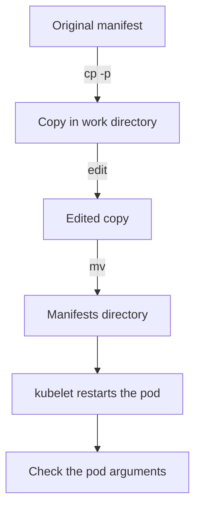

# Static Pods And Safe Editing

When a benchmark check fails on the API server, the fix is a change to a file on the control plane node. A wrong change can stop the component that you need to repair the cluster. This part shows how the kubelet runs control plane components from files, how to edit such a file in a way that limits the damage, and how to find the cause and recover when the component does not start.

## How a static pod works

A static pod is a pod that the kubelet of one node creates from a manifest file on that node. The kubelet watches a directory, which on a kubeadm node is `/etc/kubernetes/manifests`. For each file it starts a pod. When the file changes, the kubelet stops the old container and starts a new one. When the file disappears, the pod is deleted. The API server is not involved, which is why the kubelet can start the API server itself.

For each static pod the kubelet also creates a mirror pod object in the API, so that `kubectl get pods -n kube-system` shows it. The mirror pod is read only. Editing it with `kubectl` has no effect on the component. Only the file counts.

Three facts affect how you edit. The kubelet reads every file in the directory that does not start with a dot, so a backup file placed there, such as `kube-apiserver.yaml.bak`, can start a second pod or fail with an error. The kubelet notices a change by watching the directory, so a file that is only partly written can be read in a half state. And a restart of the API server takes tens of seconds, during which `kubectl` does not answer.

## Edit through a copy

The safe method has four steps. Copy the manifest to a work directory outside the manifests directory and keep the file mode. Edit the copy. Move the copy over the original in one step, so that the kubelet never sees a half written file. Wait for the new pod and check the value. The work directory must be on the same file system as the manifests, so that the move is a rename. The directory `/etc/kubernetes/edit` serves this purpose.



The diagram shows that the original is never edited in place: the copy is edited outside the watched directory and then renamed into it.

A copy of every original manifest was saved in `/opt/training/backup` when the playground started. Look at the directory and at the backups:

<!-- astrona:playground:renew -->

```sh
NODE=astro-ats-031-playground-020-03-control-plane
podman exec $NODE ls -l /etc/kubernetes/manifests /opt/training/backup
```

The first listing shows the four control plane manifests: `etcd`, `kube-apiserver`, `kube-controller-manager` and `kube-scheduler`. The mode of the three that this playground widened is `-rw-r--r--`, which is `644`. The backup keeps the original mode. List the running control plane containers with the container runtime tool of the node, `crictl`, which talks to the container runtime and not to the API server:

```sh
podman exec $NODE crictl ps --name kube-scheduler
```

## Break and recover the scheduler

You practise recovery on the scheduler, because a stopped scheduler does not stop the API. The edit adds a flag that does not exist. Make the copy, add the flag after the `--bind-address` line, and move the copy into place.

```sh
podman exec $NODE mkdir -p /etc/kubernetes/edit
podman exec $NODE cp -p /etc/kubernetes/manifests/kube-scheduler.yaml /etc/kubernetes/edit/kube-scheduler.yaml
podman exec $NODE sed -i 's|^\( *\)- --bind-address=127.0.0.1|&\n\1- --no-such-flag=true|' /etc/kubernetes/edit/kube-scheduler.yaml
podman exec $NODE mv /etc/kubernetes/edit/kube-scheduler.yaml /etc/kubernetes/manifests/kube-scheduler.yaml
```

If your manifest has no `--bind-address=127.0.0.1` line, the `sed` command changes nothing. Then add the flag by hand in the copy with an editor before you move it. After about half a minute, list all containers, including the stopped ones, and read the log of the newest scheduler container:

```sh
podman exec $NODE crictl ps -a --name kube-scheduler
podman exec $NODE crictl logs $(podman exec $NODE crictl ps -a --name kube-scheduler -q | head -n 1)
```

The first command shows a scheduler container that exited. The second prints the reason, which for an unknown flag is an error line from the scheduler that names the flag. This is the method for any control plane failure: find the container with `crictl ps -a`, read its log with `crictl logs`, and fix the manifest. With the API server down, `crictl` is the only tool that works.

Restore the original from the backup, through the same move:

```sh
podman exec $NODE cp -p /opt/training/backup/kube-scheduler.yaml /etc/kubernetes/edit/kube-scheduler.yaml
podman exec $NODE mv /etc/kubernetes/edit/kube-scheduler.yaml /etc/kubernetes/manifests/kube-scheduler.yaml
kubectl -n kube-system get pods -l component=kube-scheduler
```

The mirror pod returns to `Running` and `1/1` ready after the kubelet restarts the container. You now have the loop for every change in this module: copy, edit, move, wait, verify, and a backup to return to. The loop now applies to the flags that control who can reach the API server.

## Common pitfalls

> [!WARNING]
> - **Leaving a backup in the manifests directory.** The kubelet reads every file there. Keep backups elsewhere.
> - **Editing in place with an editor that writes temporary files.** Some editors create files in the directory while saving. Edit a copy and move it.
> - **Forgetting the file mode.** A plain `cp` without `-p` can change the mode of the file. Use `cp -p`, and check the mode afterwards.
> - **Looking for the log with `kubectl`.** When the API server is down, only `crictl` on the node shows the container log.
