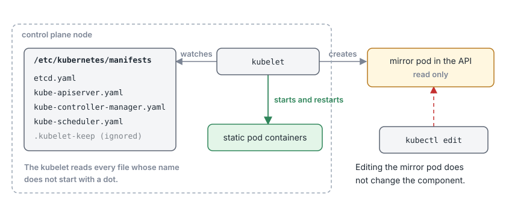
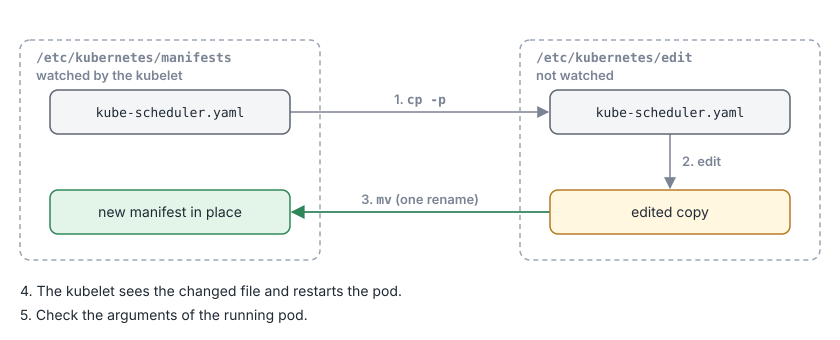

# Static Pods And Safe Editing

When a benchmark check fails on the API server, the fix is a change to a file on the control plane node. A wrong change can stop the very component that you need to repair the cluster. On this page, you see how the kubelet runs the control plane components from files. You also learn a way to edit such a file that limits the damage, and how to find the cause and recover when a component does not start.

## How a static pod works

A static pod is a pod that the kubelet of one node creates from a manifest file on that node. The kubelet watches a directory, which on a kubeadm node is `/etc/kubernetes/manifests`. For each file in it, the kubelet starts a pod.

When a file changes, the kubelet stops the old container and starts a new one. When a file disappears, the kubelet deletes the pod. The API server is not involved in any of this. That is why the kubelet can start the API server itself.

For each static pod, the kubelet also creates a mirror pod object in the API, so that `kubectl get pods -n kube-system` shows it. The mirror pod is read only. Editing it with `kubectl` has no effect on the component. Only the file counts.



The drawing shows that the file on the node is the only place where a change takes effect, while the mirror pod in the API is only a read-only view.

Three facts affect how you edit these files:

- The kubelet reads every file in the directory whose name does not start with a dot. A backup file placed there, such as `kube-apiserver.yaml.bak`, can start a second pod or fail with an error.
- The kubelet notices a change by watching the directory. It can read a file that is only partly written, in a half-finished state.
- A restart of the API server takes tens of seconds. During that time, `kubectl` does not answer.

## Edit through a copy

These three facts lead to a safe method with four steps. First, copy the manifest to a work directory outside the manifests directory and keep the file mode. Second, edit the copy. Third, move the copy over the original in one step, so that the kubelet never sees a half-written file. Fourth, wait for the new pod and check the value.

The work directory must be on the same file system as the manifests, so that the move is a rename. The directory `/etc/kubernetes/edit` serves this purpose.



The drawing shows that you never edit the original in place: you edit the copy outside the watched directory and then rename it into that directory.

When the playground started, it saved a copy of every original manifest in `/opt/training/backup`. The files belong to `root`, so you work in a shell on the node and use `sudo`. Open the shell. You log in as the `student` user, and the second command shows that `kubectl` points at this cluster:

<!-- astrona:playground:renew -->

```sh
astrona ssh astro-ats-031-playground-020-03
kubectl config current-context
```

The context is `kubernetes-admin@astro-ats-031-playground-020-03`. Run every other command on this page in that shell. Commands with `sudo` change only the playground VM, not your own computer. Now look at the manifests directory and at the backups:

```sh
sudo ls -l /etc/kubernetes/manifests /opt/training/backup
```

The output on the playground node:

```text
/etc/kubernetes/manifests:
total 16
-rw------- 1 root root 2624 Nov 18 08:52 etcd.yaml
-rw-r--r-- 1 root root 3940 Nov 18 08:52 kube-apiserver.yaml
-rw-r--r-- 1 root root 3480 Nov 18 08:52 kube-controller-manager.yaml
-rw-r--r-- 1 root root 1727 Nov 18 08:52 kube-scheduler.yaml

/opt/training/backup:
total 16
-rw------- 1 root root 2624 Nov 18 08:52 etcd.yaml
-rw------- 1 root root 3940 Nov 18 08:52 kube-apiserver.yaml
-rw------- 1 root root 3480 Nov 18 08:52 kube-controller-manager.yaml
-rw------- 1 root root 1727 Nov 18 08:52 kube-scheduler.yaml
```

The first listing shows the four control plane manifests: `etcd`, `kube-apiserver`, `kube-controller-manager` and `kube-scheduler`. The three manifests that this playground widened have the mode `-rw-r--r--`, which is `644`. The backups keep the original mode, `600`.

The directory also holds a hidden empty file, `.kubelet-keep`, which `ls -a` shows. The kubelet ignores it because its name starts with a dot.

Next, list the running scheduler container with `crictl`, the command-line tool of the container runtime. It talks to the container runtime (containerd on this node), not to the API server:

```sh
sudo crictl ps --name kube-scheduler
```

The output shows one container in the state `Running`, with the pod `kube-scheduler-astro-ats-031-playground-020-03` in the `kube-system` namespace.

## Break and recover the scheduler

Now that you know where the files are, you can practise a recovery. You practise on the scheduler, because a stopped scheduler does not stop the API. The edit adds a flag that does not exist. Make the copy, add the flag after the `--bind-address` line, check the copy, and move it into place:

```sh
sudo mkdir -p /etc/kubernetes/edit
sudo cp -p /etc/kubernetes/manifests/kube-scheduler.yaml /etc/kubernetes/edit/kube-scheduler.yaml
sudo sed -i 's|^\( *\)- --bind-address=127.0.0.1|&\n\1- --no-such-flag=true|' /etc/kubernetes/edit/kube-scheduler.yaml
sudo grep -n -e bind-address -e no-such /etc/kubernetes/edit/kube-scheduler.yaml
sudo mv /etc/kubernetes/edit/kube-scheduler.yaml /etc/kubernetes/manifests/kube-scheduler.yaml
```

The `grep` command prints `15:    - --bind-address=127.0.0.1` and `16:    - --no-such-flag=true`. If your manifest has no `--bind-address=127.0.0.1` line, the `sed` command changes nothing. In that case, add the flag by hand in the copy with an editor, such as `sudo vi`, before you move it.

After about half a minute, list all scheduler containers, including the stopped ones. Then read the last line of the log of the newest one:

```sh
sudo crictl ps -a --name kube-scheduler
sudo crictl logs --tail 1 $(sudo crictl ps -a --name kube-scheduler -q | head -n 1)
```

The output on the playground node:

```text
CONTAINER           IMAGE               CREATED             STATE               NAME                ATTEMPT             POD ID              POD                                              NAMESPACE
62a3536c0e201       e06a7254ac4fc       16 seconds ago      Exited              kube-scheduler      2                   db1d58f411132       kube-scheduler-astro-ats-031-playground-020-03   kube-system
Error: unknown flag: --no-such-flag
```

The first command shows a scheduler container that exited, and the kubelet keeps starting new attempts. The second command prints the reason. Without `--tail 1`, the log first prints the full usage text of the scheduler, and the error is the last line.

This is the method for any control plane failure: find the container with `crictl ps -a`, read its log with `crictl logs`, and fix the manifest. When the API server is down, `crictl` on the node is the only tool that shows the container log. While the scheduler fails, `kubectl -n kube-system get pods -l component=kube-scheduler` shows the mirror pod as `0/1` with the status `Error`.

To recover, restore the original from the backup, through the same move:

```sh
sudo cp -p /opt/training/backup/kube-scheduler.yaml /etc/kubernetes/edit/kube-scheduler.yaml
sudo mv /etc/kubernetes/edit/kube-scheduler.yaml /etc/kubernetes/manifests/kube-scheduler.yaml
kubectl -n kube-system get pods -l component=kube-scheduler
```

The kubelet restarts the container. About half a minute later, the output on the playground node was:

```text
NAME                                             READY   STATUS    RESTARTS   AGE
kube-scheduler-astro-ats-031-playground-020-03   1/1     Running   0          34s
```

The backup has mode `600`, so after this restore the scheduler manifest has mode `600` and no longer `644`.

You now have the loop for every change to a control plane component: copy, edit, move, wait, verify, and a backup to return to. The open question is which values to change, starting with the flags that decide who can reach the API server.

## Common pitfalls

> [!WARNING]
> - **Leaving a backup in the manifests directory.** The kubelet reads every file there. Keep backups somewhere else.
> - **Editing in place with an editor that writes temporary files.** Some editors create files in the directory while they save. Edit a copy and move it.
> - **Forgetting the file mode.** A plain `cp` without `-p` can change the mode of the file. Use `cp -p`, and check the mode afterwards.
> - **Looking for the log with `kubectl`.** When the API server is down, only `crictl` on the node shows the container log.
> - **Running node commands without `sudo`.** The manifests, the backups and `crictl` need root. Without `sudo`, the command fails with a permission error, not with the answer.
