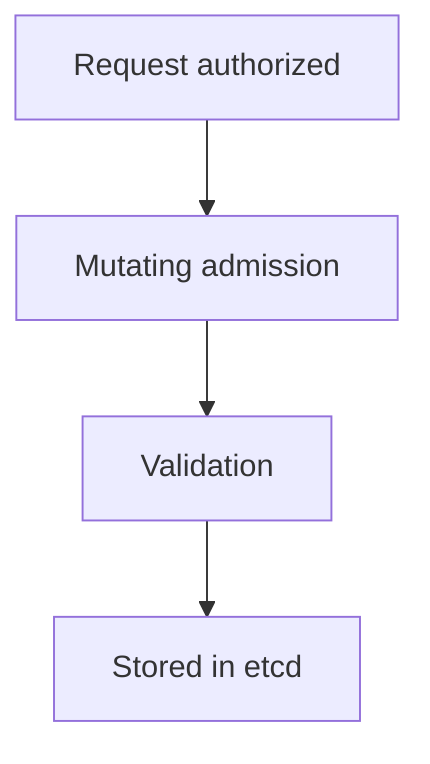

# Admission Plugins

A request that passes authentication and authorization can still be unsafe. Admission plugins are code inside the API server that runs after authorization and before the object is stored. They can change a request or reject it. The benchmark checks that some plugins are on, some are off, and none of the required ones are disabled. This part explains two plugins that the benchmark names, shows how the API server decides which plugins run, and how to verify the result.

## How the plugin list is built

The API server has a built-in list of plugins that are on by default. The flag `--enable-admission-plugins` adds plugins to that list, and `--disable-admission-plugins` removes plugins from it. A plugin that is on by default and not disabled runs even when it does not appear in the manifest, so reading `--enable-admission-plugins` alone does not show everything that runs. The default list changes between Kubernetes versions, so the reliable source is the help text of the API server binary of your version.

The kubeadm default adds one plugin: `--enable-admission-plugins=NodeRestriction`. The benchmark also checks that the plugin `ServiceAccount` is not disabled, because it attaches service account tokens to pods.

## NodeRestriction

Every kubelet has a credential for the API server. The `NodeRestriction` plugin limits that credential. A kubelet may change only its own `Node` object and the pods that are bound to its node, and it may not set labels that start with the `node-restriction.kubernetes.io/` prefix. Without this plugin, a kubelet credential taken from one worker could change the labels or taints of other nodes, which can move sensitive pods onto a node the attacker controls. The `Node` authorizer (an authorization mode that limits what a kubelet can read) and `NodeRestriction` work together: the authorizer limits what the kubelet can read and write, and the plugin limits the content of the writes.

## AlwaysPullImages

By default a container may use an image that is already cached on the node, depending on the pull policy. A second pod on the same node can then run a private image without any registry credentials, because the image is already there. The `AlwaysPullImages` plugin changes every new pod so that its containers use the pull policy `Always`. The kubelet then checks with the registry on every start, and the check needs valid credentials.

This has a cost. Each container start pulls image metadata from the registry, so startup is slower and the registry must be reachable. In an offline cluster such as the playground, enabling the plugin would make pods fail to start, because their images are only on the node. The plugin is a level 1 recommendation in the benchmark, but a reviewer weighs it against the environment.

## Read the active plugins

First read the flags in the manifest and in the running pod:

<!-- astrona:playground:renew -->

```sh
NODE=astro-ats-031-playground-020-03-control-plane
podman exec $NODE grep -e 'admission-plugins' /etc/kubernetes/manifests/kube-apiserver.yaml
```

A kubeadm cluster shows `--enable-admission-plugins=NodeRestriction`, and no `--disable-admission-plugins` line. To see which plugins are on by default, read the help text of the API server binary inside the running container. The binary needs no shell, because `exec` runs it directly:

```sh
kubectl -n kube-system exec kube-apiserver-$NODE -- kube-apiserver -h | grep -A4 -e '--enable-admission-plugins'
```

The help text lists the plugins that exist, and states which are enabled by default. If `exec` cannot find the binary by name in your image, the same text is in the documentation of your Kubernetes version. Compare the two lists: the active set is the default set, plus the plugins from `--enable-admission-plugins`, minus the plugins from `--disable-admission-plugins`.

## Change the list

To add `AlwaysPullImages` to a real cluster, change the value to a comma-separated list, with no spaces:

```yaml
- --enable-admission-plugins=NodeRestriction,AlwaysPullImages
```

This line replaces the existing `--enable-admission-plugins` line in the manifest, by editing a copy outside the manifests directory and moving it into place. After the API server restarts, read the pod arguments again. Do not do this change in the playground, because the images of the playground exist only on its nodes.



The diagram shows where admission sits: after authorization, with changes first and validation after, before the object is stored.

You can now read and reason about the plugin list. One control is still missing: a record of who did what. The next topic adds it.

## Common pitfalls

> [!WARNING]
> - **Reading only `--enable-admission-plugins`.** Plugins that are on by default do not appear there.
> - **Spaces in the list.** The value is one argument with commas and no spaces.
> - **Disabling a plugin that the cluster needs.** Do not disable `ServiceAccount` or `NodeRestriction`.
> - **Enabling `AlwaysPullImages` offline.** Pods whose images are only on the node fail to start.
