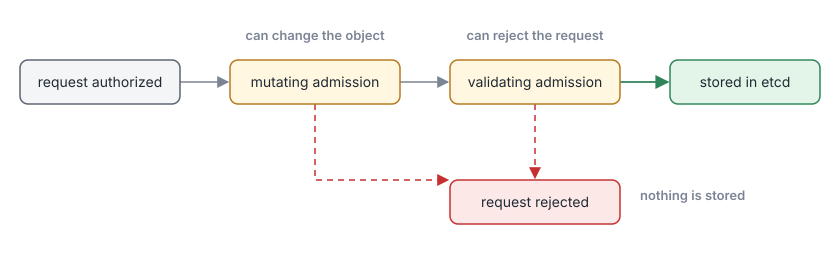
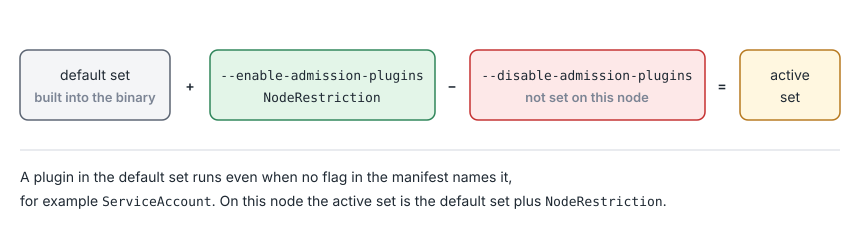

# Admission Plugins

A request that passes authentication and authorization can still be unsafe. Admission plugins are code inside the API server that runs after authorization and before the API server stores the object. They can change a request or reject it. The benchmark checks that some plugins are on, some are off, and none of the required ones are turned off. This page explains two plugins that the benchmark names, shows how the API server decides which plugins run, and shows how to verify the result.



The drawing shows where admission sits: after authorization, with the changes first and the validation after, before the object is stored in etcd. Either admission step can reject the request, and then nothing is stored.

## How the plugin list is built

The API server has a built-in list of plugins that are on by default. The flag `--enable-admission-plugins` adds plugins to that list, and `--disable-admission-plugins` removes plugins from it.

A plugin that is on by default and not turned off runs even when the manifest does not name it. So reading `--enable-admission-plugins` alone does not show everything that runs. The default list changes between Kubernetes versions, so the reliable source is the help text of the API server binary of your version.



The drawing shows the rule as a sum. On the playground node, the active set is the default set plus `NodeRestriction`, because no plugin is turned off.

The kubeadm default adds one plugin: `--enable-admission-plugins=NodeRestriction`. The benchmark also checks that the plugin `ServiceAccount` is not turned off, because it attaches service account tokens to pods.

## NodeRestriction

Every kubelet has a credential for the API server. The `NodeRestriction` plugin limits what that credential can do. A kubelet may change only its own `Node` object and the pods that are bound to its node. It may not set labels that start with the `node-restriction.kubernetes.io/` prefix.

Without this plugin, an attacker who takes the kubelet credential from one worker could change the labels or taints of other nodes. That can move sensitive pods onto a node the attacker controls.

The `Node` authorizer is the authorization mode that limits what a kubelet can read and write. It works together with `NodeRestriction`: the authorizer limits which objects the kubelet can read and write, and the plugin limits the content of the writes.

## AlwaysPullImages

By default, a container may use an image that is already cached on the node, depending on the pull policy. A second pod on the same node can then run a private image without any registry credentials, because the image is already there.

The `AlwaysPullImages` plugin changes every new pod so that its containers use the pull policy `Always`. The kubelet then checks with the registry on every start, and this check needs valid credentials.

This plugin has a cost. Each container start pulls image metadata from the registry, so startup is slower and the registry must be reachable. In an offline cluster, the plugin would make pods fail to start, because their images exist only on the node. The plugin is a level 1 recommendation in the benchmark, but a reviewer weighs it against the environment.

## Read the active plugins

With the rule in mind, you can now find out which plugins run on the playground. First, read the flags in the manifest. Open a shell on the node with `astrona ssh astro-ats-031-playground-020-03`. The manifest belongs to `root`, so read it with `sudo`:

<!-- astrona:playground:renew -->

```sh
sudo grep -e 'admission-plugins' /etc/kubernetes/manifests/kube-apiserver.yaml
```

The output on the playground node is `    - --enable-admission-plugins=NodeRestriction`, and there is no `--disable-admission-plugins` line.

To see which plugins are on by default, read the help text of the API server binary inside the running container. The command needs no shell, because `exec` runs the binary directly:

```sh
kubectl -n kube-system exec kube-apiserver-astro-ats-031-playground-020-03 -- kube-apiserver -h | grep -e '--enable-admission-plugins strings'
```

The output is one very long line. It starts with the default list of Kubernetes v1.35.10. Here it is shortened to that list:

```text
      --enable-admission-plugins strings             admission plugins that should be enabled in addition to default enabled ones (NamespaceLifecycle, LimitRanger, ServiceAccount, TaintNodesByCondition, PodSecurity, Priority, DefaultTolerationSeconds, DefaultStorageClass, StorageObjectInUseProtection, PersistentVolumeClaimResize, RuntimeClass, CertificateApproval, CertificateSigning, ClusterTrustBundleAttest, CertificateSubjectRestriction, DefaultIngressClass, PodTopologyLabels, NodeDeclaredFeatureValidator, MutatingAdmissionPolicy, MutatingAdmissionWebhook, ValidatingAdmissionPolicy, ValidatingAdmissionWebhook, ResourceQuota). ...
```

The list in brackets is the default set. After it, the line lists every plugin that exists, including `AlwaysPullImages` and `NodeRestriction`, which are not in the default set. `ServiceAccount` is in the default set, so it runs without any flag.

Now compare the two lists. The active set is the default set, plus the plugins from `--enable-admission-plugins`, minus the plugins from `--disable-admission-plugins`. On this node, that is the default set plus `NodeRestriction`.

## Change the list

Reading the list is half the work; sometimes you must also change it. To add `AlwaysPullImages` on a real cluster, change the value to a comma-separated list, with no spaces:

```yaml
- --enable-admission-plugins=NodeRestriction,AlwaysPullImages
```

This line replaces the existing `--enable-admission-plugins` line in the manifest. Make the change in a copy outside the manifests directory and move the copy into place. After the API server restarts, read the pod arguments again.

Leave this change out of the playground. The module does not need it, and every new pod would then depend on the image registry being reachable from the VM.

You can now read the plugin list and work out which plugins really run. One control is still missing: a record of who sent which request.

## Common pitfalls

> [!WARNING]
> - **Reading only `--enable-admission-plugins`.** Plugins that are on by default do not appear there.
> - **Spaces in the list.** The value is one argument with commas and no spaces.
> - **Turning off a plugin that the cluster needs.** Do not turn off `ServiceAccount` or `NodeRestriction`.
> - **Turning on `AlwaysPullImages` in an offline cluster.** Pods whose images exist only on the node fail to start.
