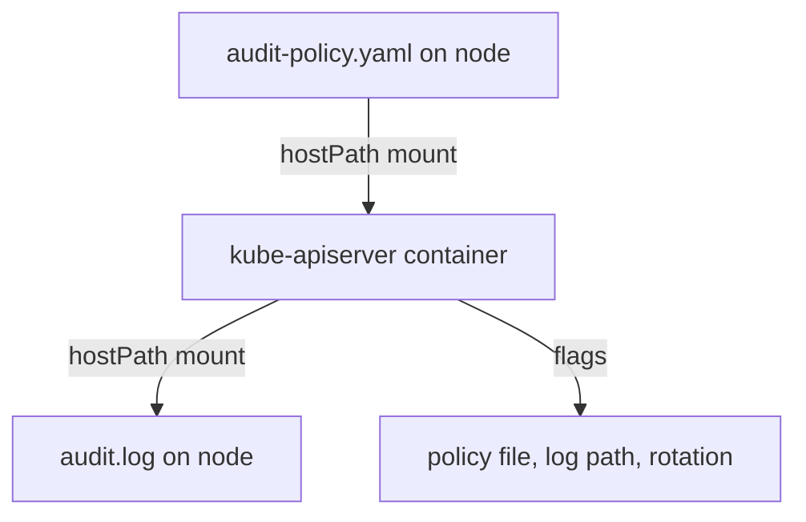

# Audit Logging

After an incident, the first question is who sent which request and when. By default the API server keeps no such record. Audit logging writes one event for each request, according to a policy that you provide. The benchmark checks that the policy file and the log path are set, and that the log has a retention limit. This part explains the policy format, the flags, the volume mounts that make it work in a static pod, and how to read an event.

## The audit policy

An audit policy is a file that lists rules. For each request the API server goes through the rules in order and uses the first rule that matches. The rule says how much to record. There are four levels:

- `None` records nothing.
- `Metadata` records who, what and when, without the request or response body.
- `Request` records the metadata and the request body.
- `RequestResponse` records the metadata, the request body and the response body.

A request passes through stages, and the field `omitStages` skips some of them. The stage `RequestReceived` fires before the work starts, and skipping it reduces the number of events. The staged policy has four rules in this order: nothing for the health endpoints, metadata for `secrets`, the request body for `pods` in `starfleet`, and metadata for everything else. Because the first match wins, the rule for the health endpoints comes first, and the catch-all rule comes last. Secrets get only the `Metadata` level because the body of a Secret holds the secret.

## The flags and the mounts

The API server needs these flags:

- `--audit-policy-file` is the path of the policy inside the API server container.
- `--audit-log-path` is the file where events are written.
- `--audit-log-maxage` is how many days to keep old log files.
- `--audit-log-maxbackup` is how many old log files to keep.
- `--audit-log-maxsize` is the size in megabytes at which the log rotates.

The API server runs in a container, so a path in a flag is a path inside that container. The policy file must be mounted into it, and the log directory must be a host path so that the log survives a restart and can be read on the node. This needs a `hostPath` volume and a `volumeMounts` entry for each. If the policy file is missing, the API server fails to start. If the log path is not on a mounted volume, the API server writes the log inside the container and loses it on restart.



The diagram shows that the policy goes into the container through a mount, and that the log comes out onto the node through another mount.

## Enable it

Look at the staged policy first. It is on the node, and nothing references it yet.

<!-- astrona:playground:renew -->

```sh
NODE=astro-ats-031-playground-020-03-control-plane
podman exec $NODE cat /opt/training/audit-policy.yaml
```

Create the directories and put the policy in a directory that you can mount. Mounting a directory is more robust than mounting one file, because a file replaced by a new inode is not seen through a single file mount.

```sh
podman exec $NODE mkdir -p /etc/kubernetes/policy /var/log/kubernetes/audit /etc/kubernetes/edit
podman exec $NODE cp /opt/training/audit-policy.yaml /etc/kubernetes/policy/audit-policy.yaml
podman exec $NODE cp -p /etc/kubernetes/manifests/kube-apiserver.yaml /etc/kubernetes/edit/kube-apiserver.yaml
```

Now edit the copy in the work directory. Use an editor such as `vi` through `podman exec -it`. Add the five flags to the `command` list of the container, after `- kube-apiserver`, with the same indentation as the other flags:

```yaml
    - --audit-policy-file=/etc/kubernetes/policy/audit-policy.yaml
    - --audit-log-path=/var/log/kubernetes/audit/audit.log
    - --audit-log-maxage=30
    - --audit-log-maxbackup=10
    - --audit-log-maxsize=100
```

Add two entries to the `volumeMounts` list of the container:

```yaml
    - mountPath: /etc/kubernetes/policy
      name: audit-policy
      readOnly: true
    - mountPath: /var/log/kubernetes/audit
      name: audit-log
```

Add two entries to the `volumes` list at the end of the pod spec:

```yaml
  - hostPath:
      path: /etc/kubernetes/policy
      type: DirectoryOrCreate
    name: audit-policy
  - hostPath:
      path: /var/log/kubernetes/audit
      type: DirectoryOrCreate
    name: audit-log
```

These three snippets are fragments of the manifest, not files to apply with `kubectl`. After you save the copy, move it into place and wait for the API server:

```sh
podman exec -it $NODE vi /etc/kubernetes/edit/kube-apiserver.yaml
podman exec $NODE mv /etc/kubernetes/edit/kube-apiserver.yaml /etc/kubernetes/manifests/kube-apiserver.yaml
until kubectl --request-timeout=3s get --raw=/readyz >/dev/null 2>&1; do sleep 3; done
```

The loop ends when the API server answers again, which can take a minute. If it does not end, use `crictl ps -a` and `crictl logs` on the node to find the error, and restore the backup.

## Read an event

Make a request and look at the end of the log. The log has one JSON object on each line.

```sh
kubectl -n starfleet get pods
podman exec $NODE tail -n 20 /var/log/kubernetes/audit/audit.log
```

Each event has fields such as `level`, `stage`, `verb`, `requestURI`, `user.username` and `responseStatus.code`. Other requests from the cluster components can also appear in the last lines, so look for the line of your request. It shows the verb `list`, the URI of the pods in `starfleet`, your user name and a response code of `200`. Because the policy gives `pods` in `starfleet` the `Request` level, a request that creates or changes a pod there also holds the request body.

You can now record every request. Next you reduce what the API server exposes about itself.

## Common pitfalls

> [!WARNING]
> - **No volume for the log.** The log is written inside the container and lost on restart.
> - **A rule order mistake.** The first matching rule wins, so a catch-all rule at the top hides every later rule.
> - **A policy that records everything at `RequestResponse`.** The log grows fast and holds Secret bodies. Keep Secrets at `Metadata`.
> - **No rotation flags.** The log fills the disk of the node.
